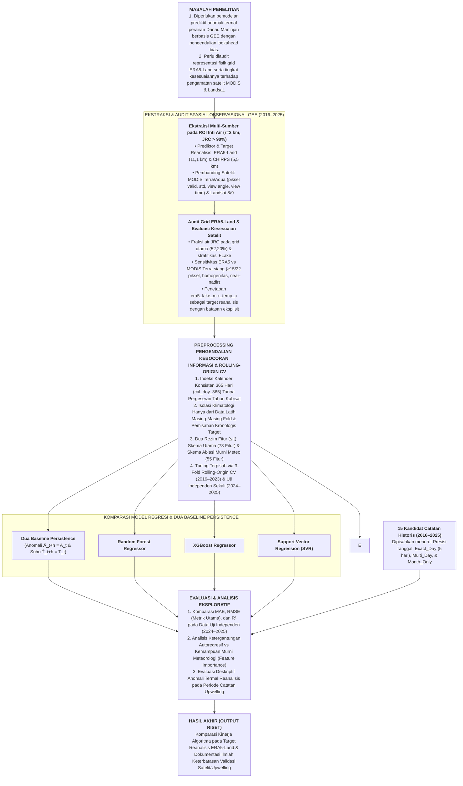
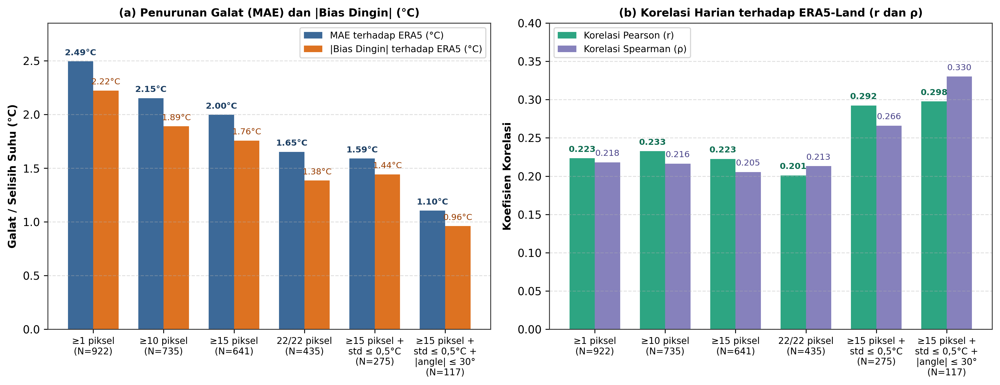
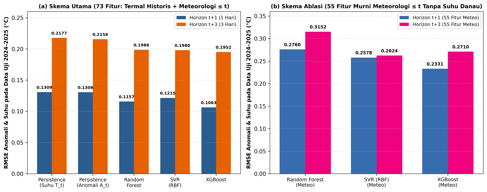
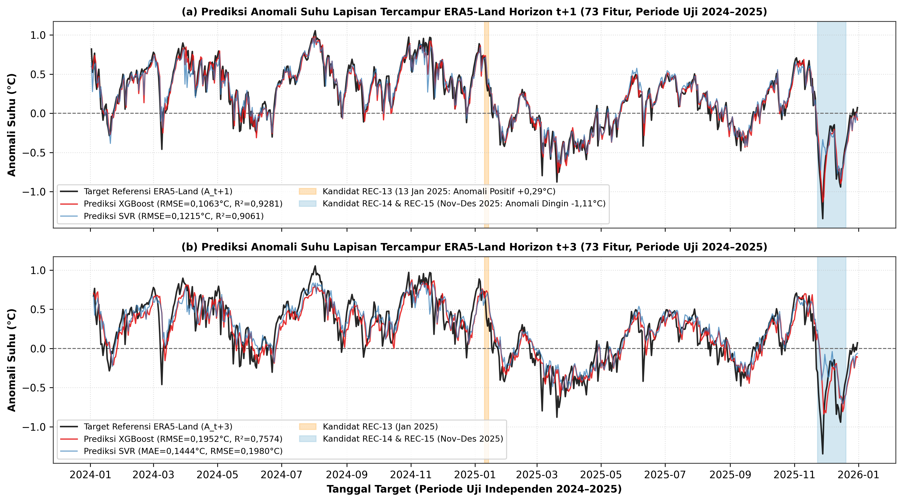
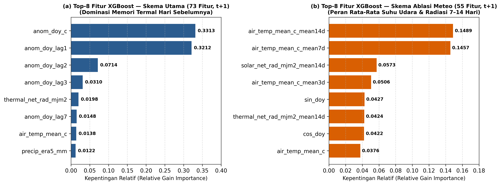
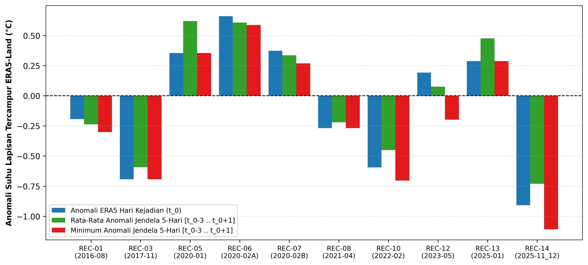

# NASKAH LENGKAP SKRIPSI (BAB I – BAB V)

**JUDUL SKRIPSI:**
**KOMPARASI ALGORITMA RANDOM FOREST, XGBOOST, DAN SUPPORT VECTOR REGRESSION UNTUK PREDIKSI ANOMALI SUHU LAPISAN TERCAMPUR REANALISIS ERA5-LAND DI KAWASAN DANAU MANINJAU BERBASIS GOOGLE EARTH ENGINE**

**Skema Penelitian:** Pengembangan Algoritma / Model / Analisis (Skema 1)
**Program Studi:** Ilmu Komputer (S1) — Fakultas Ilmu Komputer, Universitas Djuanda (2026)

---

## ABSTRAK

**Judul Skripsi:** Komparasi Algoritma Random Forest, XGBoost, dan Support Vector Regression untuk Prediksi Anomali Suhu Lapisan Tercampur Reanalisis ERA5-Land di Kawasan Danau Maninjau Berbasis Google Earth Engine
**Program Studi / Tahun:** Ilmu Komputer (S1), Fakultas Ilmu Komputer, Universitas Djuanda / 2026

Fluktuasi hidrometeorologi di kaldera Danau Maninjau berpotensi memicu anomali penurunan suhu lapisan permukaan yang berkaitan dengan pelemahan stratifikasi termal perairan, namun pemantauan harian berbasis satelit termal terhambat oleh tutupan awan tropis. Penelitian ini bertujuan mengevaluasi kesesuaian suhu reanalisis terhadap satelit serta membandingkan kinerja algoritma Random Forest, XGBoost, dan Support Vector Regression (SVR) terhadap dua model Baseline Persistence dalam memprediksi anomali suhu lapisan tercampur ERA5-Land pada horizon satu hari (t+1) dan tiga hari (t+3) berbasis Google Earth Engine periode 2016–2025 (3.653 hari). Metode penelitian mencakup audit spasial sel grid, analisis sensitivitas piksel MODIS dan Landsat, ekstraksi 73 fitur skema utama (termal historis dan meteorologi) serta 55 fitur skema ablasi murni meteorologi dengan indeks kalender 365 hari serta pengendalian kebocoran informasi masa depan melalui isolasi klimatologi dan pemisahan kronologis target, seleksi parameter melalui 3-Fold Rolling-Origin Cross-Validation (2016–2023), dan pengujian independen (2024–2025). Hasil penelitian menunjukkan bahwa sel grid utama ERA5-Land mencakup 52,20% perairan permanen, sedangkan penyaringan ketat MODIS Terra siang menurunkan MAE menjadi 1,10°C tetapi hanya menyisakan 3,2% hari pengamatan (r = 0,298). Pada pengujian independen skema utama, ketiga algoritma mengungguli kedua Baseline Persistence, di mana XGBoost menjadi model terbaik berdasarkan kriteria utama RMSE dan R² baik pada t+1 (RMSE = 0,1063°C; MAE = 0,0794°C; R² = 0,9281) maupun t+3 (RMSE = 0,1952°C; R² = 0,7574), sementara SVR mencatat MAE terendah pada t+3 (0,1444°C) dan unggul pada skema ablasi t+3 (R² = 0,5615). Evaluasi eksploratif menunjukkan bahwa anomali suhu ERA5-Land belum dapat dijadikan indikator tunggal kejadian upwelling.

**Kata Kunci:** *Danau Maninjau, ERA5-Land, Google Earth Engine, Support Vector Regression, XGBoost*

---

## DAFTAR TABEL DAN DAFTAR GAMBAR

### Daftar Tabel
* **Tabel 1.** Ringkasan Penelitian Terdahulu (2022–2026)
* **Tabel 2.** Tahapan Metodologi Penelitian Pengembangan Model (Skema 1)
* **Tabel 3.** Rincian Eksak Konstruksi Fitur Input pada Skema Utama (73 Fitur) dan Skema Ablasi Murni Meteorologi (55 Fitur)
* **Tabel 4.** Jadwal Pelaksanaan Penelitian Skripsi
* **Tabel 5.** Ringkasan Ketersediaan dan Statistik Suhu Multi-Sumber di GEE (2016–2025)
* **Tabel 6.** Karakteristik Spasial dan Parameter Termal Rata-Rata (2016–2025) pada Empat Sel Grid ERA5-Land di Sekitar Danau Maninjau
* **Tabel 7.** Analisis Sensitivitas Kesesuaian Suhu Harian ERA5-Land (`era5_lake_mix_temp_c`) terhadap MODIS Siang dan Landsat 8/9 (2016–2025)
* **Tabel 8.** Konfigurasi Hyperparameter Terbaik Berdasarkan 3-Fold Rolling-Origin CV (2016–2023)
* **Tabel 9.** Perbandingan Kinerja Model pada Data Uji Independen (2024–2025) terhadap Target Reanalisis ERA5-Land
* **Tabel 10.** Lima Fitur dengan Kontribusi Relatif Tertinggi pada Skema Utama (73 Fitur) dan Skema Ablasi Meteorologi (55 Fitur)
* **Tabel 11.** Perilaku Deskriptif Anomali Termal Reanalisis ERA5-Land dan Prediksi XGBoost pada Catatan Harian Spesifik (`Exact_Day`, Jendela $H-3$ s/d $H+1$)
* **Tabel 12.** Perilaku Deskriptif Anomali Termal pada Episode Multi-Hari ($N=3$) dan Catatan Bulanan ($N=2$)

### Daftar Gambar
* **Gambar 1.** Bagan kerangka pemikiran penelitian komparasi algoritma regresi dan audit spasial-observasional di Danau Maninjau
* **Gambar 2.** Evaluasi kesesuaian suhu harian ERA5-Land terhadap MODIS Terra siang berdasarkan kriteria kualitas cakupan piksel dan geometri sensor (2016–2025)
* **Gambar 3.** Perbandingan RMSE model pada data uji independen (2024–2025) terhadap target reanalisis ERA5-Land untuk Skema Utama (73 fitur) dan Skema Ablasi (55 fitur)
* **Gambar 4.** Deret waktu anomali suhu referensi ERA5-Land terhadap prediksi model pada data uji independen (2024–2025) untuk horizon t+1 dan t+3
* **Gambar 5.** Perbandingan kontribusi fitur relatif (feature importance) XGBoost pada Skema Utama (73 fitur) dan Skema Ablasi Murni Meteorologi (55 fitur) untuk horizon t+1
* **Gambar 6.** Distribusi deskriptif anomali suhu reanalisis ERA5-Land pada 10 catatan harian spesifik (Exact_Day) periode 2016–2025

---

# BAB I — PENDAHULUAN

## A. Latar Belakang Masalah
Danau Maninjau yang terletak di Kabupaten Agam, Provinsi Sumatera Barat, merupakan danau vulkanik-tektonik (kaldera) seluas sekitar 9.950 hektare dengan kedalaman rata-rata 105 meter dan kedalaman maksimum mencapai 165 meter (Putri dkk., 2024). Danau ini memiliki fungsi strategis bagi perekonomian masyarakat sekitar, khususnya sebagai sentra budidaya perikanan air tawar menggunakan sistem Keramba Jaring Apung (KJA) serta pembangkit listrik tenaga air (PLTA). Namun, pemanfaatan perairan secara intensif yang melampaui daya dukung lingkungan (*overcapacity*) telah mengakibatkan akumulasi limbah organik sisa pakan dan metabolisme ikan yang mengendap di dasar danau serta meningkatkan konsentrasi nitrogen dan fosfat di perairan (Komala dkk., 2024; Sunaryani, 2023).

Penumpukan bahan organik di lapisan dasar (*hipolimnion*) memicu kondisi perairan yang bersifat anoksik (miskin oksigen terlarut) serta menghasilkan akumulasi senyawa toksik seperti hidrogen sulfida ($\text{H}_2\text{S}$) dan amonia ($\text{NH}_3$). Dalam kondisi normal, lapisan permukaan danau (*epilimnion*) memiliki suhu yang lebih hangat dibandingkan lapisan dasar, sehingga terbentuk stratifikasi termal yang menahan zat beracun tetap berada di dasar perairan. Akan tetapi, ketika terjadi gangguan hidrometeorologi berupa curah hujan berintensitas tinggi, penurunan radiasi matahari akibat tutupan awan tebal, serta hembusan angin di kawasan kaldera, suhu lapisan permukaan dapat mengalami penurunan anomali (*negative thermal anomaly*). Pendinginan lapisan atas berpotensi memperlemah stabilitas kolom air dan mendukung proses pencampuran vertikal (*vertical mixing* / *upwelling*), yang oleh masyarakat lokal dikenal sebagai fenomena *tubo belerang* atau *umbalan* (Putri dkk., 2024).

Fenomena *upwelling* di Danau Maninjau telah menyebabkan kerugian ekonomi dan ekologis yang berulang. Berdasarkan rangkaian laporan Dinas Ketahanan Pangan dan Perikanan (DKPP) Kabupaten Agam yang diberitakan secara terpisah melalui Kantor Berita ANTARA, insiden kematian massal ikan budidaya KJA yang dikaitkan dengan cuaca ekstrem dan *upwelling* antara lain tercatat sebesar 10 ton pada April 2021 (ANTARA, 2021a), mencapai 1.455 ton sepanjang episode 3–24 Desember 2021 dengan estimasi kerugian sekitar Rp28,9 miliar (ANTARA, 2021b), bertambah menjadi 130 ton pada pertengahan Februari 2022 dengan estimasi kerugian hingga Rp2,6 miliar (ANTARA, 2022), terjadi kembali sebesar 15 ton pada Mei 2023 (ANTARA, 2023), bertambah sebesar 50 ton sehingga mencapai total akumulasi 75 ton pada Januari 2025 (ANTARA, 2025a), serta diawali kematian 8 ton pada akhir November 2025 (ANTARA, 2025b) yang kemudian berlanjut menjadi 1.428,73 ton sepanjang episode Desember 2025 (ANTARA, 2025c). Upaya pemodelan prediksi kejadian *upwelling* secara langsung sebagai masalah klasifikasi biner menghadapi kendala metodologis apabila hanya mengandalkan data sekunder, karena catatan kejadian yang memiliki presisi tanggal harian sangat terbatas dan rentan terhadap jeda waktu pelaporan (*reporting lag*). Sebaliknya, pembentukan label kelas potensi semata-mata dari klasterisasi tanpa pengawasan (*K-Means*) pada variabel cuaca—sebagaimana dilakukan oleh Syakir dkk. (2025)—berisiko menimbulkan sirkularitas apabila tidak diuji terhadap parameter termal yang diestimasi secara terpisah.

Dalam literatur pemodelan deret waktu lingkungan dan penginderaan jauh terkini, pendekatan komputasi yang dapat dipertanggungjawabkan tanpa pengukuran lapangan langsung adalah memprediksi **dinamika suhu lapisan tercampur dan anomali termalnya** pada horizon waktu ke depan ($t+1$ dan $t+3$) menggunakan informasi historis ($\le t$). Penelitian Li dkk. (2024) menunjukkan bahwa algoritma regresi *machine learning* seperti *Random Forest* dan *XGBoost* efektif dalam memodelkan dinamika suhu permukaan danau menggunakan prediktor meteorologi. Di sisi lain, pada kawasan danau kaldera tropis seperti Danau Maninjau, pengamatan suhu permukaan berbasis satelit optik/termal (*MODIS* dan *Landsat 8/9*) sering mengalami kekosongan data harian akibat tutupan awan persisten serta perbedaan karakteristik fisik terhadap estimasi model reanalisis seperti *ERA5-Land* (`lake_mix_layer_temperature`).

Berdasarkan landasan ilmiah tersebut, penelitian ini mengusulkan komparasi kinerja tiga algoritma regresi *machine learning*, yaitu *Random Forest Regressor* (RF), *Extreme Gradient Boosting Regressor* (XGBoost), dan *Support Vector Regression* (SVR)—serta membandingkannya terhadap dua model acuan dasar (*Baseline Persistence* anomali dan suhu mentah)—untuk memprediksi **anomali suhu lapisan tercampur hasil reanalisis ERA5-Land** di kawasan Danau Maninjau berbasis platform *Google Earth Engine* (GEE) periode 2016–2025. Penelitian ini juga dilengkapi dengan audit spasial sel grid *ERA5-Land* dan analisis sensitivitas kesesuaian terhadap suhu permukaan satelit (*MODIS* dan *Landsat 8/9*) sebagai kajian keterbatasan observasional, serta analisis deskriptif-eksploratif terhadap kandidat catatan kejadian *upwelling* historis periode 2016–2025.

---

## B. Permasalahan

### 1. Identifikasi Masalah
Berdasarkan pemaparan pada latar belakang masalah, dapat diidentifikasi permasalahan penelitian yang terbagi menjadi masalah konseptual dan masalah teknikal:
1. **Masalah Konseptual:**
   * Belum adanya kajian yang mengaudit representasi fisik sel grid reanalisis *ERA5-Land* ($\approx 11,1\text{ km}$) terhadap morfologi perairan Danau Maninjau serta menguji sensitivitas kesesuaian suhu hariannya terhadap pengamatan satelit termal (*MODIS Terra/Aqua* dan *Landsat 8/9*) pada berbagai kriteria kontrol kualitas piksel.
   * Belum diketahuinya perbandingan kinerja algoritma *ensemble* pohon keputusan (*Random Forest* dan *XGBoost*) serta metode berbasis fungsi kernel (*Support Vector Regression*) terhadap model acuan *Baseline Persistence* dalam memprediksi anomali suhu lapisan tercampur reanalisis *ERA5-Land* pada horizon 1 hari ($t+1$) dan 3 hari ($t+3$) ke depan, baik ketika menggunakan riwayat suhu sebelumnya (73 fitur) maupun ketika hanya mengandalkan variabel meteorologi (55 fitur).
2. **Masalah Teknikal:**
   * Pemodelan regresi deret waktu untuk anomali suhu rentan mengalami kebocoran informasi masa depan (*lookahead bias*) apabila rata-rata klimatologi harian dihitung dari seluruh rentang dataset atau apabila tanggal target ($t+h$) pada akhir data latih menyeberang ke periode validasi/pengujian.
   * Perhitungan indeks hari kalender (*day-of-year*) standar (1–366) mengalami pergeseran satu hari setelah tanggal 28 Februari pada tahun kabisat (2016, 2020, 2024), serta evaluasi terhadap catatan kejadian *upwelling* historis berisiko bias apabila mencampurkan catatan harian spesifik, episode multi-hari, dan catatan bulanan ke dalam satu jendela waktu yang sama.

### 2. Pernyataan Masalah (*Problem Statement*)
Inti permasalahan dalam penelitian ini adalah bagaimana membangun *pipeline* pemodelan regresi deret waktu dengan pengendalian kebocoran informasi masa depan (*lookahead bias*) melalui isolasi klimatologi dan pemisahan kronologis target untuk membandingkan akurasi algoritma *Random Forest*, *XGBoost*, dan *Support Vector Regression* (SVR) terhadap dua *Baseline Persistence* dalam memprediksi anomali suhu lapisan tercampur reanalisis *ERA5-Land* di kawasan Danau Maninjau berbasis *Google Earth Engine* (2016–2025), sekaligus menetapkan batas validitas observasionalnya terhadap satelit *MODIS/Landsat* dan catatan kejadian *upwelling* historis.

### 3. Rumusan Masalah (*Research Questions*)
Berdasarkan identifikasi dan pernyataan masalah di atas, maka rumusan pertanyaan penelitian (*research questions*) adalah sebagai berikut:
1. Bagaimana karakteristik ketersediaan data, representasi spasial sel grid *ERA5-Land*, dan tingkat kesesuaian antara estimasi suhu lapisan tercampur reanalisis *ERA5-Land* (`lake_mix_layer_temperature`) di kawasan Danau Maninjau terhadap pengamatan suhu permukaan satelit *MODIS* dan *Landsat 8/9* setelah melalui penyaringan kontrol kualitas piksel dan geometri pengamatan di *Google Earth Engine*?
2. Bagaimana kinerja algoritma *Random Forest*, *XGBoost*, dan *Support Vector Regression* (SVR) dibandingkan terhadap dua model *Baseline Persistence* (anomali dan suhu mentah) dalam memprediksi anomali suhu lapisan tercampur reanalisis *ERA5-Land* pada horizon $t+1$ dan $t+3$—baik pada Skema Utama (73 fitur termal-meteorologi $\le t$) maupun Skema Ablasi Murni Meteorologi (55 fitur cuaca $\le t$)—serta bagaimana perilaku deskriptif anomali termal reanalisis tersebut pada periode catatan kejadian *upwelling* historis 2016–2025?

---

## C. Maksud dan Tujuan Penelitian

### 1. Maksud Penelitian
Maksud dari penelitian ini adalah menerapkan dan mengevaluasi secara kritis metode komputasi *machine learning* berbasis regresi deret waktu pada data penginderaan jauh dan reanalisis iklim *Google Earth Engine* guna memperoleh model prediktif anomali suhu lapisan tercampur reanalisis *ERA5-Land* di kawasan Danau Maninjau melalui *pipeline* dengan pengendalian kebocoran informasi masa depan melalui isolasi klimatologi dan pemisahan kronologis target beserta dokumentasi keterbatasan fisiknya.

### 2. Tujuan Penelitian
Adapun tujuan yang ingin dicapai dalam penelitian ini adalah:
1. Mengevaluasi representasi spasial sel grid *ERA5-Land* di kawasan Danau Maninjau serta menganalisis sensitivitas kesesuaian suhunya terhadap pengamatan satelit *MODIS* (khususnya *MODIS Terra* siang pada berbagai ambang jumlah piksel valid, homogenitas spasial, dan sudut pandang sensor) dan *Landsat 8/9* sebagai analisis keterbatasan produk.
2. Membangun, menguji, dan membandingkan akurasi prediksi algoritma *Random Forest*, *XGBoost*, dan *Support Vector Regression* (SVR) terhadap dua model *Baseline Persistence* menggunakan metrik MAE, RMSE, dan $R^2$ (dengan RMSE sebagai metrik utama seleksi dan penentu model terbaik) melalui skema *3-Fold Rolling-Origin Cross-Validation* (2016–2023) dan pengujian independen (2024–2025) dengan pengendalian kebocoran informasi masa depan melalui isolasi klimatologi dan pemisahan kronologis target, diikuti analisis eksploratif terhadap kandidat catatan kejadian *upwelling* historis.

---

## D. Spesifikasi Produk yang Diharapkan
Sesuai dengan karakteristik **Skema 1 (Pengembangan Algoritma / Model / Analisis)**, produk yang dihasilkan dari penelitian ini bukan berupa perangkat lunak antarmuka pengguna (*end-user application*), melainkan **artefak model komputasi dan skrip analisis terstruktur** dengan spesifikasi sebagai berikut:
1. **Skrip Ekstraksi dan Audit Spasial-Piksel Google Earth Engine (`gee_extract_maninjau.js` dan `gee_audit_grid_dan_modis.js`):** Modul JavaScript GEE yang mengekstrak deret waktu harian *ERA5-Land* dan *CHIRPS* (3.653 hari), memetakan poligon sel grid *ERA5-Land* terhadap fraksi air permanen `JRC Global Surface Water` (resolusi 30 m), serta mengekstrak statistik piksel valid, simpangan baku spasial, waktu pengamatan lokal, dan sudut pandang sensor pada citra *MODIS Terra/Aqua* dan *Landsat 8/9*.
2. **Pipa Pemodelan Regresi Deret Waktu dengan Pengendalian Kebocoran Informasi Masa Depan (`audit_dan_eksperimen_ml.py` dan `analisis_audit_lanjutan_gee.py`):** Program Python 3 berbasis pustaka `scikit-learn`, `xgboost`, `pandas`, dan `numpy` yang mengimplementasikan indeks kalender konsisten 365 hari (`cal_doy_365`), isolasi perhitungan klimatologi per lipatan validasi, pemisahan kronologis tanggal target, pembentukan matriks 73 fitur (Skema Utama) dan 55 fitur (Skema Ablasi), seleksi *hyperparameter* melalui *3-Fold Rolling-Origin Cross-Validation*, serta pengujian independen terhadap dua *Baseline Persistence*.
3. **Dataset Terverifikasi dan Laporan Evaluasi Kuantitatif (CSV & Visualisasi 300 DPI):** Himpunan tabel hasil eksperimen dan grafik evaluasi resolusi tinggi yang mendokumentasikan metrik MAE, RMSE, $R^2$, *feature importance*, serta hasil evaluasi eksploratif pada tiga kategori presisi catatan kejadian *upwelling*.

---

## E. Signifikansi dan Manfaat Penelitian
Urgensi penelitian ini terletak pada perlunya standar metodologi yang jujur secara ilmiah dengan pengendalian kebocoran informasi masa depan (*lookahead bias*) ketika memanfaatkan data penginderaan jauh dan reanalisis terbuka untuk pemodelan perairan danau vulkanik tropis di Indonesia. Tanpa audit fisik terhadap sel grid reanalisis dan penyaringan ketat terhadap piksel satelit, model *machine learning* berisiko menghasilkan klaim akurasi semu yang tidak mencerminkan kondisi perairan sebenarnya. Adapun manfaat penelitian ini meliputi:
1. **Manfaat Teoritis (Kontribusi Keilmuan):**
   * Memberikan kontribusi pada bidang Ilmu Komputer dan Sains Data mengenai perancangan *pipeline* regresi deret waktu (*time-series regression*) dengan pengendalian kebocoran informasi masa depan melalui isolasi klimatologi per lipatan validasi, pemisahan kronologis tanggal target di perbatasan *split*, dan komparasi skema fitur autoregresif (73 fitur) versus murni meteorologi (55 fitur).
   * Mendokumentasikan secara kuantitatif perbedaan karakteristik antara keluaran suhu lapisan tercampur reanalisis *ERA5-Land* dan pengamatan suhu permukaan sesaat satelit (*MODIS* & *Landsat*) di perairan danau kaldera tropis.
2. **Manfaat Praktis (Bagi Peneliti Lanjutan dan Pengelola Informasi Lingkungan):**
   * Memberikan informasi empiris mengenai perbedaan kinerja algoritma *ensemble* pohon keputusan (*Random Forest*, *XGBoost*) dan metode kernel (*SVR*) ketika memprediksi target reanalisis dengan maupun tanpa riwayat suhu sebelumnya.
   * Menyediakan evaluasi awal yang proporsional mengenai keterbatasan penggunaan data reanalisis skala grid ($\approx 11,1\text{ km}$) dan satelit termal untuk pemantauan perairan Danau Maninjau sebelum dapat diintegrasikan dengan sensor *in-situ* lapangan.

---

## F. Asumsi dan Batasan Masalah (Keterbatasan Penelitian)

### 1. Asumsi Penelitian
1. Keluaran model danau 1-dimensi *FLake* pada dataset *ERA5-Land Daily Aggregated* (`lake_mix_layer_temperature`) diasumsikan merepresentasikan respons termodinamika teoretis lapisan air tercampur terhadap variabel pemaksa atmosfer skala grid di kawasan kaldera Danau Maninjau secara konsisten sepanjang periode 2016–2025.
2. Pada kerangka evaluasi retrospektif, seluruh agregasi variabel meteorologi dan termal harian pada hari ke-$t$ diasumsikan telah lengkap pada akhir hari ke-$t$ ketika model melakukan prediksi untuk horizon $t+1$ dan $t+3$.

### 2. Batasan Masalah dan Keterbatasan Penelitian
Agar klaim ilmiah penelitian ini terukur dan tidak melampaui bukti empiris yang tersedia, ruang lingkup penelitian dibatasi pada ketentuan berikut:
1. **Lokasi Studi dan Representasi Spasial Grid:** Zona perairan tengah (pelagis) Danau Maninjau, Kabupaten Agam, Sumatera Barat (titik pusat $0^\circ 18' 54'' \text{ LS}$ / $-0,315^\circ$ dan $100^\circ 11' 13'' \text{ BT}$ / $100,187^\circ$ dengan radius *buffer* inti perairan $2,0\text{ km}$ dan masker perairan permanen `JRC Global Surface Water > 90%`). ROI ini berada di dalam satu sel grid utama *ERA5-Land* (`100,20° BT, -0,30° LS`, luas $123,64\text{ km}^2$) yang memiliki fraksi perairan permanen JRC sebesar $52,20\%$ ($64,54\text{ km}^2$) dan area daratan/lereng kaldera sebesar $47,80\%$.
2. **Pembatasan Klaim Variabel Target ($y_{t+1}, y_{t+3}$):** Variabel target yang diprediksi dan dievaluasi secara harian adalah **suhu lapisan tercampur (`era5_lake_mix_temp_c`) dan anomali termalnya yang berasal dari model reanalisis *ERA5-Land* (*FLake*)**, **bukan** suhu air aktual Danau Maninjau yang diukur secara *in-situ*. Mengingat parameter kedalaman dan fraksi danau internal di dalam konfigurasi *FLake* ECMWF merupakan penyederhanaan 1-dimensi pada grid campuran daratan–perairan serta kesesuaiannya dengan satelit masih rendah, keberhasilan metrik regresi ($R^2$, MAE, RMSE) hanya berlaku bagi prediksi keluaran reanalisis *ERA5-Land*.
3. **Kedudukan Data Satelit (*MODIS* dan *Landsat 8/9*):** Data suhu permukaan satelit digunakan sebagai **audit keterbatasan dan pembanding observasional** (dengan memperhitungkan perbedaan waktu lintas lokal `view_time_hr`, jumlah piksel valid, simpangan baku spasial, dan sudut pandang sensor), bukan sebagai target pelatihan harian karena tingginya frekuensi tutupan awan.
4. **Asumsi Waktu Ketersediaan Data (*Data Availability Latency*):** Eksperimen ini dilakukan dalam kerangka evaluasi retrospektif; penerapan sebagai sistem prakiraan operasional *real-time* memiliki keterbatasan berupa jeda waktu rilis (*latency*) produk *ERA5-Land Daily* sekitar 5 hari.
5. **Sifat Eksploratif Analisis Kejadian *Upwelling*:** Evaluasi terhadap 15 kandidat catatan historis (2016–2025) dipisahkan secara deskriptif menurut ketepatan tanggalnya (`Exact_Day` $N=10$, `Multi_Day_Episode/Observation` $N=3$, dan `Month_Only` $N=2$). Analisis ini bersifat **deskriptif-eksploratif** dan bukan pembuktian kemampuan deteksi maupun kausalitas kejadian *upwelling*.

---

## G. Definisi Istilah dan Definisi Operasional
Untuk menghindari perbedaan penafsiran, berikut adalah definisi istilah dan definisi operasional variabel utama dalam penelitian ini:
1. **Suhu Lapisan Tercampur Reanalisis (*ERA5-Land Lake Mixed-Layer Temperature*, `era5_lake_mix_temp_c`):** Estimasi suhu rata-rata harian (dalam satuan $^\circ\text{C}$, dikonversi dari Kelvin dengan mengurangi $273,15$) pada lapisan air tercampur bagian atas yang dihitung oleh modul danau 1-dimensi *FLake* di dalam sistem reanalisis `ECMWF/ERA5_LAND/DAILY_AGGR` pada sel grid utama kawasan Danau Maninjau.
2. **Klimatologi Hari Kalender Konsisten 365 Hari (`clim_doy_c`):** Rata-rata suhu lapisan tercampur historis untuk setiap indeks tanggal kalender $d \in \{1, 2, \dots, 365\}$ (di mana tanggal 29 Februari pada tahun kabisat dipetakan ke indeks 59 bersama 28 Februari) yang dihaluskan dengan rata-rata bergerak melingkar 15 hari dan dihitung secara ketat hanya dari periode data latih aktif.
3. **Anomali Suhu Lapisan Tercampur (`anom_doy_c`, $A_t$):** Selisih antara suhu lapisan tercampur harian *ERA5-Land* pada hari ke-$t$ terhadap nilai klimatologi kalender pada hari yang bersangkutan ($A_t = T_t - \bar{T}_{\text{clim}, d(t)}$), dinyatakan dalam satuan $^\circ\text{C}$.
4. **Skema Utama (Rezim 1 — 73 Fitur Input $\le t$):** Konfigurasi pemodelan yang menggunakan gabungan 18 fitur riwayat termal danau (suhu, anomali, *lag* 1, 2, 3, 7 hari, rata-rata dan simpangan baku bergulir 3, 7, 14 hari, serta selisih 1 dan 3 hari) dan 55 fitur kalender serta riwayat meteorologi hingga hari ke-$t$.
5. **Skema Ablasi Murni Meteorologi (Rezim 2 — 55 Fitur Input $\le t$):** Konfigurasi pemodelan yang menghapus seluruh 18 fitur suhu dan anomali danau masa lalu, sehingga model hanya menggunakan 2 fitur kalender siklik ($\sin/\cos$) dan 53 fitur meteorologi (11 variabel cuaca hari ke-$t$, 24 fitur *lag*, dan 18 fitur rata-rata/akumulasi bergulir 3, 7, 14 hari).

---

## H. Sistematika Penulisan
Sistematika penulisan dalam penelitian skripsi ini disusun sebagai berikut:
* **BAB I PENDAHULUAN:** Menguraikan latar belakang masalah, permasalahan (identifikasi masalah, pernyataan masalah, dan rumusan masalah), maksud dan tujuan penelitian, spesifikasi produk yang diharapkan, signifikansi dan manfaat penelitian, asumsi dan batasan masalah, definisi istilah dan definisi operasional, serta sistematika penulisan.
* **BAB II TINJAUAN PUSTAKA DAN KERANGKA TEORITIS:** Memuat tinjauan objek penelitian (kawasan Danau Maninjau), tabel ringkasan 10 penelitian terdahulu (2022–2026), landasan teori mengenai stratifikasi dan anomali termal danau, karakteristik produk *Google Earth Engine* (*ERA5-Land FLake*, *CHIRPS*, *MODIS*, *Landsat*), formulasi matematis *Baseline Persistence*, *Random Forest*, *XGBoost*, dan SVR, metrik evaluasi regresi, kerangka pemikiran, serta hipotesis penelitian.
* **BAB III METODOLOGI PENELITIAN:** Menjelaskan metode dan tahapan penelitian Skema 1, model dan arsitektur yang diusulkan, prosedur pengembangan dan implementasi (pengumpulan data GEE, audit spasial grid dan sensitivitas piksel satelit, *preprocessing* dengan pengendalian kebocoran informasi masa depan melalui isolasi klimatologi dan pemisahan kronologis target beserta rincian 73 dan 55 fitur), desain uji coba (*3-Fold Rolling-Origin Cross-Validation* dan pengujian independen), serta jadwal penelitian.
* **BAB IV HASIL DAN PEMBAHASAN:** Menyajikan deskripsi objek dan hasil implementasi ekstraksi data beserta audit grid *ERA5-Land*, hasil pengujian kesesuaian *ERA5–MODIS/Landsat*, hasil komparasi akurasi prediksi RF, XGBoost, dan SVR terhadap dua *Baseline Persistence* pada Skema Utama (73 fitur) dan Skema Ablasi (55 fitur), analisis *feature importance*, evaluasi deskriptif pada kandidat catatan *upwelling*, serta pembahasan komprehensif.
* **BAB V KESIMPULAN DAN SARAN:** Berisi kesimpulan yang menjawab seluruh rumusan masalah dan pengujian hipotesis secara proporsional sesuai batasan validitas data, diikuti saran pengembangan teknis untuk penelitian lanjutan.

---
---

# BAB II — TINJAUAN PUSTAKA DAN KERANGKA TEORITIS

## A. Tinjauan Objek Penelitian (Kawasan Danau Maninjau)
Danau Maninjau adalah danau kaldera vulkanik-tektonik yang terletak di Kecamatan Tanjung Raya, Kabupaten Agam, Provinsi Sumatera Barat, pada koordinat geografis sekitar $0^\circ 12' - 0^\circ 25'\text{ LS}$ dan $100^\circ 07' - 100^\circ 16'\text{ BT}$ dengan elevasi permukaan air sekitar $461,5\text{ meter}$ di atas permukaan laut (Putri dkk., 2024). Danau ini memiliki luas perairan sekitar $99,5\text{ km}^2$ ($9.950\text{ hektare}$), panjang maksimum arah utara–selatan sekitar $16\text{ km}$, lebar maksimum arah barat–timur sekitar $7\text{ km}$, kedalaman rata-rata $105\text{ m}$, dan kedalaman maksimum mencapai $165\text{ m}$. Secara morfologis, perairan Danau Maninjau dikelilingi oleh dinding perbukitan kaldera yang curam dengan ketinggian berkisar antara $600\text{ m}$ hingga lebih dari $1.400\text{ m}$ mdpl, dan hanya memiliki satu saluran keluar alami (*outlet*) yaitu Batang Antokan di sisi barat laut yang dimanfaatkan untuk PLTA Maninjau (Komala dkk., 2024).

Waktu tinggal air (*water retention time*) yang sangat lama akibat morfologi cekungan semi-tertutup menyebabkan nutrien dan bahan organik dari aktivitas antropogenik—terutama ribuan petak Keramba Jaring Apung (KJA)—terakumulasi di dasar perairan. Berdasarkan kajian deret waktu status mutu air oleh Sunaryani (2023), perairan Danau Maninjau telah mengalami penurunan kualitas menjadi kategori cemar berat dengan status trofik **eutrofik hingga hipereutrofik**. Kondisi dasar perairan yang kaya sulfida dan miskin oksigen ini menjadikan stabilitas suhu lapisan atas sangat penting untuk dipantau dan dimodelkan secara kuantitatif.

---

## B. Penelitian Terdahulu (Tinjauan Pustaka)
Penelitian ini merujuk pada 10 (sepuluh) penelitian terdahulu dari jurnal ilmiah nasional dan internasional dalam rentang waktu 5 tahun terakhir (2022–2026), yang terbagi ke dalam tiga kelompok kontribusi: (1) dinamika fisik, kualitas air, dan *upwelling* Danau Maninjau, (2) pemodelan suhu permukaan dan potensi *upwelling* danau menggunakan *machine learning*, serta (3) pemrosesan data penginderaan jauh menggunakan *Google Earth Engine*. Ringkasan penelitian terdahulu disajikan pada Tabel 1.

**Tabel 1. Ringkasan Penelitian Terdahulu (2022–2026)**

| No | Peneliti dan Tahun | Judul dan Nama Jurnal | Metode dan Variabel | Hasil Penelitian | Kekurangan / Celah Riset (*Research Gap*) |
| :-: | :--- | :--- | :--- | :--- | :--- |
| 1 | Li dkk. (2024) | *Lake Surface Temperature Predictions under Different Climate Scenarios with Machine Learning Methods: A Case Study of Qinghai Lake and Hulun Lake, China* <br><br>**Jurnal:** *Remote Sensing* (MDPI), Vol. 16(17), 3220. | **Metode:** *Random Forest* (RF), *XGBoost*, dan *Multilayer Perceptron Neural Network* (MLPNN).<br>**Variabel:** Suhu udara, kecepatan angin, radiasi matahari, curah hujan, dan data suhu permukaan satelit MODIS. | Model *Random Forest* dan *XGBoost* efektif memprediksi suhu permukaan danau dengan tingkat kesalahan rendah ($\text{MAE} = 0,348^\circ\text{C}$, $\text{RMSE} = 0,611^\circ\text{C}$), di mana suhu udara dan radiasi menjadi prediktor yang paling berasosiasi kuat. | Studi dilakukan pada danau subtropis dan belum mengkaji prediksi anomali suhu lapisan tercampur reanalisis *ERA5-Land* beserta audit keterbatasan satelit pada danau kaldera tropis seperti Danau Maninjau. |
| 2 | Syakir dkk. (2025) | *Forecasting Upwelling in Lake Maninjau Using Vector Autoregressive, Support Vector Machine and Dashboard Visualization* <br><br>**Jurnal:** *JITK (Jurnal Ilmu Pengetahuan dan Teknologi Komputer)*, Vol. 11(2), hal. 580–590. | **Metode:** *Vector Autoregressive* (VAR), *K-Means*, dan SVM.<br>**Variabel:** Suhu permukaan, curah hujan, dan kecepatan angin di Danau Maninjau (2020–2024). | Kombinasi peramalan VAR(17) dan klasifikasi SVM menghasilkan nilai *F1-Score* di atas 0,95 dalam mengklasifikasikan klaster potensi *upwelling*. | Label target dibentuk menggunakan klasterisasi *K-Means* dari variabel cuaca tanpa pemeriksaan terhadap catatan kejadian historis maupun perbandingan regresi RF, XGBoost, dan SVR terhadap *Baseline Persistence*. |
| 3 | Putri dkk. (2024) | *The Impact of Weather Condition Changes on Vertical Distribution of Sulfides in Lake Maninjau Based on Observation Data* <br><br>**Jurnal:** *LIMNOTEK: Perairan Darat Tropis di Indonesia* (BRIN), Vol. 30(1), hal. 1–11. | **Metode:** Analisis observasi profil vertikal suhu, DO, sulfida, dan kondisi meteorologi.<br>**Variabel:** Suhu air vertikal, durasi penyinaran matahari, curah hujan, kecepatan angin (Nov 2022 & Agu 2023). | Penurunan suhu udara, berkurangnya durasi penyinaran matahari, tingginya curah hujan, dan peningkatan kecepatan angin pada akhir November 2022 melemahkan stratifikasi termal dan mendorong kenaikan sulfida ke permukaan (hingga $4,16\,\mu\text{g/L}$). | Analisis bersifat observasional pada dua periode survei pendek dan belum membangun model prediksi deret waktu berbasis *machine learning*. |
| 4 | Ulhaq dkk. (2025) | *Integration of Machine Learning and Time Series Analysis for Upwelling Prediction Dashboard in Lake Laut Tawar, Indonesia: A Study Based on Climate Forecasting* <br><br>**Jurnal:** *Theoretical and Applied Climatology* (Springer), Vol. 156(9), 463. | **Metode:** Analisis deret waktu dan pemodelan *Machine Learning*.<br>**Variabel:** Suhu permukaan, kecepatan angin, curah hujan, dan indikator atmosfer di Danau Laut Tawar. | Integrasi peramalan deret waktu iklim dan *machine learning* mampu memetakan periode kondisi meteorologi yang berkaitan dengan risiko *upwelling* pada danau tropis di Sumatera. | Studi dilakukan di Danau Laut Tawar (Aceh) dan belum menguji komparasi algoritma regresi RF, XGBoost, dan SVR untuk memprediksi anomali termal reanalisis *ERA5-Land* berbasis katalog *Google Earth Engine*. |
| 5 | Fajri dkk. (2026) | *Perbandingan Algoritma Random Forest dan XGBoost dalam Klasifikasi Kualitas Air Danau Maninjau* <br><br>**Jurnal:** *Jurnal Nasional Teknologi dan Sistem Informasi (TEKNOSI)*, Universitas Andalas, Vol. 12(2), hal. 276–283. | **Metode:** *Random Forest* dan *XGBoost* dengan skema pembagian data 8:2.<br>**Variabel:** Parameter kualitas air dan *Water Quality Index* (WQI) Danau Maninjau. | Algoritma *Random Forest* mencatat akurasi 97%, mengungguli *XGBoost* (87%) dalam memodelkan klasifikasi mutu air di Danau Maninjau. | Terbatas pada klasifikasi mutu air statis dan belum menerapkan varian regresi (RF, XGBoost, SVR) pada data deret waktu GEE dengan evaluasi terhadap *Baseline Persistence*. |
| 6 | Aldiansyah dan Saputra (2022) | *Comparison of Machine Learning Algorithms for Land Use and Land Cover Analysis Using Google Earth Engine (Case Study: Wanggu Watershed)* <br><br>**Jurnal:** *International Journal of Remote Sensing and Earth Sciences (IJReSES)* (BRIN), Vol. 19(2), hal. 197–210. | **Metode:** *Random Forest* (RF), SVM, dan CART berbasis *Google Earth Engine*.<br>**Variabel:** Komposit spektral citra Landsat-8 dan Sentinel-2. | *Random Forest* mengungguli SVM dan CART dengan akurasi 94,74% (Landsat-8) dan 96,15% (Sentinel-2) dalam pemrosesan data geospasial di GEE. | Berfokus pada klasifikasi spasial daratan, belum mengeksplorasi ekstraksi deret waktu klimatologi (*ERA5-Land* & *CHIRPS*) serta audit kualitas piksel termal perairan danau di GEE. |
| 7 | Valbuena dkk. (2022) | *3D Flow Structures During Upwelling Events in Lakes of Moderate Size* <br><br>**Jurnal:** *Water Resources Research* (Wiley/AGU), Vol. 58(3), e2021WR030666. | **Metode:** Pemodelan hidrodinamika 3D dan analisis deret waktu angin-suhu.<br>**Variabel:** Kecepatan dan arah angin, profil suhu air, anomali suhu permukaan. | Impuls tegangan angin memicu kemiringan termoklin dan berasosiasi dengan penurunan suhu permukaan di zona terdampak *upwelling*. | Membutuhkan simulasi numerik 3D yang kompleks dan data batimetri rinci, belum mengkaji pemodelan regresi deret waktu berbasis data reanalisis terbuka. |
| 8 | Hamze-Ziabari dkk. (2023) | *Chimney-Like Intense Pelagic Upwelling in the Center of Basin-Scale Cyclonic Gyres in Large Lake Geneva* <br><br>**Jurnal:** *Journal of Geophysical Research: Oceans* (Wiley), Vol. 128(7), e2022JC019592. | **Metode:** Pemodelan hidrodinamika, pengukuran lapangan, dan citra satelit termal.<br>**Variabel:** Komponen angin, suhu permukaan danau, struktur pusaran air. | Menunjukkan bahwa *upwelling* di bagian tengah danau (*pelagic zone*) berkaitan dengan anomali dingin suhu permukaan air pasca-gangguan angin regional, namun juga menekankan keterbatasan pengamatan permukaan saja. | Fokus pada analisis mekanisme fisika fluida dan belum menerapkan algoritma regresi *machine learning* untuk memprediksi anomali suhu beberapa hari ke depan. |
| 9 | Naumenko dkk. (2025) | *Spatiotemporal Variability of the Thermal Structure of Upwelling in the Southwestern Part of Lake Baikal* <br><br>**Jurnal:** *Izvestiya, Atmospheric and Oceanic Physics* (Springer), Vol. 61(11), hal. 1446–1454. | **Metode:** Analisis spasial-temporal pengamatan suhu pada stasiun dan analisis arus permukaan.<br>**Variabel:** Suhu permukaan dan kolom air, struktur termal *coastal upwelling*, serta dinamika arus permukaan. | Mengungkapkan variabilitas spasial-temporal struktur termal selama berlangsungnya kejadian *coastal upwelling* serta keterkaitannya dengan penurunan suhu lokal dan dinamika arus permukaan di bagian barat daya Danau Baikal. | Analisis berfokus pada struktur termal observasional pada kejadian *upwelling* di danau lintang tinggi dan belum membangun model prediksi regresi harian berbasis algoritma RF, XGBoost, maupun SVR. |
| 10 | Sunaryani (2023) | *Penentuan Status Mutu Air dan Status Trofik di Perairan Danau Maninjau* <br><br>**Jurnal:** *Jurnal Teknologi Lingkungan* (BRIN), Vol. 24(1), hal. 21–27. | **Metode:** Metode STORET dan klasifikasi status trofik deret waktu 10 tahun (2011–2020).<br>**Variabel:** Parameter fisik, kimia, dan biologis mutu air di Danau Maninjau. | Perairan Danau Maninjau berstatus cemar berat serta eutrofik–hipereutrofik akibat beban limbah organik KJA, menjelaskan tingginya kerentanan ekologis saat terjadi pencampuran kolom air. | Mengkaji status mutu air secara periodik, namun belum menyediakan model prediksi kondisi termal berbasis faktor cuaca harian. |

*Sumber: Diolah dari Pustaka Primer (2026)*

---

## C. Landasan Teori

### 1. Stratifikasi Termal, Anomali Suhu Lapisan Tercampur, dan Keterbatasannya sebagai Indikator *Upwelling*
Di danau tropis dalam seperti Danau Maninjau, perbedaan suhu antara lapisan permukaan (*epilimnion*, berkisar $27^\circ\text{C} - 30^\circ\text{C}$) dan lapisan dasar (*hipolimnion*, berkisar $25^\circ\text{C} - 26^\circ\text{C}$) relatif kecil ($\Delta T \approx 2^\circ\text{C} - 4^\circ\text{C}$), namun cukup untuk mempertahankan stratifikasi termal pada kondisi cuaca normal (Putri dkk., 2024).

Ketika terjadi kombinasi gangguan meteorologi berupa berkurangnya radiasi matahari neto akibat awan tebal, curah hujan tinggi, dan peningkatan kecepatan angin permukaan selama beberapa hari, suhu lapisan atas perairan ($T_t$) dapat mengalami penurunan relatif terhadap kondisi termal latar belakangnya—sebagaimana karakteristik perubahan struktur termal permukaan yang dikaji pada fenomena *upwelling* danau dalam (Valbuena dkk., 2022; Hamze-Ziabari dkk., 2023; Naumenko dkk., 2025). Agar deviasi suhu jangka pendek dapat dipisahkan secara konsisten dari siklus musiman tahunan pada pemodelan deret waktu harian, penelitian ini menetapkan definisi operasional **Anomali Suhu Harian ($A_t$)** terhadap rata-rata klimatologis hari kalender ($\bar{T}_{\text{clim}, d(t)}$) yang dihitung dari periode data latih historis:
$$A_t = T_t - \bar{T}_{\text{clim}, d(t)}$$
di mana $d(t) \in \{1, 2, \dots, 365\}$ adalah indeks hari kalender yang konsisten pada tahun kabisat maupun non-kabisat. Secara ilmiah, perlu ditegaskan bahwa anomali suhu negatif ($A_t < 0$), terlebih lagi apabila berasal dari estimasi model reanalisis skala grid, **tidak secara otomatis membuktikan terjadinya keruntuhan stratifikasi maupun kejadian *upwelling* aktual**, karena konfirmasi *upwelling* memerlukan pengukuran profil vertikal suhu dan oksigen terlarut di lapangan. Oleh sebab itu, keterkaitan antara anomali suhu reanalisis dengan catatan kejadian *upwelling* hanya dapat dianalisis secara eksploratif.

---

### 2. Platform *Google Earth Engine* (GEE) dan Karakteristik Fisik Dataset
Penelitian ini memanfaatkan tiga kelompok dataset pada *Google Earth Engine* (GEE) dengan memperhatikan perbedaan mendasar dalam resolusi spasial, waktu pengamatan, dan besaran fisik yang diestimasi:
1. **ECMWF ERA5-Land Daily Aggregated (`ECMWF/ERA5_LAND/DAILY_AGGR`):** Memiliki resolusi spasial asli $0,1^\circ \times 0,1^\circ$ ($\approx 11.132\text{ meter}$, luas sel grid $\approx 123,64\text{ km}^2$ di ekuator). Menyediakan variabel meteorologi harian (suhu udara 2m, komponen angin $u_{10}$ dan $v_{10}$, radiasi matahari neto, radiasi termal neto, tekanan permukaan, curah hujan) serta keluaran model danau 1-dimensi *FLake* berupa **suhu lapisan air tercampur (`lake_mix_layer_temperature`)**, suhu dasar (`lake_bottom_temperature`), dan kedalaman lapisan tercampur (`lake_mix_layer_depth`). Karena ukuran grid $\approx 11,1\text{ km}$ mencakup perairan danau sekaligus daratan perbukitan kaldera di sekitarnya, serta menggunakan parameterisasi danau 1D, variabel `era5_lake_mix_temp_c` merupakan **keluaran model reanalisis regional**, bukan pengukuran suhu air *in-situ*.
2. **CHIRPS Daily (`UCSB-CHG/CHIRPS/DAILY`):** Menyediakan estimasi curah hujan harian dari gabungan citra inframerah satelit dan stasiun cuaca dengan resolusi spasial asli $0,05^\circ$ ($\approx 5.566\text{ meter}$).
3. **Observasi Satelit Termal MODIS (`MOD11A1` & `MYD11A1`) dan Landsat 8/9 (`ST_B10`):**
   * *MODIS Terra* (lintas pagi/siang $\approx 10:15\text{ WIB}$, malam $\approx 22:15\text{ WIB}$) dan *MODIS Aqua* (lintas siang $\approx 13:45\text{ WIB}$, dini hari $\approx 01:45\text{ WIB}$) memiliki resolusi spasial $\approx 1\text{ km}$ ($\approx 926,6\text{ m}$ pada proyeksi sinusoidal asli, mencakup maksimal 22 piksel air di dalam ROI radius $2\text{ km}$), dilengkapi band kontrol kualitas `QC_Day`, `QC_Night`, waktu pengamatan lokal (`Day_view_time`), dan sudut pandang sensor (`Day_view_angle`).
   * *Landsat 8/9 Level-2* (lintas pagi $\approx 10:00\text{ WIB}$) memiliki resolusi spasial $30\text{ meter}$ dengan siklus ulang 16 hari, dilengkapi band `QA_PIXEL` dan ketidakpastian termal `ST_QA`.
   Berbeda dengan `era5_lake_mix_temp_c` yang merepresentasikan rata-rata 24 jam suhu lapisan tercampur model, sensor satelit mengukur **suhu kulit permukaan sesaat (*instantaneous thermal skin temperature*)** pada lapisan tipis $\sim 10-20\,\mu\text{m}$ yang sangat dipengaruhi oleh waktu lintas satelit, sudut pandang sensor di cekungan kaldera, serta kontaminasi awan tipis (*sub-pixel cirrus*).

---

### 3. Model Pembanding Dasar (*Baseline Persistence*) dan Algoritma Regresi *Machine Learning*

#### a. Dua Model *Baseline Persistence* (Anomali dan Suhu Mentah)
Dalam peramalan deret waktu (*time-series forecasting*), algoritma *machine learning* wajib dibandingkan terhadap dua varian model acuan *Persistence* tanpa pelatihan parameter:
1. ***Baseline Persistence* Anomali ($\hat{A}_{t+h}^{\text{pers-A}} = A_t$):** Mengasumsikan bahwa deviasi anomali termal pada horizon $t+h$ bertahan sama dengan anomali pada hari ke-$t$, sehingga prediksi suhu aktualnya mengikuti pergeseran klimatologi kalender ($\hat{T}_{t+h}^{\text{pers-A}} = A_t + \bar{T}_{\text{clim}, d(t+h)}$).
2. ***Baseline Persistence* Suhu Mentah ($\hat{T}_{t+h}^{\text{pers-T}} = T_t$):** Mengasumsikan bahwa suhu absolut pada horizon $t+h$ sama persis dengan suhu pada hari ke-$t$, sehingga prediksi anomalinya adalah $\hat{A}_{t+h}^{\text{pers-T}} = T_t - \bar{T}_{\text{clim}, d(t+h)}$.

Suatu algoritma *machine learning* dinyatakan memberikan nilai tambah prediktif pada target reanalisis apabila mampu menghasilkan nilai MAE dan RMSE yang lebih rendah serta $R^2$ yang lebih tinggi dibandingkan kedua model *Persistence* tersebut.

#### b. Algoritma *Random Forest Regressor* (RF)
*Random Forest Regressor* membangun sejumlah $K$ pohon regresi (*regression trees*) secara paralel dari sampel *bootstrap* data pelatihan (Li dkk., 2024). Pada setiap pemisahan simpul (*node*), algoritma memilih subset fitur secara acak dan mencari titik potong yang meminimalkan *Sum of Squared Errors* (SSE):
$$\text{SSE} = \sum_{i \in R_1} (y_i - \bar{y}_{R_1})^2 + \sum_{i \in R_2} (y_i - \bar{y}_{R_2})^2$$
Prediksi akhir diperoleh dari rata-rata seluruh $K$ pohon:
$$\hat{y} = \frac{1}{K} \sum_{k=1}^{K} h_k(\mathbf{x})$$

#### c. Algoritma *Extreme Gradient Boosting Regressor* (XGBoost)
*XGBoost Regressor* membangun pohon regresi secara sekuensial, di mana pohon ke-$m$ dilatih untuk memprediksi residual kesalahan dari prediksi iterasi sebelumnya dengan laju pembelajaran $\eta$:
$$\hat{y}_i^{(m)} = \hat{y}_i^{(m-1)} + \eta f_m(\mathbf{x}_i)$$
Fungsi objektif yang diminimalkan mencakup fungsi kerugian kuadrat dan penalti regularisasi kompleksitas pohon ($\gamma, \lambda$):
$$\mathcal{L}^{(m)} = \sum_{i=1}^{n} \frac{1}{2}\left(y_i - \hat{y}_i^{(m)}\right)^2 + \gamma T + \frac{1}{2}\lambda \sum_{j=1}^{T} w_j^2$$

#### d. Algoritma *Support Vector Regression* (SVR)
*Support Vector Regression* (SVR) mencari fungsi aproksimasi $f(\mathbf{x}) = \mathbf{w}^T \phi(\mathbf{x}) + b$ yang menjaga kesalahan prediksi berada di dalam tabung toleransi $\varepsilon$ (*epsilon-insensitive tube*):
$$\min_{\mathbf{w}, b, \xi, \xi^*} \frac{1}{2} \|\mathbf{w}\|^2 + C \sum_{i=1}^{n} (\xi_i + \xi_i^*)$$
dengan menggunakan fungsi kernel *Radial Basis Function* (RBF), $K(\mathbf{x}_i, \mathbf{x}_j) = \exp(-\gamma \|\mathbf{x}_i - \mathbf{x}_j\|^2)$, untuk memetakan hubungan nonlinier antara prediktor dan respons termal reanalisis.

---

### 4. Metrik Evaluasi Model Regresi
Akurasi prediksi dievaluasi menggunakan tiga metrik utama pada data uji independen ($n$ sampel), baik pada skala anomali ($A_{t+h}$) maupun skala suhu reanalisis ($T_{t+h}$):
1. **Mean Absolute Error (MAE):** $\text{MAE} = \frac{1}{n} \sum_{i=1}^{n} |y_i - \hat{y}_i|$
2. **Root Mean Squared Error (RMSE):** $\text{RMSE} = \sqrt{\frac{1}{n} \sum_{i=1}^{n} (y_i - \hat{y}_i)^2}$
3. **Coefficient of Determination ($R^2$):** $R^2 = 1 - \frac{\sum_{i=1}^{n} (y_i - \hat{y}_i)^2}{\sum_{i=1}^{n} (y_i - \bar{y})^2}$

Dalam penelitian ini, **RMSE dan $R^2$ ditetapkan sebagai metrik utama penentu peringkat model terbaik** karena fungsi objektif pelatihan pohon regresi dan kriteria seleksi *hyperparameter* pada *Rolling-Origin Cross-Validation* meminimalkan kesalahan kuadrat (*squared error*) yang memberikan bobot penalti lebih tegas terhadap simpangan prediksi besar, sedangkan **MAE** dilaporkan sebagai metrik pendamping untuk mengukur rata-rata kesalahan absolut harian.

*(Catatan matematis: Karena untuk setiap tanggal target $t+h$ nilai klimatologi $\bar{T}_{\text{clim}, d(t+h)}$ bersifat deterministik, maka selisih kesalahan $\hat{T}_{t+h} - T_{t+h} \equiv \hat{A}_{t+h} - A_{t+h}$, sehingga nilai MAE dan RMSE pada skala suhu maupun skala anomali bernilai identik, sementara nilai $R^2$ berbeda karena penyebut varians pada skala suhu mencakup siklus musiman tahunan).*

---

## D. Kerangka Pemikiran (Kerangka Berpikir)
Kerangka pemikiran penelitian ini diilustrasikan pada Gambar 1 berikut:



**Gambar 1. Bagan kerangka pemikiran penelitian komparasi algoritma regresi dan audit spasial-observasional di Danau Maninjau**
*Sumber: Hasil Perancangan Penelitian (2026)*

---

## E. Hipotesis Penelitian
Berdasarkan landasan teori dan kerangka pemikiran di atas, dirumuskan hipotesis penelitian sebagai berikut:
1. **Hipotesis Pertama ($H_1$):** Penerapan penyaringan kontrol kualitas bertingkat pada citra satelit *MODIS Terra* siang (ambang jumlah piksel air valid $\ge 15/22$, simpangan baku spasial $\le 0,5^\circ\text{C}$, dan sudut pandang sensor dekat nadir $\le 30^\circ$) dapat menurunkan selisih kesalahan absolut (*Mean Absolute Error*) terhadap suhu lapisan tercampur *ERA5-Land*, namun ketersediaan hari pengamatan yang tersisa sangat terbatas sehingga belum memadai sebagai target pelatihan harian kontinu.
2. **Hipotesis Kedua ($H_2$):** Algoritma *Random Forest*, *XGBoost*, dan *Support Vector Regression* (SVR) yang dilatih menggunakan *pipeline* dengan pengendalian kebocoran informasi masa depan melalui isolasi klimatologi dan pemisahan kronologis target pada Skema Utama (73 fitur termal-meteorologi $\le t$) mampu menghasilkan nilai RMSE yang lebih rendah dan $R^2$ yang lebih tinggi dibandingkan kedua model acuan *Baseline Persistence* ($\hat{A}_{t+h} = A_t$ dan $\hat{T}_{t+h} = T_t$) pada prediksi anomali suhu lapisan tercampur *ERA5-Land* horizon $t+1$ dan $t+3$ di periode uji independen (2024–2025).
3. **Hipotesis Ketiga ($H_3$):** Penghapusan fitur riwayat suhu danau pada Skema Ablasi Murni Meteorologi (55 fitur cuaca $\le t$) menyebabkan penurunan nilai $R^2$ secara substansial dibandingkan Skema Utama (73 fitur), yang menunjukkan dominannya informasi riwayat suhu dalam kemampuan prediksi jangka pendek.

---
---

# BAB III — METODOLOGI PENELITIAN

## A. Metode dan Tahapan Penelitian (Skema 1: Pengembangan Algoritma / Model)
Penelitian ini menggunakan metode penelitian kuantitatif eksperimental yang mengacu pada kerangka **Skema 1 (Pengembangan Algoritma / Model / Analisis)** pada buku panduan skripsi Fakultas Ilmu Komputer Universitas Djuanda. Tahapan metodologi penelitian disusun secara sistematis ke dalam 7 (tujuh) tahapan utama sebagaimana disajikan pada Tabel 2.

**Tabel 2. Tahapan Metodologi Penelitian Pengembangan Model (Skema 1)**

| Tahap | Kegiatan | Output |
| :--- | :--- | :--- |
| **1. Pengumpulan Data** | Ekstraksi data meteorologi dan reanalisis ERA5-Land, CHIRPS, MODIS, dan Landsat di GEE (2016–2025) beserta atribut kualitas spasial piksel dan penyusunan inventaris 15 kandidat catatan historis. | File CSV dataset harian, Landsat, audit grid ERA5, audit piksel MODIS, dan inventaris kejadian |
| **2. Analisis & Audit Data** | Audit fraksi air dan parameter *FLake* pada sel grid ERA5-Land serta analisis sensitivitas kesesuaian suhu ERA5 terhadap MODIS Terra/Aqua (ambang $\ge 15/22$ piksel, homogenitas, sudut pandang) dan Landsat. | Tabel audit grid ERA5 dan tabel evaluasi sensitivitas ERA5 vs MODIS/Landsat |
| **3. Preprocessing** | Pemetaan indeks kalender konsisten 365 hari (`cal_doy_365`), isolasi perhitungan klimatologi pada batas data latih, pembentukan 73 fitur (Skema Utama) dan 55 fitur (Skema Ablasi Meteorologi), serta pemisahan kronologis tanggal target di perbatasan *split*. | Matriks fitur dengan isolasi klimatologi dan pemisahan kronologis target untuk masing-masing horizon ($t+1$ dan $t+3$) |
| **4. Perancangan Model** | Perancangan *pipeline* regresi untuk dua *Baseline Persistence* ($\hat{A}_{t+h}=A_t$ dan $\hat{T}_{t+h}=T_t$), *Random Forest*, *XGBoost*, dan SVR beserta skema *3-Fold Rolling-Origin Cross-Validation* (ROCV). | Arsitektur pemodelan dan skema seleksi *hyperparameter* terpisah untuk kedua rezim fitur |
| **5. Implementasi** | Penulisan skrip ekstraksi dan audit GEE (`gee_extract_maninjau.js`, `gee_audit_grid_dan_modis.js`) serta implementasi komputasi Python (`audit_dan_eksperimen_ml.py`, `analisis_audit_lanjutan_gee.py`). | Kode program yang portabel dan dapat direproduksi |
| **6. Pengujian** | Eksekusi seleksi *hyperparameter* melalui 3-Fold ROCV (2016–2023) secara terpisah untuk Skema Utama (73 fitur) dan Skema Ablasi (55 fitur), dilanjutkan pengujian satu kali pada *Independent Test Set* (2024–2025). | Tabel hasil *tuning* ROCV dan tabel hasil evaluasi uji independen 2024–2025 |
| **7. Evaluasi** | Analisis perbandingan MAE, RMSE (metrik utama), dan $R^2$ terhadap kedua *Baseline Persistence*, analisis *feature importance*, pembahasan keterbatasan kesesuaian satelit, serta analisis deskriptif pada 3 kategori catatan *upwelling*. | Kesimpulan komparasi algoritma dan rekomendasi metodologis |

*Sumber: Hasil Perancangan Penelitian (2026)*

---

## B. Model dan Arsitektur yang Diusulkan
Model yang diusulkan dalam penelitian ini adalah arsitektur komparasi regresi deret waktu dua rezim (*dual-regime time-series regression pipeline*) yang memprediksi anomali suhu lapisan tercampur $\hat{A}_{t+h}$ untuk horizon $h \in \{1, 3\}$ hari ke depan, kemudian merekonstruksi estimasi suhu absolut reanalisis melalui relasi deterministik $\hat{T}_{t+h} = \hat{A}_{t+h} + \bar{T}_{\text{clim}, d(t+h)}$. Arsitektur ini menguji tiga keluarga algoritma regresi yang memiliki karakteristik induktif berbeda:
1. ***Random Forest Regressor* (RF):** Mewakili pendekatan *bagging* pohon keputusan paralel yang mereduksi varians melalui perataan prediksi antar-pohon independen.
2. ***Extreme Gradient Boosting Regressor* (XGBoost):** Mewakili pendekatan *boosting* pohon keputusan sekuensial dengan regularisasi $L_1/L_2$ yang secara bertahap mengoreksi kesalahan residual dari iterasi sebelumnya.
3. ***Support Vector Regression* (SVR) dengan Kernel RBF:** Mewakili pendekatan optimisasi margin berbasis fungsi kernel nonlinier pada ruang fitur berdimensi tinggi yang didahului oleh standardisasi fitur (`StandardScaler`) di dalam objek `Pipeline` untuk mencegah kebocoran statistik skala fitur dari data uji.

---

## C. Prosedur Pengembangan dan Implementasi

### 1. Pengumpulan Data dan Audit Spasial-Piksel di Google Earth Engine
Pengumpulan data dan audit kualitas dilakukan melalui dua skrip Google Earth Engine (`gee_extract_maninjau.js` dan `gee_audit_grid_dan_modis.js`):
1. **Penentuan Area Inti Perairan (*Core Water ROI*):**
   Titik pusat perairan Danau Maninjau ($[100,187^\circ\text{ BT}, -0,315^\circ\text{ LS}]$) diberi radius *buffer* $2.000\text{ meter}$ dan difilter dengan masker `JRC/GSW1_4/GlobalSurfaceWater` (`occurrence > 90%`).
2. **Audit Spasial Sel Grid ERA5-Land (`maninjau_audit_grid_era5.csv`):**
   Memetakan poligon sel grid asli `ECMWF/ERA5_LAND/DAILY_AGGR` ($\approx 0,1^\circ \times 0,1^\circ$) di sekitar kaldera Maninjau dan menghitung luas irisan terhadap ROI Inti, persentase fraksi air permanen JRC resolusi $30\text{ m}$ di dalam sel grid, elevasi rata-rata SRTM, serta nilai rata-rata multi-tahun parameter *FLake* (`lake_mix_layer_temperature`, `lake_bottom_temperature`, `lake_mix_layer_depth`, `skin_temperature`, dan `temperature_2m`).
3. **Ekstraksi dan Audit Kualitas Piksel Satelit (`maninjau_audit_modis_pixels_2016_2025.csv` & `maninjau_landsat_lst_2016_2025.csv`):**
   * **MODIS Terra (`MOD11A1`) & Aqua (`MYD11A1`):** Menyaring band `QC_Day` dan `QC_Night` (*Mandatory QA* $\le 1$ dan *LST error* $\le 2\text{ K}$) pada piksel air JRC di dalam ROI (maksimum 22 piksel beresolusi $\approx 926,6\text{ m}$), serta mengekstrak rata-rata suhu (`mean_c`), simpangan baku spasial antar-piksel (`std_c`), nilai minimum/maksimum (`min_c`, `max_c`), **jumlah piksel air valid (`valid_pixels`)**, **waktu pengamatan matahari lokal (`view_time_hr`)**, dan **sudut pandang zenit sensor (`view_angle_deg`)**.
   * **Landsat 8/9 Level-2 (`scale: 30` m):** Menyaring awan/bayangan awan melalui `QA_PIXEL`, ketidakpastian `ST_QA < 3,0 K`, dan jumlah piksel air valid $\ge 100$ piksel.

### 2. Evaluasi Kesesuaian ERA5–MODIS dan Penetapan Target Reanalisis
Sebelum pemodelan dilakukan, dijalankan evaluasi khusus kesesuaian suhu harian `era5_lake_mix_temp_c` terhadap pengamatan satelit—khususnya **MODIS Terra Siang** yang memiliki ketersediaan tertinggi—dengan menerapkan ambang jumlah piksel valid ($\ge 1, \ge 5, \ge 10, \ge 15, \ge 18, \ge 20$, hingga $22/22$ piksel), keseragaman spasial (`std_c <= 0,5°C`), dan sudut pandang dekat nadir (`|view_angle_deg| <= 30°`). Ambang $\ge 15$ dari 22 piksel digunakan sebagai analisis sensitivitas kualitas cakupan. Mengingat pengamatan satelit yang memenuhi kriteria kualitas ketat bersifat tidak kontinu (hanya mencakup sebagian kecil hari dalam 10 tahun) serta mengukur besaran fisik yang berbeda (suhu kulit permukaan sesaat pada jam lintas satelit vs suhu lapisan tercampur rata-rata 24 jam), maka **target pemodelan harian ditetapkan pada keluaran reanalisis `era5_lake_mix_temp_c`**, sedangkan hasil audit satelit didokumentasikan sebagai batasan validitas observasional.

### 3. Preprocessing dengan Pengendalian Kebocoran Informasi Masa Depan dan Rincian Konstruksi Fitur (73 vs 55 Fitur)
Tahap *preprocessing* dirancang di dalam `audit_dan_eksperimen_ml.py` melalui *pipeline* dengan pengendalian kebocoran informasi masa depan (*lookahead bias*) melalui isolasi klimatologi dan pemisahan kronologis target:
1. **Indeks Kalender Konsisten 365 Hari (`cal_doy_365`):**
   Setiap tanggal dipetakan berdasarkan pasangan `(bulan, hari)` ke kalender acuan non-kabisat 365 hari (di mana tanggal 29 Februari pada tahun kabisat 2016, 2020, dan 2024 dipetakan ke indeks 59 bersama 28 Februari). Dengan demikian, tanggal 1 Maret selalu berada pada indeks 60 dan 31 Desember selalu pada indeks 365 di seluruh tahun tanpa pergeseran pasca-Februari.
2. **Isolasi Klimatologi Berdasarkan Batas Akhir Pelatihan (`clim_end_date`):**
   Nilai klimatologi harian ($\bar{T}_{\text{clim}, d}$, dihaluskan dengan jendela bergerak melingkar 15 hari pada indeks $1..365$) dihitung **hanya dari baris data di dalam periode pelatihan aktif** (`date <= clim_end_date`). Pada saat validasi silang, klimatologi tidak pernah menyertakan data dari periode validasi maupun data uji; pada saat pengujian final (2024–2025), klimatologi dihitung hanya dari periode pra-uji (2016–2023).
3. **Pemotongan Tanggal Target di Perbatasan *Split* (*Boundary Target Isolation*):**
   Untuk horizon prediksi $h \in \{1, 3\}$, setiap baris pengamatan pada tanggal fitur $t$ memiliki tanggal target $t_{\text{target}} = t + h$. Agar target pada akhir periode pelatihan tidak menyeberang ke periode validasi atau pengujian, sampel pelatihan diwajibkan memenuhi syarat ganda: $t \le t_{\text{akhir\_latih}}$ **dan** $t + h \le t_{\text{akhir\_latih}}$.
4. **Konstruksi Dua Rezim Fitur Input ($\mathbf{X}_{\le t}$: 73 Fitur vs 55 Fitur):**
   Sesuai implementasi fungsi `build_leak_free_dataset()` pada `audit_dan_eksperimen_ml.py`, rincian komposisi fitur disajikan secara eksak pada Tabel 3.
   * **Rezim 1 — Skema Utama (Termal Historis + Meteorologi $\le t$, total 73 fitur):** Menggabungkan **18 fitur autoregresif termal danau (`ar_cols`)** dan **55 fitur kalender serta meteorologi (`feature_cols_meteo`)**.
   * **Rezim 2 — Skema Ablasi Murni Meteorologi ($\le t$, total 55 fitur):** Menghapus seluruh 18 fitur suhu dan anomali danau masa lalu (`ar_cols`), sehingga model hanya menggunakan **55 fitur kalender dan riwayat meteorologi (`feature_cols_meteo`)** untuk menguji seberapa besar kemampuan prediksi murni dari variabel pemaksa atmosfer.

**Tabel 3. Rincian Eksak Konstruksi Fitur Input pada Skema Utama (73 Fitur) dan Skema Ablasi Murni Meteorologi (55 Fitur)**

| Kelompok Fitur | Nama Kolom Fitur dalam Kode (`audit_dan_eksperimen_ml.py`) | Jumlah Fitur | Skema Utama (Rezim 1) | Skema Ablasi Meteo (Rezim 2) |
| :--- | :--- | :-: | :-: | :-: |
| **1. Termal Hari-$t$** | `era5_lake_mix_temp_c`, `anom_doy_c` | 2 | $\checkmark$ | — |
| **2. *Lag* Termal Danau** | `lake_temp_lag{1,2,3,7}`, `anom_doy_lag{1,2,3,7}` | 8 | $\checkmark$ | — |
| **3. *Rolling* Termal Danau** | `lake_temp_mean{3,7,14}d`, `lake_temp_std{3,7,14}d` | 6 | $\checkmark$ | — |
| **4. Laju Perubahan Termal** | `lake_temp_diff1d`, `lake_temp_diff3d` | 2 | $\checkmark$ | — |
| *Subtotal Fitur Termal (`ar_cols`)* | *Seluruh fitur riwayat suhu & anomali danau ($\le t$)* | **18** | **18 Fitur** | **0 Fitur** |
| **5. Kalender Siklik** | `sin_doy`, `cos_doy` | 2 | $\checkmark$ | $\checkmark$ |
| **6. Meteorologi Hari-$t$** | `air_temp_mean_c`, `air_temp_min_c`, `air_temp_max_c`, `u_wind_10m_ms`, `v_wind_10m_ms`, `wind_speed_10m`, `solar_net_rad_mjm2`, `thermal_net_rad_mjm2`, `surface_pressure_hpa`, `precip_era5_mm`, `precip_chirps_mm` | 11 | $\checkmark$ | $\checkmark$ |
| **7. *Lag* Meteorologi** | *Lag* $\{1, 2, 3, 7\}$ hari untuk 6 variabel utama (`air_temp_mean_c`, `wind_speed_10m`, `solar_net_rad_mjm2`, `thermal_net_rad_mjm2`, `precip_era5_mm`, `precip_chirps_mm`) ($6 \times 4$) | 24 | $\checkmark$ | $\checkmark$ |
| **8. *Rolling* Meteorologi** | Rata-rata bergulir (`mean{3,7,14}d`) untuk 4 variabel cuaca kontinu dan akumulasi bergulir (`sum{3,7,14}d`) untuk 2 variabel curah hujan ($6 \times 3$) | 18 | $\checkmark$ | $\checkmark$ |
| *Subtotal Fitur Meteo (`feature_cols_meteo`)* | *Seluruh fitur kalender & riwayat meteorologi ($\le t$)* | **55** | **55 Fitur** | **55 Fitur** |
| **TOTAL FITUR INPUT** | **`len(feature_cols_full)` vs `len(feature_cols_meteo)`** | — | **73 Fitur** | **55 Fitur** |

*Sumber: Hasil Implementasi Pipa Fitur `audit_dan_eksperimen_ml.py` (2026)*

---

## D. Desain Uji Coba dan Evaluasi Model

### 1. Desain Uji Coba: *3-Fold Rolling-Origin Cross-Validation* (ROCV) dan Uji Independen
Pemilihan *hyperparameter* dilakukan menggunakan skema **3-Fold Expanding-Window / Rolling-Origin Cross-Validation (ROCV)** pada periode pra-uji (2016–2023):
* **Fold 1:** Latih `2016–2019` (Klimatologi $\le$ `2019-12-31`, $t+h \le$ `2019-12-31`) $\rightarrow$ Validasi `2020–2021` ($t+h \le$ `2021-12-31`).
* **Fold 2:** Latih `2016–2020` (Klimatologi $\le$ `2020-12-31`, $t+h \le$ `2020-12-31`) $\rightarrow$ Validasi `2021–2022` ($t+h \le$ `2022-12-31`).
* **Fold 3:** Latih `2016–2021` (Klimatologi $\le$ `2021-12-31`, $t+h \le$ `2021-12-31`) $\rightarrow$ Validasi `2022–2023` ($t+h \le$ `2023-12-31`).

Perlu dicatat secara metodologis bahwa ketiga *fold* validasi di atas menggunakan jendela evaluasi 2 tahun yang bergeser per 1 tahun (sehingga tahun 2021 dan 2022 beririsan antar-*fold* yang berurutan); oleh karena itu, metrik antar-*fold* tidak sepenuhnya saling bebas secara statistik, melainkan berfungsi untuk memilih konfigurasi *hyperparameter* dengan rata-rata `ROCV_Mean_RMSE` paling stabil sebelum diuji satu kali pada **Data Uji Independen (`2024–2025`)**. Proses pencarian *hyperparameter* ROCV ini dijalankan **secara terpisah** untuk Skema Utama (73 fitur) dan Skema Ablasi Murni Meteorologi (55 fitur). Selain itu, hasil prediksi pada Fold 3 (`2022–2023`) disimpan terpisah sebagai *Validation Set* dan tidak digabungkan sebagai hasil uji independen.

### 2. Subjek/Objek Uji Coba dan Pembagian Data
Objek uji coba dalam penelitian ini adalah deret waktu harian multi-sumber di kawasan perairan Danau Maninjau sepanjang 10 tahun (1 Januari 2016 – 31 Desember 2025, 3.653 hari). Setelah pemotongan 14 hari pertama pada awal tahun 2016 untuk pembentukan jendela bergulir 14 hari (`rolling 14d`) serta pemotongan tanggal target di perbatasan *split*, jumlah sampel pada pengujian final adalah:
* **Horizon $t+1$:** Data Latih Pra-Uji (`2016–2023`) sebanyak $2.907$ hari dan Data Uji Independen (`2024–2025`) sebanyak $730$ hari.
* **Horizon $t+3$:** Data Latih Pra-Uji (`2016–2023`) sebanyak $2.905$ hari dan Data Uji Independen (`2024–2025`) sebanyak $728$ hari.

### 3. Jenis Data dan Instrumen Pengumpulan Data
Penelitian ini menggunakan data kuantitatif sekunder yang terdiri atas: (1) data deret waktu reanalisis dan penginderaan jauh yang diekstrak melalui instrumen *Application Programming Interface* (API) *Google Earth Engine* menggunakan bahasa JavaScript, serta (2) data inventaris 15 kandidat catatan historis kejadian *upwelling* / kematian ikan massal di Danau Maninjau (2016–2025) yang dikompilasi dari publikasi ilmiah BRIN (Putri dkk., 2024) dan laporan resmi DKPP Kabupaten Agam pada Kantor Berita ANTARA (ANTARA, 2021a, 2021b, 2022, 2023, 2025a, 2025b, 2025c) beserta tautan sumber per kejadian pada berkas `inventaris_upwelling_maninjau_2016_2025.csv`.

### 4. Teknik Analisis Data dan Evaluasi Eksploratif Catatan Historis
Analisis data dilakukan melalui tiga tahapan kuantitatif:
1. **Analisis Statistik Kesesuaian Satelit:** Menghitung bias rata-rata, MAE, RMSE, korelasi linier Pearson ($r$), dan korelasi peringkat Spearman ($\rho$) antara `era5_lake_mix_temp_c` dan pengamatan satelit pada setiap tingkatan filter kualitas piksel.
2. **Analisis Komparasi Regresi:** Membandingkan nilai MAE, RMSE, dan $R^2$ (skala anomali dan skala suhu) antara *Random Forest*, *XGBoost*, dan SVR terhadap kedua *Baseline Persistence* pada data uji independen 2024–2025, dengan menetapkan **RMSE terendah dan $R^2$ tertinggi sebagai kriteria utama penentu model terbaik**.
3. **Evaluasi Deskriptif-Eksploratif terhadap Catatan Kejadian Historis:** Analisis terhadap 15 kandidat catatan di `inventaris_upwelling_maninjau_2016_2025.csv` dilakukan secara deskriptif dengan menyeragamkan acuan klimatologi antara seri observasi ERA5 dan seri prediksi pada masing-masing rezim waktu, serta memisahkan tabel analisis ke dalam tiga kelompok durasi yang tidak dicampur:
   * **Kelompok 1 (`Exact_Day`, $N=10$ catatan):** Catatan yang memiliki tanggal laporan harian spesifik, dianalisis pada tanggal laporan ($t_0$) dan jendela seragam 5 hari ($[t_0 - 3, t_0 + 1]$) menggunakan nilai rata-rata jendela (`mean`) dan nilai minimum jendela (`min`).
   * **Kelompok 2 (`Multi_Day_Episode` & `Multi_Day_Observation`, $N=3$ catatan):** Episode yang berlangsung selama beberapa hari (4 hingga 24 hari), dianalisis sepanjang rentang tanggal episode tanpa diberlakukan jendela $H-3$.
   * **Kelompok 3 (`Month_Only`, $N=2$ catatan):** Catatan sekunder yang hanya menyebutkan bulan kejadian (Maret 2017 dan Februari 2018), disajikan terpisah sebagai statistik bulanan dan dikecualikan dari analisis kejadian harian.

---

## E. Jadwal Penelitian (Penjadwalan)
Pelaksanaan penelitian dirancang selama 1 (satu) semester (4 bulan efektif) sebagaimana disajikan pada Tabel 4.

**Tabel 4. Jadwal Pelaksanaan Penelitian Skripsi**

| No | Kegiatan Penelitian | Bulan 1 | Bulan 2 | Bulan 3 | Bulan 4 |
| :-: | :--- | :-: | :-: | :-: | :-: |
| 1 | Studi literatur, perumusan masalah, dan penyusunan Proposal Skripsi | $\blacksquare\blacksquare\blacksquare\blacksquare$ | | | |
| 2 | Ekstraksi dataset harian GEE serta audit spasial grid ERA5-Land dan piksel MODIS/Landsat | | $\blacksquare\blacksquare$ | | |
| 3 | Perancangan *pipeline* dengan pengendalian *lookahead bias* (73 & 55 fitur) dan *tuning* 3-Fold ROCV | | $\blacksquare\blacksquare$ | $\blacksquare$ | |
| 4 | Pengujian pada *Independent Test Set* (2024–2025), analisis *feature importance*, dan evaluasi eksploratif | | | $\blacksquare\blacksquare\blacksquare$ | |
| 5 | Penyusunan laporan akhir (Bab IV–V), pembuatan grafik, dan sidang Skripsi | | | | $\blacksquare\blacksquare\blacksquare\blacksquare$ |

*Sumber: Rencana Kerja Penelitian (2026)*

---
---

---

# BAB IV — HASIL DAN PEMBAHASAN

Bab ini menyajikan hasil penelitian dan pembahasan berdasarkan tahapan metodologi Skema 1 yang telah dirancang pada Bab III, meliputi: (1) deskripsi objek dan hasil implementasi ekstraksi data *Google Earth Engine* (GEE) beserta audit spasial sel grid *ERA5-Land*, (2) hasil pengujian kesesuaian suhu *ERA5-Land* terhadap pengamatan satelit *MODIS* dan *Landsat 8/9*, seleksi *hyperparameter* *3-Fold Rolling-Origin Cross-Validation* (ROCV), komparasi akurasi model pada data uji independen (2024–2025) untuk Skema Utama (73 fitur) dan Skema Ablasi Meteorologi (55 fitur), *feature importance*, serta evaluasi deskriptif catatan *upwelling*, dan (3) analisis serta pembahasan komprehensif terhadap rumusan masalah dan hipotesis penelitian.

---

## A. Deskripsi Objek dan Hasil Implementasi Ekstraksi Data

### 1. Hasil Implementasi Pipa Komputasi GEE dan Python
Implementasi pengembangan model dan analisis dalam penelitian ini diwujudkan melalui empat skrip komputasi modular yang dijalankan secara berurutan:
1. **Skrip Ekstraksi Multi-Sumber GEE (`gee_extract_maninjau.js`):** Mengekstrak deret waktu harian 22 kolom dari katalog `ECMWF/ERA5_LAND/DAILY_AGGR`, `UCSB-CHG/CHIRPS/DAILY`, `MODIS/061/MOD11A1`, dan `MODIS/061/MYD11A1`, serta citra `LANDSAT/LC08/C02/T1_L2` dan `LANDSAT/LC09/C02/T1_L2` pada zona inti perairan Danau Maninjau.
2. **Skrip Audit Spasial Grid dan Piksel MODIS GEE (`gee_audit_grid_dan_modis.js`):** Mengekstrak geometri poligon sel grid asli *ERA5-Land* beserta fraksi perairan permanen `JRC/GSW1_4/GlobalSurfaceWater` (`occurrence > 90%`) dan statistik piksel harian *MODIS* (`valid_pixels`, `std_c`, `view_time_hr`, dan `view_angle_deg`).
3. **Skrip Evaluasi Sensitivitas Spasial-Satelit (`analisis_audit_lanjutan_gee.py`):** Menjalankan analisis sensitivitas kesesuaian suhu harian *ERA5-Land* terhadap *MODIS Terra/Aqua* pada berbagai kombinasi ambang jumlah piksel valid, homogenitas spasial, dan sudut pandang sensor.
4. **Skrip Pemodelan Regresi Deret Waktu dengan Pengendalian Kebocoran Informasi Masa Depan (`audit_dan_eksperimen_ml.py`):** Mengimplementasikan indeks kalender konsisten 365 hari (`cal_doy_365`), isolasi klimatologi per *fold*, pemisahan kronologis tanggal target, matriks fitur 73 kolom (Skema Utama) dan 55 kolom (Skema Ablasi), seleksi *hyperparameter* *3-Fold Rolling-Origin CV* (2016–2023), evaluasi pada data uji independen (2024–2025), serta evaluasi deskriptif terhadap 15 kandidat catatan *upwelling*.

Potongan kode inti pada fungsi `build_leak_free_dataset()` di dalam `audit_dan_eksperimen_ml.py` yang menerapkan pengendalian kebocoran informasi masa depan melalui isolasi klimatologi (`date <= clim_cutoff`) dan pemisahan kronologis target di perbatasan periode pelatihan disajikan berikut ini:

```python
# Isolasi perhitungan klimatologi 365-hari hanya dari periode pelatihan aktif
ref_df = df[df['date'] <= clim_cutoff]
doy_means = ref_df.groupby('cal_doy_365')['era5_lake_mix_temp_c'].mean()
doy_means = doy_means.reindex(range(1, 366)).interpolate(method='linear')
doy_padded = pd.concat([doy_means.iloc[-7:], doy_means, doy_means.iloc[:7]])
doy_clim_smooth = doy_padded.rolling(15, center=True, min_periods=1).mean().iloc[7:-7]

# Pemotongan tanggal target (target_date <= tr_end) agar tidak bocor ke periode uji
tr_sub = df_f[(df_f['date'] <= tr_end) & (df_f['target_date'] <= tr_end)].copy()
va_sub = df_f[(df_f['date'] >= va_start) & (df_f['date'] <= va_end) & (df_f['target_date'] <= va_end)].copy()
```

### 2. Kelengkapan Dataset Harian GEE (2016–2025)
Ekstraksi deret waktu multi-sumber pada zona inti perairan (*Core Water ROI*, radius $2\text{ km}$ di titik pusat $[100,187^\circ\text{ BT}, -0,315^\circ\text{ LS}]$ dengan masker perairan permanen `JRC > 90%`) menghasilkan 3.653 baris pengamatan harian tanpa tanggal yang hilang dari 1 Januari 2016 hingga 31 Desember 2025. Ringkasan kelengkapan dan statistik deskriptif sumber data disajikan pada Tabel 5.

**Tabel 5. Ringkasan Ketersediaan dan Statistik Suhu Multi-Sumber di GEE (2016–2025)**

| Sumber Data / Variabel Suhu | Waktu Pengamatan / Representasi | Jumlah Hari Valid (dari 3.653 Hari) | Persentase Ketersediaan | Rata-Rata (°C) | Simpangan Baku (°C) | Minimum (°C) | Maksimum (°C) |
| :--- | :--- | :-: | :-: | :-: | :-: | :-: | :-: |
| **ERA5-Land `lake_mix_layer_temperature`** | Rata-rata harian model (24 jam) | 3.653 | 100,0% | 27,57 | 0,56 | 25,53 | 29,15 |
| **ERA5-Land `skin_temperature`** | Rata-rata harian model (24 jam) | 3.653 | 100,0% | 27,24 | 0,58 | 24,96 | 28,88 |
| **ERA5-Land `temperature_2m` (Suhu Udara)** | Rata-rata harian model (24 jam) | 3.653 | 100,0% | 22,08 | 0,73 | 19,77 | 24,51 |
| **MODIS Terra Siang (`MOD11A1`)** | Sesaat ($10,26 \pm 0,53\text{ WIB}$) | 922 | 25,2% | 25,53 | 3,02 | 10,59 | 37,60 |
| **MODIS Aqua Siang (`MYD11A1`)** | Sesaat ($13,73 \pm 0,46\text{ WIB}$) | 686 | 18,8% | 26,59 | 2,71 | 13,25 | 39,26 |
| **MODIS Aqua Malam (`MYD11A1`)** | Sesaat ($01,79 \pm 0,52\text{ WIB}$) | 270 | 7,4% | 22,11 | 2,84 | 10,98 | 28,41 |
| **MODIS Terra Malam (`MOD11A1`)** | Sesaat ($22,26 \pm 0,52\text{ WIB}$) | 155 | 4,2% | 22,84 | 2,79 | 11,58 | 27,95 |
| **Landsat 8/9 Level-2 (`ST_B10`)** | Sesaat ($\approx 10:00\text{ WIB}$) | 61 | 1,7% | 28,77 | 2,98 | 18,92 | 33,90 |

*Sumber: Hasil Pengolahan Data GEE (2026)*

Sebagaimana terlihat pada Tabel 5, produk reanalisis *ERA5-Land* dan curah hujan *CHIRPS* memiliki ketersediaan harian 100% sepanjang 10 tahun. Sebaliknya, observasi satelit termal mengalami keterbatasan ketersediaan yang berat akibat tutupan awan tropis di kawasan Bukit Barisan, di mana *MODIS Terra* siang hanya tersedia pada 25,2% hari dan *Landsat 8/9* hanya menyediakan 61 citra dalam 10 tahun ($\approx 6$ citra per tahun).

### 3. Hasil Audit Spasial Sel Grid ERA5-Land di Kawasan Kaldera Maninjau
Mengingat *ERA5-Land* memiliki resolusi spasial asli $0,1^\circ \times 0,1^\circ$ ($\approx 11.132\text{ m}$), dilakukan audit spasial terhadap 4 sel grid di sekitar kawasan kaldera Danau Maninjau (`maninjau_audit_grid_era5.csv`). Hasil audit spasial disajikan pada Tabel 6.

**Tabel 6. Karakteristik Spasial dan Parameter Termal Rata-Rata (2016–2025) pada Empat Sel Grid ERA5-Land di Sekitar Danau Maninjau**

| ID Grid (Koordinat Pusat) | Beririsan dengan ROI Inti ($r=2\text{ km}$) | Luas Sel Grid ($\text{km}^2$) | Fraksi Air Permanen JRC (%) | Luas Air JRC ($\text{km}^2$) | Elevasi Rata-Rata SRTM (m) | $T_{\text{mix}}$ Danau (°C) | $T_{\text{bottom}}$ Dasar (°C) | Kedalaman $h_{\text{mix}}$ (m) | $T_{\text{skin}}$ Grid (°C) | $T_{\text{air,2m}}$ Grid (°C) |
| :--- | :-: | :-: | :-: | :-: | :-: | :-: | :-: | :-: | :-: | :-: |
| **`1001999970` (`100,2°BT, -0,3°LS`)** | **Ya ($12,42\text{ km}^2$)** | 123,64 | **52,20%** | **64,54** | 589,89 | **27,57** | **24,57** | **7,16** | **27,24** | 22,08 |
| `1001999960` (`100,2°BT, -0,4°LS`) | Tidak ($0,00\text{ km}^2$) | 123,64 | 23,46% | 29,00 | 723,97 | 24,94 | 24,34 | 21,08 | 23,59 | 23,05 |
| `1000999970` (`100,1°BT, -0,3°LS`) | Tidak ($0,00\text{ km}^2$) | 123,64 | 0,00% | 0,00 | 507,01 | 24,93 | 24,55 | 18,64 | 23,49 | 23,39 |
| `1000999960` (`100,1°BT, -0,4°LS`) | Tidak ($0,00\text{ km}^2$) | 123,64 | 0,00% | 0,00 | 336,48 | 25,72 | 25,29 | 19,29 | 24,30 | 24,35 |

*Sumber: Hasil Audit Spasial GEE `maninjau_audit_grid_era5.csv` (2026)*

Berdasarkan Tabel 6, seluruh area ROI Inti perairan ($12,42\text{ km}^2$) berada di dalam satu sel grid tunggal (`1001999970`, berpusat di $100,20^\circ\text{ BT}, -0,30^\circ\text{ LS}$). Di dalam sel grid seluas $123,64\text{ km}^2$ ini, sebesar **52,20% ($64,54\text{ km}^2$)** teridentifikasi sebagai perairan permanen berdasarkan produk `JRC Global Surface Water` resolusi $30\text{ m}$, sedangkan **47,80%** sisanya merupakan daratan dan lereng perbukitan kaldera (elevasi rata-rata grid $589,89\text{ m}$ mdpl). Sel grid utama ini menunjukkan stratifikasi vertikal antara suhu lapisan tercampur ($27,57^\circ\text{C}$, kedalaman rata-rata $7,16\text{ m}$) dan suhu lapisan dasar model ($24,57^\circ\text{C}$, selisih $+3,00^\circ\text{C}$), serta memiliki korelasi internal yang sangat kuat terhadap `skin_temperature` grid ($r = +0,976$).

---

## B. Hasil Pengujian Kesesuaian Satelit dan Kinerja Model Regresi

### 1. Hasil Evaluasi Sensitivitas Suhu ERA5-Land terhadap Satelit MODIS dan Landsat
Untuk menguji apakah variasi suhu harian `era5_lake_mix_temp_c` memiliki kesesuaian dengan pengamatan satelit pada tanggal yang sama, dilakukan analisis sensitivitas bertahap berdasarkan atribut kualitas cakupan piksel (maksimum **22 piksel air** *MODIS* di dalam ROI radius $2\text{ km}$), keseragaman spasial antar-piksel (`std_c`), dan sudut pandang sensor (`view_angle_deg`) pada `maninjau_audit_modis_pixels_2016_2025.csv`. Hasil evaluasi disajikan pada Tabel 7 dan divisualisasikan pada Gambar 2.

**Tabel 7. Analisis Sensitivitas Kesesuaian Suhu Harian ERA5-Land (`era5_lake_mix_temp_c`) terhadap MODIS Siang dan Landsat 8/9 (2016–2025)**

| Sensor (Waktu Pengamatan Lokal) | Kriteria Penyaringan Kualitas Cakupan & Geometri Sensor | Jumlah Hari ($N$) | Rata-Rata Satelit (°C) | Rentang Min–Max (°C) | Bias vs ERA5 (°C) | MAE vs ERA5 (°C) | RMSE vs ERA5 (°C) | Korelasi Pearson ($r$) | Korelasi Spearman ($\rho$) |
| :--- | :--- | :-: | :-: | :-: | :-: | :-: | :-: | :-: | :-: |
| **MODIS Terra Siang** ($10,26 \pm 0,53\text{ WIB}$) | 1. Semua hari lolos QC ($\ge 1/22$ piksel) | 922 | 25,53 | 10,59 – 37,60 | −2,22 | 2,49 | 3,12 | 0,223 | 0,218 |
| **MODIS Terra Siang** ($10,26 \pm 0,53\text{ WIB}$) | 2. Ambang cakupan $\ge 10/22$ piksel | 735 | 25,86 | 17,53 – 37,60 | −1,89 | 2,15 | 2,66 | 0,233 | 0,216 |
| **MODIS Terra Siang** ($10,26 \pm 0,53\text{ WIB}$) | **3. Ambang cakupan memadai ($\ge 15/22$ piksel)** | **641** | **26,00** | **17,53 – 34,92** | **−1,76** | **2,00** | **2,49** | **0,223** | **0,205** |
| **MODIS Terra Siang** ($10,26 \pm 0,53\text{ WIB}$) | 4. Cakupan penuh ($22/22$ piksel) | 435 | 26,38 | 20,74 – 34,92 | −1,38 | 1,65 | 2,11 | 0,201 | 0,213 |
| **MODIS Terra Siang** ($10,26 \pm 0,53\text{ WIB}$) | 5. $\ge 15$ piksel + Homogen (`std <= 0,5°C`) | 275 | 26,34 | 20,74 – 34,92 | −1,44 | 1,59 | 2,02 | 0,292 | 0,266 |
| **MODIS Terra Siang** ($10,26 \pm 0,53\text{ WIB}$) | **6. $\ge 15$ piksel + Homogen (`std <= 0,5°C`) + *Near-Nadir* (`|angle| <= 30°`)** | **117** | **26,78** | **22,75 – 29,14** | **−0,96** | **1,10** | **1,52** | **0,298** | **0,330** |
| **MODIS Aqua Siang** ($13,73 \pm 0,46\text{ WIB}$) | 1. Semua hari lolos QC ($\ge 1/22$ piksel) | 686 | 26,60 | 13,59 – 39,29 | −1,12 | 2,02 | 2,69 | 0,132 | 0,119 |
| **MODIS Aqua Siang** ($13,73 \pm 0,46\text{ WIB}$) | 2. Ambang cakupan memadai ($\ge 15/22$ piksel) | 441 | 27,39 | 16,46 – 39,29 | −0,35 | 1,56 | 2,13 | 0,127 | 0,112 |
| **MODIS Aqua Siang** ($13,73 \pm 0,46\text{ WIB}$) | 3. $\ge 15$ piksel + Homogen (`std <= 0,5°C`) + *Near-Nadir* (`|angle| <= 30°`) | 85 | 28,30 | 23,70 – 30,83 | +0,53 | 1,16 | 1,43 | 0,206 | 0,214 |
| **Landsat 8/9 (`ST_B10`)** ($\approx 10:00\text{ WIB}$) | 1. Lolos QA awal ($\ge 100$ piksel, `ST_QA < 3K`) | 61 | 28,77 | 18,92 – 33,90 | +1,02 | 3,00 | 3,66 | 0,242 | 0,231 |
| **Landsat 8/9 (`ST_B10`)** ($\approx 10:00\text{ WIB}$) | 2. Filter QA ketat ($\ge 5.000$ piksel, `std < 0,5°C`, awan $< 30\%$) | 16 | 30,68 | 29,11 – 32,87 | +2,88 | 2,88 | 3,05 | 0,364 | 0,350 |

*Sumber: Hasil Pengolahan Data `evaluasi_khusus_era5_vs_modis_terra.csv` (2026)*



**Gambar 2. Evaluasi kesesuaian suhu harian ERA5-Land terhadap MODIS Terra siang berdasarkan kriteria kualitas cakupan piksel dan geometri sensor (2016–2025)**
*Sumber: Hasil Pengolahan Data (2026)*

### 2. Hasil Seleksi Hyperparameter melalui *3-Fold Rolling-Origin Cross-Validation* (2016–2023)
Pemilihan *hyperparameter* dilakukan menggunakan rata-rata RMSE dari 3 *fold* berurutan pada periode pra-uji (`Fold 1: 2020–2021`, `Fold 2: 2021–2022`, `Fold 3: 2022–2023`), di mana klimatologi setiap *fold* dihitung secara terisolasi hanya dari data latihnya. Proses *tuning* dijalankan secara terpisah untuk **Rezim 1 (Skema Utama: 73 fitur termal historis + meteorologi $\le t$)** dan **Rezim 2 (Skema Ablasi: 55 fitur murni meteorologi $\le t$)**. Ringkasan konfigurasi terbaik hasil ROCV (`hasil_tuning_validasi_2022_2023.csv`) disajikan pada Tabel 8.

**Tabel 8. Konfigurasi Hyperparameter Terbaik Berdasarkan 3-Fold Rolling-Origin CV (2016–2023)**

| Horizon | Rezim Fitur Input ($\le t$) | Algoritma | Konfigurasi Terpilih (Minimum `ROCV_Mean_RMSE`) | Fold 1 RMSE (°C) | Fold 2 RMSE (°C) | Fold 3 RMSE (°C) | Rata-Rata ROCV RMSE $\pm$ Std (°C) | Rata-Rata ROCV $R^2$ Anomali |
| :-: | :--- | :--- | :--- | :-: | :-: | :-: | :-: | :-: |
| **$t+1$** | **1. Utama** (73 Fitur) | *Random Forest* | `n_estimators=300, max_depth=12, min_samples_leaf=3` | 0,1196 | 0,1091 | 0,1092 | $0,1126 \pm 0,0049$ | 0,9224 |
| **$t+1$** | **1. Utama** (73 Fitur) | **XGBoost** | `n_estimators=400, lr=0.02, max_depth=3, subsample=0.8` | 0,1094 | 0,1022 | 0,1092 | **$0,1069 \pm 0,0034$** | **0,9314** |
| **$t+1$** | **1. Utama** (73 Fitur) | *SVR (RBF)* | `kernel='rbf', C=1.0, gamma=0.002, epsilon=0.01` | 0,1062 | 0,1097 | 0,1081 | $0,1080 \pm 0,0014$ | 0,9289 |
| **$t+1$** | **2. Ablasi** (55 Fitur) | *Random Forest* | `n_estimators=300, max_depth=12, min_samples_leaf=3` | 0,2466 | 0,2875 | 0,3424 | $0,2922 \pm 0,0392$ | 0,5017 |
| **$t+1$** | **2. Ablasi** (55 Fitur) | **XGBoost** | `n_estimators=300, lr=0.05, max_depth=4, subsample=0.8` | 0,2163 | 0,2571 | 0,2959 | **$0,2564 \pm 0,0325$** | **0,6133** |
| **$t+1$** | **2. Ablasi** (55 Fitur) | *SVR (RBF)* | `kernel='rbf', C=1.0, gamma='scale', epsilon=0.02` | 0,2384 | 0,2631 | 0,3041 | $0,2685 \pm 0,0271$ | 0,5770 |
| **$t+3$** | **1. Utama** (73 Fitur) | *Random Forest* | `n_estimators=500, max_depth=10, min_samples_leaf=10` | 0,2031 | 0,1930 | 0,1982 | $0,1981 \pm 0,0041$ | 0,7623 |
| **$t+3$** | **1. Utama** (73 Fitur) | *XGBoost* | `n_estimators=200, lr=0.03, max_depth=3, subsample=0.8` | 0,1927 | 0,1917 | 0,2028 | $0,1957 \pm 0,0050$ | 0,7703 |
| **$t+3$** | **1. Utama** (73 Fitur) | **SVR (RBF)** | `kernel='rbf', C=0.5, gamma=0.002, epsilon=0.01` | 0,1943 | 0,1939 | 0,1877 | **$0,1920 \pm 0,0030$** | **0,7763** |
| **$t+3$** | **2. Ablasi** (55 Fitur) | *Random Forest* | `n_estimators=300, max_depth=12, min_samples_leaf=3` | 0,2757 | 0,3135 | 0,3683 | $0,3192 \pm 0,0380$ | 0,4045 |
| **$t+3$** | **2. Ablasi** (55 Fitur) | **XGBoost** | `n_estimators=300, lr=0.05, max_depth=4, subsample=0.8` | 0,2562 | 0,2878 | 0,3285 | **$0,2908 \pm 0,0296$** | **0,5045** |
| **$t+3$** | **2. Ablasi** (55 Fitur) | *SVR (RBF)* | `kernel='rbf', C=0.5, gamma=0.005, epsilon=0.01` | 0,2753 | 0,2955 | 0,3175 | $0,2961 \pm 0,0172$ | 0,4842 |

*Sumber: Hasil Pengolahan Data `hasil_tuning_validasi_2022_2023.csv` (2026)*

### 3. Hasil Pengujian pada Data Uji Independen (2024–2025): Skema Utama (73 Fitur) dan Skema Ablasi (55 Fitur)
Setelah konfigurasi terbaik dipilih dari ROCV, masing-masing model dilatih satu kali pada seluruh periode pra-uji (`2016–2023`, dengan pemotongan tanggal target $t+h \le \text{31 Desember 2023}$ dan klimatologi 365 hari dari 2016–2023) lalu dievaluasi pada **Data Uji Independen (`2024–2025`, $N=730$ hari untuk $t+1$ dan $N=728$ hari untuk $t+3$)**. Hasil pengujian disajikan pada Tabel 9, sedangkan perbandingan grafik RMSE dan deret waktu prediksinya disajikan pada Gambar 3 dan Gambar 4.

**Tabel 9. Perbandingan Kinerja Model pada Data Uji Independen (2024–2025) terhadap Target Reanalisis ERA5-Land**

| Horizon | Rezim Fitur Input ($\le t$) | Model Prediksi | MAE (°C) | RMSE (°C) *(Metrik Utama)* | $R^2$ Anomali ($A_{t+h}$) | $R^2$ Suhu ERA5 ($T_{t+h}$) | Penurunan RMSE vs *Persistence* Anomali (%) |
| :-: | :--- | :--- | :-: | :-: | :-: | :-: | :-: |
| **$t+1$** | **1. Utama** (73 Fitur) | *Baseline Persistence* (Suhu Mentah: $\hat{T}_{t+1} = T_t$) | 0,0963 | 0,1309 | 0,8910 | 0,9353 | −0,20% |
| **$t+1$** | **1. Utama** (73 Fitur) | *Baseline Persistence* (Anomali: $\hat{A}_{t+1} = A_t$) | 0,0963 | 0,1306 | 0,8915 | 0,9355 | 0,00% (Acuan) |
| **$t+1$** | **1. Utama** (73 Fitur) | **SVR (RBF)** | 0,0834 | 0,1215 | 0,9061 | 0,9442 | +6,98% |
| **$t+1$** | **1. Utama** (73 Fitur) | **Random Forest** | 0,0860 | 0,1157 | 0,9149 | 0,9494 | +11,44% |
| **$t+1$** | **1. Utama** (73 Fitur) | **XGBoost** *(Model Terbaik $t+1$)* | **0,0794** | **0,1063** | **0,9281** | **0,9573** | **+18,61%** |
| **$t+1$** | **2. Ablasi** (55 Fitur) | **Random Forest (Meteo)** | 0,2082 | 0,2760 | 0,5156 | 0,7123 | — |
| **$t+1$** | **2. Ablasi** (55 Fitur) | **SVR (RBF Meteo)** | 0,1943 | 0,2578 | 0,5773 | 0,7489 | — |
| **$t+1$** | **2. Ablasi** (55 Fitur) | **XGBoost (Meteo)** *(Model Terbaik Ablasi $t+1$)* | **0,1816** | **0,2331** | **0,6545** | **0,7948** | — |
| **$t+3$** | **1. Utama** (73 Fitur) | *Baseline Persistence* (Suhu Mentah: $\hat{T}_{t+3} = T_t$) | 0,1680 | 0,2177 | 0,6981 | 0,8213 | −1,00% |
| **$t+3$** | **1. Utama** (73 Fitur) | *Baseline Persistence* (Anomali: $\hat{A}_{t+3} = A_t$) | 0,1654 | 0,2156 | 0,7040 | 0,8249 | 0,00% (Acuan) |
| **$t+3$** | **1. Utama** (73 Fitur) | **Random Forest** | 0,1535 | 0,1986 | 0,7489 | 0,8514 | +7,89% |
| **$t+3$** | **1. Utama** (73 Fitur) | **SVR (RBF)** *(MAE Terendah $t+3$)* | **0,1444** | 0,1980 | 0,7503 | 0,8523 | +8,16% |
| **$t+3$** | **1. Utama** (73 Fitur) | **XGBoost** *(Model Terbaik $t+3$ berdasar RMSE & $R^2$)* | 0,1501 | **0,1952** | **0,7574** | **0,8564** | **+9,46%** |
| **$t+3$** | **2. Ablasi** (55 Fitur) | **Random Forest (Meteo)** | 0,2403 | 0,3152 | 0,3674 | 0,6257 | — |
| **$t+3$** | **2. Ablasi** (55 Fitur) | **XGBoost (Meteo)** | 0,2087 | 0,2710 | 0,5324 | 0,7233 | — |
| **$t+3$** | **2. Ablasi** (55 Fitur) | **SVR (RBF Meteo)** *(Model Terbaik Ablasi $t+3$)* | **0,2045** | **0,2624** | **0,5615** | **0,7405** | — |

*Sumber: Hasil Pengolahan Data `hasil_evaluasi_test_2024_2025.csv` (2026)*



**Gambar 3. Perbandingan RMSE model pada data uji independen (2024–2025) terhadap target reanalisis ERA5-Land untuk Skema Utama (73 fitur) dan Skema Ablasi (55 fitur)**
*Sumber: Hasil Pengolahan Data (2026)*



**Gambar 4. Deret waktu anomali suhu referensi ERA5-Land terhadap prediksi model pada data uji independen (2024–2025) untuk horizon t+1 dan t+3**
*Sumber: Hasil Pengolahan Data (2026)*

### 4. Hasil Analisis *Feature Importance*
Hasil ekstraksi kontribusi fitur relatif (*feature importance*) pada *Random Forest* dan *XGBoost* (`hasil_feature_importance.csv`) disajikan secara eksak sesuai nama kolom program pada Tabel 10 dan divisualisasikan pada Gambar 5.

**Tabel 10. Lima Fitur dengan Kontribusi Relatif Tertinggi pada Skema Utama (73 Fitur) dan Skema Ablasi Meteorologi (55 Fitur)**

| Rezim Fitur Input | Model | Peringkat 1 | Peringkat 2 | Peringkat 3 | Peringkat 4 | Peringkat 5 |
| :--- | :--- | :--- | :--- | :--- | :--- | :--- |
| **1. Utama ($t+1$, 73 Fitur)** | *Random Forest* | `anom_doy_c` (0,9332) | `precip_era5_mm` (0,0117) | `thermal_net_rad_mjm2` (0,0046) | `u_wind_10m_ms` (0,0037) | `precip_chirps_mm` (0,0034) |
| **1. Utama ($t+1$, 73 Fitur)** | *XGBoost* | `anom_doy_c` (0,3313) | `anom_doy_lag1` (0,3212) | `anom_doy_lag2` (0,0714) | `anom_doy_lag3` (0,0310) | `thermal_net_rad_mjm2` (0,0198) |
| **1. Utama ($t+3$, 73 Fitur)** | *Random Forest* | `anom_doy_c` (0,8773) | `precip_era5_mm` (0,0121) | `anom_doy_lag1` (0,0076) | `anom_doy_lag2` (0,0075) | `thermal_net_rad_mjm2` (0,0062) |
| **1. Utama ($t+3$, 73 Fitur)** | *XGBoost* | `anom_doy_c` (0,2937) | `anom_doy_lag1` (0,1662) | `anom_doy_lag2` (0,0832) | `air_temp_mean_c` (0,0279) | `anom_doy_lag3` (0,0277) |
| **2. Ablasi Meteo ($t+1$, 55 Fitur)** | *Random Forest* | `air_temp_mean_c_mean14d` (0,2661) | `air_temp_mean_c_mean7d` (0,1238) | `sin_doy` (0,1207) | `cos_doy` (0,0923) | `solar_net_rad_mjm2_mean14d` (0,0736) |
| **2. Ablasi Meteo ($t+1$, 55 Fitur)** | *XGBoost* | `air_temp_mean_c_mean14d` (0,1489) | `air_temp_mean_c_mean7d` (0,1457) | `solar_net_rad_mjm2_mean14d` (0,0573) | `air_temp_mean_c_mean3d` (0,0506) | `sin_doy` (0,0427) |
| **2. Ablasi Meteo ($t+3$, 55 Fitur)** | *Random Forest* | `air_temp_mean_c_mean14d` (0,1998) | `air_temp_mean_c_mean7d` (0,1681) | `sin_doy` (0,1090) | `cos_doy` (0,1008) | `thermal_net_rad_mjm2_mean14d` (0,0772) |
| **2. Ablasi Meteo ($t+3$, 55 Fitur)** | *XGBoost* | `air_temp_mean_c_mean7d` (0,1668) | `air_temp_mean_c_mean14d` (0,1318) | `thermal_net_rad_mjm2_mean14d` (0,0627) | `cos_doy` (0,0480) | `sin_doy` (0,0418) |

*Sumber: Hasil Pengolahan Data `hasil_feature_importance.csv` (2026)*



**Gambar 5. Perbandingan kontribusi fitur relatif (feature importance) XGBoost pada Skema Utama (73 fitur) dan Skema Ablasi Murni Meteorologi (55 fitur) untuk horizon t+1**
*Sumber: Hasil Pengolahan Data (2026)*

### 5. Hasil Evaluasi Deskriptif-Eksploratif pada Kandidat Catatan Upwelling (2016–2025)
Sesuai batasan penelitian, analisis terhadap 15 kandidat catatan historis pada `inventaris_upwelling_maninjau_2016_2025.csv` disajikan secara deskriptif dan dipisahkan ke dalam tiga kelompok menurut kategori presisi tanggal dan durasi jendelanya (`hasil_evaluasi_eksploratif_upwelling.csv`). Kelompok 1 (`Exact_Day`, $N=10$ catatan dengan jendela seragam 5 hari $[t_0-3, t_0+1]$) disajikan pada Tabel 11 dan Gambar 6, sedangkan Kelompok 2 (`Multi_Day`, $N=3$) dan Kelompok 3 (`Month_Only`, $N=2$) disajikan pada Tabel 12.

**Tabel 11. Perilaku Deskriptif Anomali Termal Reanalisis ERA5-Land dan Prediksi XGBoost pada Catatan Harian Spesifik (`Exact_Day`, Jendela $H-3$ s/d $H+1$)**

| ID Catatan (Bulan/Tahun) | Rezim Evaluasi (Klimatologi Acuan) | Kerugian Ikan (Ton) | Anomali ERA5 Hari-$t_0$ (°C) | Mean Anomali Jendela 5-Hari (°C) | Min Anomali Jendela 5-Hari (°C) | Perubahan 3-Hari $\Delta T_{3\text{d}}$ (°C) | Prediksi Mean XGBoost $t+1$ (°C) | Prediksi Min XGBoost $t+1$ (°C) | Curah Hujan Maks (mm) |
| :--- | :--- | :-: | :-: | :-: | :-: | :-: | :-: | :-: | :-: |
| **REC-01** (Agu 2016) | 1. Latih Historis (Clim 2016–2021) | 1.500,0 | −0,19 | −0,24 | −0,30 | −0,05 | — *(In-Sample)* | — *(In-Sample)* | 30,4 |
| **REC-03** (Nov 2017) | 1. Latih Historis (Clim 2016–2021) | 50,0 | −0,69 | −0,59 | −0,69 | −0,37 | — *(In-Sample)* | — *(In-Sample)* | 43,5 |
| **REC-05** (Jan 2020) | 1. Latih Historis (Clim 2016–2021) | 10,0 | +0,35 | +0,62 | +0,35 | −0,39 | — *(In-Sample)* | — *(In-Sample)* | 35,9 |
| **REC-06** (Feb 2020 A) | 1. Latih Historis (Clim 2016–2021) | 15,0 | +0,66 | +0,61 | +0,59 | +0,08 | — *(In-Sample)* | — *(In-Sample)* | 18,7 |
| **REC-07** (Feb 2020 B) | 1. Latih Historis (Clim 2016–2021) | 10,0 | +0,37 | +0,34 | +0,27 | +0,01 | — *(In-Sample)* | — *(In-Sample)* | 2,8 |
| **REC-08** (Apr 2021) | 1. Latih Historis (Clim 2016–2021) | 10,0 | −0,27 | −0,22 | −0,27 | −0,08 | — *(In-Sample)* | — *(In-Sample)* | 15,5 |
| **REC-10** (Feb 2022) | 2. Validasi (Clim 2016–2021) | 130,0 | −0,59 | −0,45 | −0,70 | −0,48 | −0,30 | −0,54 | 7,0 |
| **REC-12** (Mei 2023) | 2. Validasi (Clim 2016–2021) | 15,0 | +0,19 | +0,08 | −0,20 | +0,26 | +0,01 | −0,22 | 7,4 |
| **REC-13** (Jan 2025) | **3. Uji Independen (Clim 2016–2023)** | +50,0 *(Total 75,0)* | **+0,29** | **+0,48** | **+0,29** | **−0,41** | **+0,55** | **+0,34** | 33,0 |
| **REC-14** (Nov 2025) | **3. Uji Independen (Clim 2016–2023)** | 8,0 *(Awal)* | **−0,91** | **−0,73** | **−1,11** | **−0,77** | **−0,57** | **−0,95** | 120,0 |

*Sumber: Hasil Pengolahan Data `hasil_evaluasi_eksploratif_upwelling.csv` (2026)*



**Gambar 6. Distribusi deskriptif anomali suhu reanalisis ERA5-Land pada 10 catatan harian spesifik (Exact_Day) periode 2016–2025**
*Sumber: Hasil Pengolahan Data (2026)*

**Tabel 12. Perilaku Deskriptif Anomali Termal pada Episode Multi-Hari ($N=3$) dan Catatan Bulanan ($N=2$)**

| ID Catatan (Periode) | Kategori Presisi (Durasi Jendela) | Rezim Evaluasi (Klimatologi Acuan) | Kerugian Ikan (Ton) | Mean Anomali Periode (°C) | Min Anomali Periode (°C) | Perubahan 3-Hari Maks $\Delta T_{3\text{d}}$ (°C) | Prediksi Mean XGBoost $t+1$ (°C) | Prediksi Min XGBoost $t+1$ (°C) |
| :--- | :--- | :--- | :-: | :-: | :-: | :-: | :-: | :-: |
| **REC-09** (1–24 Des 2021) | `Multi_Day_Episode` (24 hari) | 1. Latih Historis (Clim 2016–2021) | 1.455,00 | +0,25 | −0,45 | −0,98 | — *(In-Sample)* | — *(In-Sample)* |
| **REC-11** (26–29 Nov 2022) | `Multi_Day_Observation` BRIN (4 hari) | 2. Validasi (Clim 2016–2021) | 0,00 *(Riset)* | −0,70 | −0,86 | +0,10 | −0,69 | −0,87 |
| **REC-15** (1–20 Des 2025) | `Multi_Day_Episode` (20 hari) | **3. Uji Independen (Clim 2016–2023)** | 1.428,73 | **−0,50** | **−0,94** | **−0,71** | **−0,51** | **−0,90** |
| **REC-02** (Maret 2017) | `Month_Only` (31 hari — Bulanan) | 1. Latih Historis (Clim 2016–2021) | 77,00 | −0,60 | −1,24 | −0,24 | — | — |
| **REC-04** (Februari 2018) | `Month_Only` (28 hari — Bulanan) | 1. Latih Historis (Clim 2016–2021) | 160,00 | −0,28 | −0,42 | −0,09 | — | — |

*Sumber: Hasil Pengolahan Data `hasil_evaluasi_eksploratif_upwelling.csv` (2026)*

---

## C. Analisis dan Pembahasan

### 1. Pembahasan Keterbatasan Fisik Grid ERA5-Land dan Validasi Satelit (Jawaban Rumusan Masalah 1 & Hipotesis $H_1$)
Berdasarkan hasil audit spasial pada Tabel 6 dan analisis sensitivitas pada Tabel 7, terdapat tiga temuan utama yang menjawab Rumusan Masalah 1 sekaligus menguji Hipotesis $H_1$:
1. **Representasi Campuran Daratan–Perairan pada Grid ERA5-Land:** Meskipun sel grid utama *ERA5-Land* (`1001999970`) mencakup seluruh zona inti perairan Danau Maninjau dengan proporsi air permanen JRC sebesar **52,20% ($64,54\text{ km}^2$)** dan menunjukkan dinamika termal internal yang konsisten terhadap radiasi matahari ($r = +0,782$), suhu udara ($r = +0,518$), dan curah hujan ($r = -0,375$), sekitar **47,80% luas sel grid tersebut merupakan daratan perbukitan kaldera**. Di samping itu, parameter kedalaman lapisan tercampur rata-rata pada modul 1-dimensi *FLake* ($7,16\text{ m}$) dan suhu dasar model ($24,57^\circ\text{C}$) merupakan penyederhanaan numerik yang belum terkalibrasi terhadap batimetri aktual Danau Maninjau ($105-165\text{ m}$).
2. **Sensitivitas Kualitas Piksel MODIS dan Perbedaan Waktu Lintas Lokal:** Pada *MODIS Terra* siang ($\approx 10:15\text{ WIB}$), penerapan syarat jumlah piksel valid dari $\ge 1/22$ piksel ($N=922$) ke $\ge 15/22$ piksel ($N=641$) dan $22/22$ piksel ($N=435$) secara konsisten menurunkan MAE dari $2,49^\circ\text{C}$ menjadi $2,00^\circ\text{C}$ dan $1,65^\circ\text{C}$. Ketika dikombinasikan dengan syarat keseragaman spasial antar-piksel (`std_c <= 0,5°C`) dan sudut pandang dekat nadir (`|view_angle_deg| <= 30°`), penyaringan ini mengurangi kemungkinan kontaminasi piksel campuran maupun gangguan atmosfer/awan tipis sub-piksel sehingga nilai suhu ekstrem berkurang (rentang menyempit menjadi $22,75^\circ\text{C}-29,14^\circ\text{C}$) dan MAE turun menjadi **$1,10^\circ\text{C}$** ($r = 0,298$, $\rho = 0,330$). Selain itu, pada filter ketat terlihat perbedaan arah bias yang selaras dengan siklus pemanasan diurnal: *MODIS Terra* pagi menjelang siang ($10,26\text{ WIB}$) rata-rata lebih dingin **$-0,96^\circ\text{C}$** daripada *ERA5-Land*, sedangkan *MODIS Aqua* siang ($13,73\text{ WIB}$) rata-rata lebih hangat **$+0,53^\circ\text{C}$** daripada *ERA5-Land*.
3. **Evaluasi Hipotesis Pertama ($H_1$):** Temuan empiris ini **mendukung Hipotesis Pertama ($H_1$)**, di mana penyaringan kualitas cakupan piksel dan geometri pengamatan berasosiasi dengan penurunan kesalahan absolut terhadap *ERA5-Land* (dari $2,49^\circ\text{C}$ menjadi $1,10^\circ\text{C}$), namun hanya menyisakan **117 hari dari 3.653 hari (3,2% periode studi)** dengan korelasi yang masih lemah–moderat ($r = 0,298$). Oleh sebab itu, secara ilmiah `era5_lake_mix_temp_c` ditetapkan sebagai target pemodelan reanalisis, dan capaian akurasi model regresi pada penelitian ini tidak diklaim sebagai akurasi terhadap suhu air lapangan sebenarnya.

### 2. Pembahasan Komparasi Kinerja Random Forest, XGBoost, dan SVR serta Kriteria Metrik Penentu Model Terbaik (Jawaban Rumusan Masalah 2 & Hipotesis $H_2$)
Berdasarkan hasil pengujian independen (2024–2025) pada Tabel 9, ketiga algoritma *machine learning* (*Random Forest*, *XGBoost*, dan SVR) yang dilatih pada Skema Utama (73 fitur) berhasil menghasilkan nilai MAE dan RMSE yang lebih rendah serta $R^2$ yang lebih tinggi dibandingkan kedua model acuan *Baseline Persistence* ($\hat{A}_{t+h}=A_t$ dan $\hat{T}_{t+h}=T_t$) baik pada horizon $t+1$ maupun $t+3$. Dengan demikian, **hasil pengujian mendukung Hipotesis Kedua ($H_2$)**.

Dalam menentukan peringkat algoritma terbaik, penelitian ini menetapkan **RMSE dan $R^2$ sebagai kriteria evaluasi utama**, sedangkan **MAE digunakan sebagai metrik evaluasi pendamping**:
1. **Pada Horizon $t+1$ (Skema Utama — 73 Fitur):** Algoritma **XGBoost** unggul secara mutlak pada seluruh metrik evaluasi, dengan nilai **$\text{RMSE} = 0,1063^\circ\text{C}$**, **$\text{MAE} = 0,0794^\circ\text{C}$**, **$R^2\text{ Anomali} = 0,9281$**, dan **$R^2\text{ Suhu} = 0,9573$** (menurunkan RMSE sebesar **18,61%** dibandingkan *Baseline Persistence* Anomali), diikuti oleh *Random Forest* ($\text{RMSE} = 0,1157^\circ\text{C}$, $R^2\text{ Anomali} = 0,9149$) dan SVR ($\text{RMSE} = 0,1215^\circ\text{C}$, $R^2\text{ Anomali} = 0,9061$).
2. **Pada Horizon $t+3$ (Skema Utama — 73 Fitur):** Berdasarkan kriteria utama RMSE dan $R^2$, **XGBoost** kembali menjadi model terbaik dengan **$\text{RMSE} = 0,1952^\circ\text{C}$**, **$R^2\text{ Anomali} = 0,7574$**, dan **$R^2\text{ Suhu} = 0,8564$** (menurunkan RMSE sebesar **9,46%** dibandingkan *Baseline Persistence* Anomali). Di posisi kedua berdasarkan RMSE adalah **SVR (RBF)** dengan $\text{RMSE} = 0,1980^\circ\text{C}$ ($R^2\text{ Anomali} = 0,7503$) dan di posisi ketiga adalah *Random Forest* dengan $\text{RMSE} = 0,1986^\circ\text{C}$ ($R^2\text{ Anomali} = 0,7489$). Namun, apabila ditinjau dari metrik rata-rata kesalahan absolut (**MAE**), **SVR (RBF)** mencatatkan nilai MAE paling rendah pada horizon $t+3$ sebesar **$0,1444^\circ\text{C}$**, lebih rendah dibandingkan *XGBoost* ($0,1501^\circ\text{C}$) dan *Random Forest* ($0,1535^\circ\text{C}$). Perbedaan peringkat antara RMSE dan MAE pada horizon $t+3$ ini diduga berkaitan dengan perbedaan karakteristik fungsi kerugian kedua algoritma; fungsi kerugian *epsilon-insensitive* ($\varepsilon = 0,01$) pada SVR dapat berkontribusi menghasilkan rata-rata kesalahan absolut harian (MAE) yang sedikit lebih kecil pada fluktuasi normal, sedangkan optimisasi fungsi kerugian kuadratik pada *XGBoost* cenderung memberi penalti lebih besar terhadap simpangan ekstrem sehingga dapat berkontribusi menghasilkan nilai RMSE dan $R^2$ yang sedikit lebih baik.

### 3. Pembahasan Ketergantungan Autoregresif vs Kemampuan Murni Meteorologi (Pengujian Hipotesis $H_3$)
Perbandingan antara Skema Utama (73 fitur) dan Skema Ablasi Murni Meteorologi (55 fitur) pada Tabel 9 dan Tabel 10 memberikan bukti kuantitatif yang menjawab Hipotesis $H_3$:
1. **Kontribusi Dominan Fitur Autoregresif pada Skema Utama (73 Fitur):** Sebagaimana ditunjukkan pada Tabel 10, pada Skema Utama algoritma *Random Forest* menumpukan **93,32% ($t+1$)** dan **87,73% ($t+3$)** bobot kepentingannya pada satu fitur tunggal, yaitu `anom_doy_c`. Sebaliknya, **XGBoost** mendistribusikan bobot pemisahan pohonnya secara lebih proporsional di antara `anom_doy_c` ($0,3313$ pada $t+1$; $0,2937$ pada $t+3$), `anom_doy_lag1` ($0,3212$ pada $t+1$; $0,1662$ pada $t+3$), `anom_doy_lag2` ($0,0714$ pada $t+1$; $0,0832$ pada $t+3$), serta mengintegrasikan koreksi dari `thermal_net_rad_mjm2` ($0,0198$) dan `air_temp_mean_c` ($0,0279$). Mekanisme *gradient boosting* memungkinkan pohon-pohon sekuensial mempelajari laju perubahan multi-hari dan pemaksa cuaca sebagai koreksi atas persistensi suhu hari sebelumnya.
2. **Dampak Penghapusan Fitur Termal pada Skema Ablasi (55 Fitur) dan Evaluasi Hipotesis $H_3$:** Ketika ke-18 fitur riwayat suhu dan anomali danau dihapus sehingga model hanya menggunakan 55 fitur kalender dan meteorologi, nilai $R^2\text{ Anomali}$ turun dari kisaran $0,9061-0,9281$ menjadi **$0,5156-0,6545$** pada horizon $t+1$, dan dari kisaran $0,7489-0,7574$ menjadi **$0,3674-0,5615$** pada horizon $t+3$. Penurunan substansial ini **mendukung Hipotesis Ketiga ($H_3$)** dan menunjukkan dominannya informasi riwayat suhu dalam kemampuan prediksi harian. Menariknya, pada kondisi tanpa riwayat suhu danau ini, **XGBoost** unggul pada horizon $t+1$ ($\text{RMSE} = 0,2331^\circ\text{C}$, $R^2\text{ Anomali} = 0,6545$), sedangkan **SVR (RBF)** berbalik mengungguli *XGBoost* dan *Random Forest* pada horizon $t+3$ ($\text{RMSE} = 0,2624^\circ\text{C}$, $\text{MAE} = 0,2045^\circ\text{C}$, $R^2\text{ Anomali} = 0,5615$). Tabel 10 memperlihatkan bahwa tanpa fitur suhu danau, model bertumpu pada agregasi cuaca bergulir 7 hingga 14 hari, yaitu `air_temp_mean_c_mean14d`, `air_temp_mean_c_mean7d`, `solar_net_rad_mjm2_mean14d`, dan `thermal_net_rad_mjm2_mean14d`, yang sejalan dengan respons termal perairan terhadap pemaksa atmosfer mingguan (Li dkk., 2024).

### 4. Pembahasan Kritis Anomali Termal Reanalisis terhadap Kejadian Upwelling
Berdasarkan Tabel 11 dan Tabel 12, evaluasi deskriptif terhadap 15 kandidat catatan kejadian *upwelling* menunjukkan dua sisi temuan yang harus dilaporkan secara objektif:
1. **Kemampuan Melacak Anomali Dingin pada Episode Skala Besar:** Pada periode validasi dan uji independen, model *XGBoost* mampu melacak penurunan anomali suhu *ERA5-Land* secara akurat. Pada periode survei lapangan BRIN (`REC-11`, 26–29 November 2022, saat Putri dkk. [2024] mencatat pelemahan stratifikasi termal dan kenaikan sulfida ke lapisan permukaan), anomali rata-rata *ERA5-Land* bernilai $-0,70^\circ\text{C}$ (minimum $-0,86^\circ\text{C}$) dan diprediksi oleh *XGBoost* sebesar $-0,69^\circ\text{C}$ (minimum $-0,87^\circ\text{C}$). Demikian pula pada episode kematian ikan masif akhir November hingga Desember 2025 (`REC-14` dan `REC-15`, total kematian $1.436,73\text{ ton}$ pasca curah hujan ekstrem $120,0\text{ mm/hari}$), anomali *ERA5-Land* jatuh ke $-0,91^\circ\text{C}$ (minimum jendela $-1,11^\circ\text{C}$) pada `REC-14` dan rata-rata $-0,50^\circ\text{C}$ (minimum $-0,94^\circ\text{C}$) pada `REC-15`, yang berhasil diprediksi oleh *XGBoost* pada data uji independen sebesar $-0,57^\circ\text{C}$ (minimum $-0,95^\circ\text{C}$) dan $-0,51^\circ\text{C}$ (minimum $-0,90^\circ\text{C}$).
2. **Ketidakkonsistenan pada Kejadian Skala Lokal:** Sebaliknya, Tabel 11 juga membuktikan bahwa **tidak semua catatan kematian ikan berasosiasi dengan anomali suhu negatif pada produk *ERA5-Land***. Dari 10 catatan harian spesifik (`Exact_Day`), terdapat 5 catatan yang justru memiliki anomali positif pada hari kejadian maupun rata-rata jendela 5 hari, yaitu `REC-05` ($+0,35^\circ\text{C}$), `REC-06` ($+0,66^\circ\text{C}$), `REC-07` ($+0,37^\circ\text{C}$), `REC-12` ($+0,19^\circ\text{C}$), serta **`REC-13` pada 13 Januari 2025 ($+0,29^\circ\text{C}$, rata-rata jendela $+0,48^\circ\text{C}$)**. Fakta empiris ini menegaskan bahwa anomali suhu lapisan tercampur *ERA5-Land* pada satu sel grid beresolusi $11,1\text{ km}$ belum dapat dijadikan indikator tunggal (*standalone detector*) untuk mendeteksi kejadian *upwelling* di Danau Maninjau, karena kematian ikan skala lokal ($10-50\text{ ton}$) di teluk-teluk KJA dapat dipicu oleh dinamika angin lokal atau deplesi oksigen biokimia setempat yang tidak tercermin pada rata-rata termal skala grid.

---
---

# BAB V — KESIMPULAN DAN SARAN

## A. Kesimpulan
Berdasarkan hasil audit data geospasial di *Google Earth Engine*, pengujian model melalui *3-Fold Rolling-Origin Cross-Validation* (2016–2023), evaluasi pada data uji independen (2024–2025), serta analisis eksploratif yang telah dilakukan, maka dapat ditarik kesimpulan yang menjawab rumusan masalah dan hipotesis penelitian sebagai berikut:

1. **Karakteristik Representasi Spasial ERA5-Land dan Kesesuaiannya terhadap Satelit (Jawaban Rumusan Masalah 1 & Hipotesis $H_1$):**
   * Sel grid utama *ERA5-Land* (`100,20° BT, -0,30° LS`, luas $123,64\text{ km}^2$) yang menaungi zona inti perairan Danau Maninjau mencakup **52,20% ($64,54\text{ km}^2$) perairan permanen JRC** dan menunjukkan perilaku stratifikasi vertikal pada modul *FLake* ($T_{\text{mix}} = 27,57^\circ\text{C}$ vs $T_{\text{bottom}} = 24,57^\circ\text{C}$). Namun, sekitar 47,80% luas grid masih berupa daratan perbukitan kaldera (elevasi rata-rata $589,89\text{ m}$ mdpl) dan konfigurasi internal *FLake* belum tervalidasi terhadap pengukuran lapangan.
   * Evaluasi sensitivitas terhadap *MODIS Terra* siang menunjukkan bahwa penerapan syarat kualitas cakupan ($\ge 15$ dari 22 piksel valid, $N=641$), homogenitas spasial (`std <= 0,5°C`), dan sudut pandang dekat nadir (`|view_angle| <= 30°`, $N=117$) mampu menurunkan MAE dari $2,49^\circ\text{C}$ menjadi **$1,10^\circ\text{C}$**, namun hanya menyisakan **3,2% hari pengamatan** dan menghasilkan korelasi yang masih lemah–moderat ($r = 0,223$ pada $\ge 15$ piksel; $r = 0,298$ pada filter ketat). Hasil evaluasi ini **mendukung Hipotesis Pertama ($H_1$)** dan menegaskan bahwa model *machine learning* dalam penelitian ini secara spesifik memprediksi **dinamika suhu lapisan tercampur keluaran reanalisis *ERA5-Land***, bukan suhu air aktual yang tervalidasi pengamatan langsung.

2. **Komparasi Kinerja Algoritma Random Forest, XGBoost, dan SVR serta Eksplorasi Kejadian Upwelling (Jawaban Rumusan Masalah 2 & Hipotesis $H_2, H_3$):**
   * Pada **Skema Utama (73 fitur: 18 fitur termal historis + 55 fitur kalender dan meteorologi $\le t$)** di periode uji independen (2024–2025), ketiga algoritma berhasil mengungguli kedua *Baseline Persistence* ($\hat{A}_{t+h}=A_t$ dan $\hat{T}_{t+h}=T_t$), sehingga **hasil pengujian mendukung Hipotesis Kedua ($H_2$)**. Berdasarkan kriteria utama RMSE dan $R^2$, algoritma **XGBoost** menjadi model terbaik pada kedua horizon prediksi, dengan **$\text{RMSE} = 0,1063^\circ\text{C}$, $\text{MAE} = 0,0794^\circ\text{C}$, dan $R^2\text{ Anomali} = 0,9281$** ($R^2\text{ Suhu} = 0,9573$, menurunkan RMSE sebesar **18,61%** dibanding *Persistence*) pada horizon **$t+1$**, serta **$\text{RMSE} = 0,1952^\circ\text{C}$, $\text{MAE} = 0,1501^\circ\text{C}$, dan $R^2\text{ Anomali} = 0,7574$** ($R^2\text{ Suhu} = 0,8564$, menurunkan RMSE sebesar **9,46%**) pada horizon **$t+3$**. Adapun berdasarkan metrik pendamping MAE pada horizon $t+3$, algoritma **SVR (RBF)** mencatatkan rata-rata kesalahan absolut terendah sebesar **$0,1444^\circ\text{C}$** ($\text{RMSE} = 0,1980^\circ\text{C}$, $R^2\text{ Anomali} = 0,7503$).
   * Analisis *feature importance* dan uji ablasi menunjukkan bahwa tingginya akurasi pada Skema Utama sangat ditopang oleh fitur anomali suhu hari sebelumnya (`anom_doy_c` dan `anom_doy_lag1`). Ketika seluruh 18 fitur suhu danau historis dihapus pada **Skema Ablasi Murni Meteorologi (55 fitur $\le t$)**, nilai $R^2\text{ Anomali}$ turun secara substansial menjadi $0,5156-0,6545$ ($t+1$) dan $0,3674-0,5615$ ($t+3$), sehingga **hasil pengujian mendukung Hipotesis Ketiga ($H_3$)**. Pada skema tanpa riwayat suhu danau tersebut, **XGBoost** unggul pada horizon $t+1$ ($\text{RMSE} = 0,2331^\circ\text{C}$, $R^2\text{ Anomali} = 0,6545$), sedangkan **SVR (RBF)** menjadi algoritma terbaik pada horizon $t+3$ ($\text{RMSE} = 0,2624^\circ\text{C}$, $\text{MAE} = 0,2045^\circ\text{C}$, $R^2\text{ Anomali} = 0,5615$) dengan mengandalkan fitur rata-rata bergulir 7–14 hari (`air_temp_mean_c_mean14d`, `air_temp_mean_c_mean7d`, `solar_net_rad_mjm2_mean14d`, dan `thermal_net_rad_mjm2_mean14d`).
   * Evaluasi deskriptif-eksploratif terhadap 15 kandidat catatan historis menunjukkan bahwa meskipun episode kematian ikan skala masif (Februari 2022 dan November–Desember 2025) serta periode observasi kenaikan sulfida BRIN (November 2022) bertepatan dengan anomali dingin kuat pada *ERA5-Land* dan berhasil diikuti oleh prediksi *XGBoost* ($-0,54^\circ\text{C}$ hingga $-0,95^\circ\text{C}$), terdapat 5 dari 10 catatan harian spesifik (termasuk Januari 2025 sebesar $+0,29^\circ\text{C}$) yang memiliki anomali positif. Dengan demikian, anomali suhu lapisan tercampur *ERA5-Land* hanya berperan sebagai informasi konteks termal skala regional dan belum terbukti sebagai indikator tunggal pendeteksi *upwelling*.

---

## B. Saran
Berdasarkan temuan dan keterbatasan penelitian yang telah teridentifikasi, disarankan beberapa langkah teknis yang dapat ditindaklanjuti pada penelitian berikutnya:
1. **Integrasi Data Pengukuran *In-Situ* Berkelanjutan:** Penelitian selanjutnya disarankan memasang atau mengintegrasikan data sensor termistor vertikal (*buoy* / *data logger* suhu air dan oksigen terlarut pada kedalaman $0\text{ m}, 5\text{ m}, 10\text{ m}, \text{dan } 20\text{ m}$) di zona KJA Danau Maninjau guna mengkalibrasi bias antara suhu lapisan tercampur *ERA5-Land*, suhu kulit satelit *MODIS/Landsat*, dan suhu kolom air sebenarnya.
2. **Pemeriksaan Parameterisasi Internal *FLake* dan Pemodelan Hidrodinamika Spasial:** Mengingat satu sel grid *ERA5-Land* ($11,1\text{ km}$) merata-ratakan seluruh cekungan danau, penelitian lanjutan perlu mengkaji konfigurasi parameter kedalaman danau di dalam model *FLake* ECMWF atau menggabungkan prediksi *machine learning* dengan model hidrodinamika 3-dimensi untuk menangkap proses *upwelling* lokal di sub-teluk (seperti Tanjung Sani dan Bayua).
3. **Penyelarasan Jam Pengamatan (*Diurnal Matching*) pada Data Satelit:** Untuk meningkatkan kesesuaian antara reanalisis dan satelit, penelitian berikutnya dapat mengekstrak produk *ERA5-Land Hourly* (`ECMWF/ERA5_LAND/HOURLY`) tepat pada jam lintas lokal satelit (`view_time_hr`, yaitu pukul 10:00 WIB untuk *MODIS Terra* dan *Landsat* serta pukul 14:00 WIB untuk *MODIS Aqua*).
4. **Penanganan Jeda Rilis Data (*Operational Latency*) untuk Sistem Prakiraan:** Apabila model akan diimplementasikan sebagai sistem prakiraan operasional harian, pipa input perlu diintegrasikan dengan data prakiraan cuaca numerik (*Numerical Weather Prediction* seperti *NOAA GFS* atau *ECMWF IFS* di GEE) atau stasiun cuaca otomatis (*AWS*) lokal untuk mengatasi jeda rilis sekitar 5 hari pada produk *ERA5-Land Daily*.

---

# DAFTAR RUJUKAN

**A. Pustaka Jurnal Ilmiah Primer (11 Artikel)**

Aldiansyah, S. dan Saputra, R. A. (2022). Comparison of Machine Learning Algorithms for Land Use and Land Cover Analysis Using Google Earth Engine (Case Study: Wanggu Watershed). *International Journal of Remote Sensing and Earth Sciences (IJReSES)*, Vol. 19(2), hal. 197–210. DOI: `10.30536/ijreses.v19i2.13716`.

Fajri, M., Kencana, M. R., Putra, W. M., dan Thoriq, M. (2026). Perbandingan Algoritma Random Forest dan XGBoost dalam Klasifikasi Kualitas Air Danau Maninjau. *Jurnal Nasional Teknologi dan Sistem Informasi (TEKNOSI)*, Vol. 12(2), hal. 276–283. DOI: `10.25077/TEKNOSI.v12i2.2026.276-283`.

Hamze-Ziabari, S. M., Lemmin, U., Foroughan, M., Reiss, R. S., dan Barry, D. A. (2023). Chimney-Like Intense Pelagic Upwelling in the Center of Basin-Scale Cyclonic Gyres in Large Lake Geneva. *Journal of Geophysical Research: Oceans*, Vol. 128(7), e2022JC019592. DOI: `10.1029/2022JC019592`.

Komala, P. S., Zulkarnaini, Z., Kurniati, R. I., dan Fauzi, M. (2024). The Effect of Anthropogenic Activities on the Spatial Distribution of Total Nitrogen and Total Phosphate in Lake Maninjau. *Journal of Water and Land Development*, No. 60, hal. 71–78. DOI: `10.24425/jwld.2024.149109`.

Li, Z., Zhang, Z., Xiong, S., Zhang, W., dan Li, R. (2024). Lake Surface Temperature Predictions under Different Climate Scenarios with Machine Learning Methods: A Case Study of Qinghai Lake and Hulun Lake, China. *Remote Sensing*, Vol. 16(17), 3220, hal. 1–22. DOI: `10.3390/rs16173220`.

Naumenko, M. A., Guzivaty, V. V., Budnev, N. M., dan Troitskaya, E. S. (2025). Spatiotemporal Variability of the Thermal Structure of Upwelling in the Southwestern Part of Lake Baikal. *Izvestiya, Atmospheric and Oceanic Physics*, Vol. 61(11), hal. 1446–1454. DOI: `10.1134/S0001433826700210`.

Putri, M. R., Jasalesmana, T., Abdurrachman, M., Henny, C., Nomosatryo, S., dan Albani, A. S. (2024). The Impact of Weather Condition Changes on Vertical Distribution of Sulfides in Lake Maninjau Based on Observation Data. *LIMNOTEK: Perairan Darat Tropis di Indonesia*, Vol. 30(1), hal. 1–11. DOI: `10.55981/limnotek.2024.2203`.

Sunaryani, A. (2023). Penentuan Status Mutu Air dan Status Trofik di Perairan Danau Maninjau. *Jurnal Teknologi Lingkungan*, Vol. 24(1), hal. 21–27. DOI: `10.55981/jtl.2023.246`.

Syakir, F., Irhamsyah, M., Melinda, Yunidar, Zulhelmi, dan Miftahujjannah, R. (2025). Forecasting Upwelling in Lake Maninjau Using Vector Autoregressive, Support Vector Machine and Dashboard Visualization. *JITK (Jurnal Ilmu Pengetahuan dan Teknologi Komputer)*, Vol. 11(2), hal. 580–590. DOI: `10.33480/jitk.v11i2.6665`.

Ulhaq, M. Z., Farid, M., Aziza, Z. I., Nuzullah, T. M. F., Syakir, F., dan Sasmita, N. R. (2025). Integration of Machine Learning and Time Series Analysis for Upwelling Prediction Dashboard in Lake Laut Tawar, Indonesia: A Study Based on Climate Forecasting. *Theoretical and Applied Climatology*, Vol. 156(9), 463. DOI: `10.1007/s00704-025-05717-3`.

Valbuena, S. A., Bombardelli, F. A., Cortés, A., Largier, J. L., Roberts, D. C., Forrest, A. L., dan Schladow, S. G. (2022). 3D Flow Structures During Upwelling Events in Lakes of Moderate Size. *Water Resources Research*, Vol. 58(3), e2021WR030666. DOI: `10.1029/2021WR030666`.

**B. Sumber Laporan Kejadian Sekunder (Berita Resmi LKBN ANTARA / DKPP Kabupaten Agam)**

ANTARA. (2021a, 27 April). *10 ton ikan di Danau Maninjau mati massal*. Lembaga Kantor Berita Nasional (LKBN) ANTARA (Laporan DKPP Kabupaten Agam). Tersedia pada: `https://www.antaranews.com/berita/2124642/10-ton-ikan-di-danau-maninjau-mati-massal`.

ANTARA. (2021b, 27 Desember). *Kurang oksigen, jumlah ikan mati di Danau Maninjau menjadi 1.455 ton*. Lembaga Kantor Berita Nasional (LKBN) ANTARA (Laporan DKPP Kabupaten Agam). Tersedia pada: `https://www.antaranews.com/berita/2609237/kurang-oksigen-jumlah-ikan-mati-di-danau-maninjau-menjadi-1455-ton`.

ANTARA. (2022, 15 Februari). *Ikan mati di Danau Maninjau bertambah, petani rugi hingga Rp2,6 miliar*. Lembaga Kantor Berita Nasional (LKBN) ANTARA (Laporan DKPP Kabupaten Agam). Tersedia pada: `https://www.antaranews.com/berita/2703957/ikan-mati-di-danau-maninjau-bertambah-petani-rugi-hingga-rp26-miliar`.

ANTARA. (2023, 16 Mei). *Pemkab Agam: 15 ton ikan di Danau Maninjau mati akibat angin kencang*. Lembaga Kantor Berita Nasional (LKBN) ANTARA (Laporan DKPP Kabupaten Agam). Tersedia pada: `https://www.antaranews.com/berita/3542046/pemkab-agam-15-ton-ikan-di-danau-maninjau-mati-akibat-angin-kencang`.

ANTARA. (2025a, 19 Januari). *Kematian ikan di Danau Maninjau bertambah 50 ton*. Lembaga Kantor Berita Nasional (LKBN) ANTARA (Laporan DKPP Kabupaten Agam). Tersedia pada: `https://www.antaranews.com/berita/4594238/kematian-ikan-di-danau-maninjau-bertambah-50-ton`.

ANTARA. (2025b, 27 November). *Ikan Danau Maninjau mati capai delapan ton dampak hujan-angin kencang*. Lembaga Kantor Berita Nasional (LKBN) ANTARA (Laporan DKPP Kabupaten Agam). Tersedia pada: `https://www.antaranews.com/berita/5270801/ikan-danau-maninjau-mati-capai-delapan-ton-dampak-hujan-angin-kencang`.

ANTARA. (2025c, 20 Desember). *Sekitar 1.428,73 ton ikan mati dampak upwelling air Danau Maninjau*. Lembaga Kantor Berita Nasional (LKBN) ANTARA (Laporan DKPP Kabupaten Agam). Tersedia pada: `https://www.antaranews.com/berita/5314777/sekitar-142873-ton-ikan-mati-dampak-upwelling-air-danau-maninjau`.

---

# LAMPIRAN PENDUKUNG (SKEMA 1: PENGEMBANGAN ALGORITMA / MODEL)

## Lampiran I. Daftar Artefak Dataset dan Kode Program Penelitian
1. `gee_extract_maninjau.js` — Skrip ekstraksi deret waktu harian *ERA5-Land*, *CHIRPS*, *MODIS Terra/Aqua*, dan *Landsat 8/9* di *Google Earth Engine*.
2. `gee_audit_grid_dan_modis.js` — Skrip audit geometri poligon sel grid *ERA5-Land*, fraksi air permanen `JRC Global Surface Water` (30 m), serta atribut kualitas piksel *MODIS* (`valid_pixels`, `std_c`, `view_time_hr`, `view_angle_deg`).
3. `audit_dan_eksperimen_ml.py` — Skrip utama pemodelan *machine learning* dengan pengendalian kebocoran informasi masa depan melalui isolasi klimatologi dan pemisahan kronologis target (indeks kalender konsisten 365 hari, konstruksi 73 fitur Skema Utama dan 55 fitur Skema Ablasi, seleksi *hyperparameter* *3-Fold Rolling-Origin Cross-Validation*, pengujian independen terhadap dua *Baseline Persistence*, dan evaluasi eksploratif catatan *upwelling*).
4. `analisis_audit_lanjutan_gee.py` — Skrip analisis sensitivitas kesesuaian suhu *ERA5-Land* terhadap *MODIS Terra/Aqua* dan *Landsat 8/9*.
5. `buat_grafik_dan_naskah_lengkap.py` — Skrip pembangkit grafik publikasi 300 DPI (`Gambar_Skripsi/` dan folder utama) serta penggabungan naskah lengkap dengan verifikasi otomatis file sumber terbaru.

---

## Lampiran II. Dokumentasi Metadata Bibliografi Pustaka Jurnal dan Sumber Berita Sekunder
Tabel berikut mendokumentasikan **metadata bibliografi** (penulis, nama jurnal/penerbit, volume/nomor, halaman/nomor artikel, serta kode DOI laman penerbit) untuk 11 artikel jurnal ilmiah primer yang dirujuk dalam naskah ini:

| No | Sitasi dalam Teks | Penulis Lengkap | Jurnal & Penerbit | Vol(No), Halaman / Nomor Artikel | DOI Laman Penerbit & Kanal Publikasi |
| :-: | :--- | :--- | :--- | :--- | :--- |
| 1 | Aldiansyah dan Saputra (2022) | Septianto Aldiansyah, Randi Adrian Saputra | *International Journal of Remote Sensing and Earth Sciences (IJReSES)* (Penerbit BRIN) | Vol. 19(2), hal. 197–210 *(Edisi 2022)* | DOI Penerbit BRIN: `10.30536/ijreses.v19i2.13716` *(Rekaman Garuda memuat DOI lama `10.30536/j.ijreses.2022.v19.a3803`)* — Jurnal Nasional (BRIN) |
| 2 | Fajri dkk. (2026) | Muhammad Fajri, Muhammad Rama Kencana, Wendi Marsa Putra, Muhammad Thoriq | *Jurnal Nasional Teknologi dan Sistem Informasi (TEKNOSI)* (Universitas Andalas) | Vol. 12(2), hal. 276–283 | DOI: `10.25077/TEKNOSI.v12i2.2026.276-283` — Jurnal Nasional (Universitas Andalas) |
| 3 | Hamze-Ziabari dkk. (2023) | Seyed Mahmood Hamze-Ziabari, Ulrich Lemmin, Mehrshad Foroughan, Rafael S. Reiss, D. Andrew Barry | *Journal of Geophysical Research: Oceans* (Wiley / AGU) | Vol. 128(7), e2022JC019592 | DOI: `10.1029/2022JC019592` — Jurnal Internasional (Wiley / AGU) |
| 4 | Komala dkk. (2024) | Puti Sri Komala, Zulkarnaini Zulkarnaini, Roselyn Indah Kurniati, Mhd Fauzi | *Journal of Water and Land Development* (Polish Academy of Sciences) | No. 60, hal. 71–78 | DOI: `10.24425/jwld.2024.149109` — Jurnal Internasional (Polish Academy of Sciences) |
| 5 | Li dkk. (2024) | Zhenghao Li, Zhijie Zhang, Shengqing Xiong, Wanchang Zhang, Rui Li | *Remote Sensing* (MDPI) | Vol. 16(17), 3220 (hal. 1–22) | DOI: `10.3390/rs16173220` — Jurnal Internasional (MDPI) |
| 6 | Naumenko dkk. (2025) | Mikhail A. Naumenko, V. V. Guzivaty, N. M. Budnev, Elena S. Troitskaya | *Izvestiya, Atmospheric and Oceanic Physics* (Pleiades Publishing / Springer) | Vol. 61(11), hal. 1446–1454 *(Volume tahun 2025; publikasi daring Springer Mei 2026)* | DOI: `10.1134/S0001433826700210` *(Edisi terjemahan resmi dari Issledovanie Zemli iz Kosmosa 2025 No. 6 hal. 54–65)* — Jurnal Internasional (Springer) |
| 7 | Putri dkk. (2024) | Mutiara Rachmat Putri, Taofik Jasalesmana, Mirzam Abdurrachman, Cynthia Henny, Sulung Nomosatryo, Alif Shidqie Albani | *LIMNOTEK: Perairan Darat Tropis di Indonesia* (Penerbit BRIN) | Vol. 30(1), hal. 1–11 | DOI: `10.55981/limnotek.2024.2203` — Jurnal Nasional (BRIN) |
| 8 | Sunaryani (2023) | Astried Sunaryani | *Jurnal Teknologi Lingkungan* (Penerbit BRIN) | Vol. 24(1), hal. 21–27 | DOI: `10.55981/jtl.2023.246` — Jurnal Nasional (BRIN) |
| 9 | Syakir dkk. (2025) | Fakhrus Syakir, Muhammad Irhamsyah, Melinda, Yunidar, Zulhelmi, Rizka Miftahujjannah | *JITK (Jurnal Ilmu Pengetahuan dan Teknologi Komputer)* (Universitas Nusa Mandiri) | Vol. 11(2), hal. 580–590 | DOI: `10.33480/jitk.v11i2.6665` — Jurnal Nasional (Universitas Nusa Mandiri) |
| 10 | Ulhaq dkk. (2025) | M. Z. Ulhaq, M. Farid, Z. I. Aziza, T. M. F. Nuzullah, F. Syakir, N. R. Sasmita | *Theoretical and Applied Climatology* (Springer) | Vol. 156(9), 463 | DOI: `10.1007/s00704-025-05717-3` — Jurnal Internasional (Springer) |
| 11 | Valbuena dkk. (2022) | Sergio A. Valbuena, Fabián A. Bombardelli, Alicia Cortés, John L. Largier, Derek C. Roberts, Alexander L. Forrest, S. Geoffrey Schladow | *Water Resources Research* (Wiley / AGU) | Vol. 58(3), e2021WR030666 | DOI: `10.1029/2021WR030666` — Jurnal Internasional (Wiley / AGU) |

**Pemisahan Ruang Lingkup Verifikasi Metadata dan Isi Kutipan:**
1. **Ruang Lingkup Verifikasi Metadata Bibliografi:** Pemeriksaan pada tabel di atas mencakup keberadaan publikasi, kesesuaian nama penulis, judul resmi pada laman penerbit, nama jurnal, volume/nomor, halaman atau nomor artikel, serta kode DOI berdasarkan laman penerbit resmi dan/atau portal Garuda (termasuk pencatatan perbedaan DOI lama di Garuda vs portal BRIN untuk Aldiansyah & Saputra [2022] serta tahun volume vs tanggal terbit daring untuk Naumenko dkk. [2025]).
2. **Batasan terhadap Isi Kutipan Teks Lengkap dan Status Indeksasi:** Verifikasi metadata bibliografi di atas **terpisah dari pemeriksaan isi teks lengkap (*full-text PDF*) halaman demi halaman**. Oleh sebab itu, rujukan terhadap artikel jurnal di dalam BAB I hingga BAB IV dibatasi pada parafrasa konseptual umum `(Penulis, Tahun)` yang selaras dengan ringkasan/abstrak resmi publikasi tanpa mengklaim kutipan nomor halaman spesifik, sedangkan seluruh angka hasil pemodelan dan evaluasi dalam naskah ini berasal dari pengolahan data GEE dan eksperimen penulis. Selain itu, tabel ini tidak mengklaim peringkat akreditasi SINTA atau kuartil Scopus tertentu tanpa lampiran sertifikat/rekaman indeksasi historis pada tahun terbit masing-masing artikel.
3. **Ketertelusuran Berita Sekunder LKBN ANTARA:** Seluruh angka laporan kematian ikan KJA periode 2021–2025 yang dirujuk pada BAB I (`ANTARA, 2021a, 2021b, 2022, 2023, 2025a, 2025b, 2025c`) telah dicantumkan satu per satu pada bagian B Daftar Rujukan lengkap dengan tanggal terbit, judul berita, institusi sumber (DKPP Kabupaten Agam / LKBN ANTARA), serta tautan URL spesifik yang selaras dengan berkas `inventaris_upwelling_maninjau_2016_2025.csv`.
