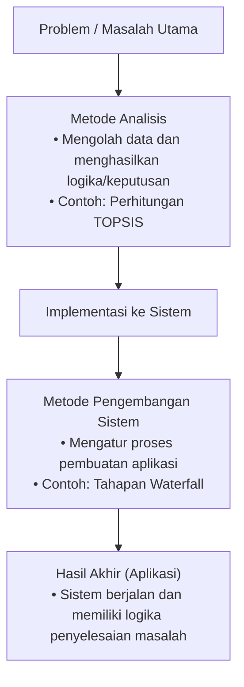

# PANDUAN PENULISAN SKRIPSI
**FAKULTAS ILMU KOMPUTER**  
**UNIVERSITAS DJUANDA**  
**2026**

---

## KATA PENGANTAR

Segala puji dan syukur kami panjatkan kepada Allah SWT, atas rahmat dan karunia-Nya, sehingga Buku Pedoman Penulisan Tugas Akhir Skripsi ini dapat terselesaikan dengan baik oleh Tim Penyusun dari Fakultas Ilmu Komputer Universitas Djuanda. Buku pedoman ini disusun untuk memberikan panduan kepada mahasiswa mengenai teknik, prosedur, dan langkah-langkah dalam penyusunan skripsi di lingkungan Fakultas Ilmu Komputer.

Semoga buku ini dapat menjadi acuan yang berguna bagi mahasiswa dalam menyelesaikan tugas akhir tepat waktu berupa proposal penelitian dan laporan skripsi. Begitu juga bagi dosen pembimbing, kami berharap buku ini dapat memfasilitasi proses bimbingan skripsi, khususnya terkait dengan substansi dan format penulisan.

Kami mengucapkan terima kasih yang sebesar-besarnya kepada seluruh pihak yang telah berkontribusi dalam penyusunan buku pedoman ini, terutama Ketua dan Pengurus Yayasan PSPIAI, Rektor Universitas Djuanda beserta jajaran, dan tentunya Tim Penyusun yang telah bekerja keras dalam penyelesaian panduan ini.

Kami menyadari bahwa buku ini masih jauh dari sempurna, oleh karena itu, masukan dan saran perbaikan sangat kami harapkan demi kesempurnaan panduan ini di masa mendatang. Semoga buku ini bermanfaat bagi seluruh mahasiswa dan dosen di Fakultas Ilmu Komputer Universitas Djuanda.

Bogor, September 2026  
Dekan,

**Dr. Ir. H. Himmatul Miftah, M.Si., MPM.**  
NIP 196706011993031001

---

## BAB I PENDAHULUAN

### A. PENGERTIAN SKRIPSI
Skripsi adalah karya tulis ilmiah yang menyajikan hasil penelitian mengenai suatu masalah dalam bidang ilmu tertentu, dengan menerapkan kaidah-kaidah yang sesuai dengan bidang tersebut. Penelitian merupakan kegiatan yang direncanakan, terarah, sistematis, dan terkontrol, bertujuan untuk mengumpulkan data dan informasi terkait masalah tertentu dalam disiplin ilmu, menggunakan metode ilmiah untuk menjawab pertanyaan penelitian atau menguji hipotesis. Skripsi memiliki posisi yang setara dengan mata kuliah lain, tetapi berbeda dalam bentuk, proses pembelajaran, dan metode penilaiannya. Skripsi memiliki beban 6 SKS, yang setara dengan 18 jam aktivitas akademik per minggu, atau sekitar 300 jam selama satu semester. Skripsi merupakan salah satu karya ilmiah berdasarkan hasil penelitian eksperimen dan/atau studi keperpustakaan yang dipaparkan dalam bentuk tulisan hasil penelitian mahasiswa di bawah pengawasan dosen pembimbing, sesuai dengan bidang studinya sebagai tugas akhir dalam studi formalnya di perguruan tinggi untuk memperoleh gelar sarjana. Karya tulis ilmiah akan membahas mengenai suatu permasalahan atau fenomena dalam bidang ilmu tertentu dengan menggunakan kaidah-kaidah yang berlaku.

### B. TUJUAN SKRIPSI
Mengingat pentingnya keseragaman dalam penulisan laporan skripsi, maka perlu disusun suatu pedoman dalam menyusun laporan skripsi. Buku Panduan Skripsi ini bertujuan untuk membantu dan mempermudah mahasiswa program Ilmu Komputer dalam menulis skripsi. Buku ini hanya menjelaskan **prosedur pelaksanaan** dan **format penulisan skripsi** yang hanya berlaku di Fakultas Ilmu Komputer, Universitas Djuanda.

### C. KRITERIA SKRIPSI
Skripsi harus memenuhi standar penulisan tertentu, di antaranya:
1. Mahasiswa telah lulus dan memenuhi jumlah SKS sebanyak 138 SKS untuk program studi Strata Satu.
2. Mahasiswa telah lulus Matakuliah Metodologi Penelitian, Kuliah Kerja Nyata dan Kerja Praktek dengan minimal nilai adalah C.
3. Mahasiswa hanya boleh memiliki jumlah nilai D atau E maksimal 10 SKS untuk program studi Strata Satu pada setiap mata kuliah.
4. Mengamati fenomena empiris, mengidentifikasi, merumuskan, dan mampu memberikan jawaban terhadap masalah penelitian.
5. Melaksanakan prosedur dan standar penelitian ilmiah yang tepat dan akurat untuk menjawab permasalahan penelitian yang telah dirumuskan oleh peneliti.
6. Menyusun laporan hasil penelitian secara sistematis sesuai dengan standar penulisan ilmiah.
7. Isi karya tulis didasarkan pada data atau informasi yang diperoleh dari studi pustaka dan/atau penelitian lapangan.
8. Menggunakan referensi minimal 10 (sepuluh) hasil penelitian, seperti skripsi, tesis, atau disertasi dari program studi yang terakreditasi minimal B, serta jurnal ilmiah terakreditasi, studi kasus yang diterbitkan dalam buku ber-ISBN. Referensi dapat berupa jurnal ilmiah nasional maupun internasional yang terbaru (minimal 5 tahun terakhir) sebagai landasan berpikir (kerangka teori) dan tinjauan penelitian/kasus sebelumnya dalam penulisan skripsi.

### D. TIM PEMBIMBING
Setiap mahasiswa yang sedang mempersiapkan dan melaksanakan penelitian untuk penyusunan skripsi akan dibimbing oleh dua dosen pembimbing. Dosen pembimbing ini ditunjuk oleh Dekan melalui Ketua Program Studi, dan penunjukannya ditetapkan dalam Keputusan Dekan dengan beberapa ketentuan sebagai berikut:
1. Minimal memiliki gelar S2;
2. Memiliki jabatan akademik paling sedikit Asisten Ahli;
3. Telah mengampu mata kuliah yang terkait dengan bimbingan selama minimal dua tahun berturut-turut.

### E. WEWENANG DAN TANGGUNG JAWAB PEMBIMBING
Tim Pembimbing Skripsi memiliki wewenang dan tanggung jawab sebagai berikut:
1. Bertanggung jawab atas kesesuaian topik, perumusan masalah, pemecahan masalah, dan penyelesaian penulisan skripsi.
2. Menentukan dan bertanggung jawab atas pemilihan alat bantu penelitian yang digunakan dalam skripsi, yang dapat dipertanggungjawabkan secara ilmiah.
3. Menjamin keabsahan laporan skripsi mahasiswa bimbingannya, dengan memperhatikan teknik penulisan ilmiah dan mencegah kemungkinan terjadinya duplikasi atau plagiarisme.
4. Bertanggung jawab atas keseluruhan kualitas penulisan skripsi, memastikan bahwa skripsi memenuhi beban 6 SKS, dan memiliki hak untuk menolak skripsi jika dinilai tidak memenuhi syarat.
5. Mengusulkan mahasiswa untuk mengikuti Ujian Skripsi dan Ujian, dengan mempertimbangkan kesiapan akademiknya.
6. Hal-hal lain yang belum diatur akan ditentukan melalui Keputusan Dekan.

### F. PENGUJIAN SKRIPSI
Panitia Ujian Skripsi dibentuk dan ditetapkan melalui Keputusan Dekan No. 029/FILKOMSKEP/X/2025 mengenai Panduan Tugas Akhir Fakultas Ilmu Komputer Universitas Djuanda.

Ketentuan kelulusan ujian skripsi adalah sebagai berikut:
1. Kelulusan ditentukan oleh masing-masing Penguji. Jika rata-rata nilai skripsi minimal 60, mahasiswa dinyatakan lulus.
2. Nilai skripsi didasarkan pada kemampuan mahasiswa dalam mempresentasikan skripsi serta penguasaan dan pemahaman terhadap materi yang dibahas.
3. Kelulusan akhir adalah nilai rata-rata dari semua nilai yang diberikan oleh dosen penguji, dengan minimal nilai 60.
4. Hasil Ujian Skripsi harus dicatat dalam Berita Acara. Berita Acara tersebut ditandatangani oleh Dosen Penguji, serta Ketua dan Sekretaris Penguji.
5. Mahasiswa yang tidak mencapai nilai minimal diberi kesempatan mengikuti ujian ulangan. Waktu ujian ulangan ditentukan saat pemberitahuan ketidaklulusan.
6. Ujian ulangan dapat diikuti maksimal tiga kali. Jika tidak lulus, mahasiswa harus mengikuti kuliah penyegaran yang ditetapkan oleh Program Studi.
7. Jika dalam dua minggu tidak ada pernyataan kesediaan untuk mengikuti kuliah penyegaran, mahasiswa dianggap mengundurkan diri dari Fakultas Ilmu Komputer Universitas Djuanda.
8. Jika mahasiswa tetap tidak lulus setelah kesempatan ujian ulang, mereka dinyatakan mengundurkan diri atau *drop out* dari Fakultas Ilmu Komputer Universitas Djuanda.

### G. HAK KEKAYAAN INTELEKTUAL DAN ARTIKEL
Fakultas Ilmu Komputer Universitas Djuanda Bogor mengakui bahwa mahasiswa memiliki Hak Kekayaan Intelektual (HKI) atas skripsi yang ditulisnya, dengan pengecualian sebagai berikut:
1. Dokumen fisik seperti file elektronik dan skripsi yang diserahkan ke Fakultas menjadi milik Fakultas Ilmu Komputer.
2. Fakultas berhak menyebarluaskan skripsi sebagai bagian dari koleksi perpustakaan Universitas Djuanda Bogor.
3. Fakultas berhak menggandakan skripsi atas permintaan universitas atau instansi yang kompeten.
4. Fakultas berhak menyebarluaskan skripsi dalam bentuk publikasi ilmiah atau jurnal, baik internal maupun eksternal.
5. Mahasiswa diwajibkan mempublikasikan hasil skripsinya dalam jurnal, dengan mahasiswa sebagai penulis pertama, pembimbing I sebagai penulis kedua, dan pembimbing II sebagai penulis ketiga.
6. Jika dosen pembimbing (I atau II) mengembangkan skripsi lebih luas, mendalam, dan menjadi buku, artikel, atau makalah ilmiah untuk publikasi di majalah, seminar, simposium, atau kongres, maka pembimbing (I atau II) menjadi penulis pertama dan kedua, sementara mahasiswa sebagai penulis ketiga.
7. Publikasi artikel harus mendapatkan persetujuan dari Pembimbing I dan II, serta Kepala Laboratorium Program Studi. Setelah itu, disahkan oleh Kepala Program Studi dengan membawa bukti *Letter of Acceptance* (LoA). Satu salinan bukti LoA harus diserahkan kepada Kepala Laboratorium Program Studi.

### H. YUDISIUM
Jika Panitia Penguji Ujian Skripsi memutuskan bahwa mahasiswa lulus, maka mereka harus menentukan yudisium atau predikat kelulusan mahasiswa sesuai dengan peraturan yang tercantum dalam Buku Panduan Penulisan Skripsi Fakultas Ilmu Komputer Universitas Djuanda. Hasil kelulusan Ujian Skripsi, yang tercantum dalam Berita Acara, harus ditandatangani dan diketahui oleh Wakil Dekan 1 atas nama Dekan Fakultas Ilmu Komputer Universitas Djuanda. Indeks Prestasi Kumulatif (IPK) dan predikat kelulusan atau yudisium mahasiswa ditentukan berdasarkan Peraturan Menteri Pendidikan dan Kebudayaan Republik Indonesia No. 3 Tahun 2020 tentang Standar Nasional Pendidikan Tinggi (SNPT).

**Tabel 1. Daftar Indeks Prestasi Kumulatif dan Predikat Kelulusan**

| Indeks Prestasi Kumulatif (IPK) | Predikat atau Yudisium |
| :---: | :---: |
| 2,76 - 3,00 | Memuaskan |
| 3,01 - 3,50 | Sangat Memuaskan |
| > 3,50 | Pujian |

Mahasiswa yang lulus dengan IPK yang tidak termasuk dalam kategori IPK pada Tabel 1 akan diberikan transkrip nilai dengan tanda (-) tanpa predikat lainnya.

### I. PUBLIKASI
Mahasiswa yang telah lulus ujian skripsi diwajibkan membuat artikel ilmiah berdasarkan skripsi mereka. Penulisan artikel dan urutan nama penulis harus dilakukan di bawah bimbingan dua dosen pembimbing skripsi. Format artikel harus disesuaikan dengan ketentuan jurnal yang dituju. Mahasiswa yang ingin mengajukan sidang skripsi wajib menunjukkan bukti pengiriman artikel (*submit*) ke jurnal yang minimal terindeks SINTA.

**Tahap Submit Jurnal:**
1. Penentuan jurnal untuk *submit* artikel harus melalui konsultasi dengan Dosen Pembimbing.
2. Setelah disetujui oleh Pembimbing 1, mahasiswa melanjutkan pembimbingan artikel dengan Pembimbing 1 dan 2, dimulai dari Pembimbing 2.
3. Setelah mendapat persetujuan untuk *submit* dari kedua pembimbing, artikel harus disahkan oleh Ketua Program Studi dengan membawa bukti *submit* (Lampiran 25).

### J. KETENTUAN UMUM
Beberapa ketentuan umum yang harus dipenuhi oleh mahasiswa dalam proses skripsi adalah sebagai berikut:
1. Setiap mahasiswa diwajibkan menyusun dan menempuh ujian tugas akhir/skripsi sebagai syarat akhir pendidikan program sarjana (S1).
2. Skripsi harus disusun sesuai dengan kaidah ilmiah yang berlaku.
3. Format skripsi harus mengikuti ketentuan yang telah disahkan oleh Dekan.
4. Mahasiswa wajib mampu mempertanggungjawabkan isi skripsi di hadapan Panitia Penguji Skripsi dan Pembimbing.
5. Ujian skripsi dilakukan secara lisan di depan tim penguji terhadap satu mahasiswa dalam satu ruangan untuk menilai pertanggungjawaban skripsinya. Kelulusan ujian skripsi **ditentukan oleh Dewan Penguji dan harus didukung oleh minimal dua pertiga suara anggota penguji** atau jumlah suara mayoritas sesuai ketentuan Fakultas/Program Studi.
6. Tim penguji Kolokium (seminar proposal) dan Seminar Hasil (Semhas) terdiri dari dua dosen pembimbing dan satu penguji tamu yang kompeten di bidang kajian skripsi mahasiswa.
7. Dosen Pembimbing I dan II wajib menghadiri seminar kolokium dan seminar hasil, sedangkan pada sidang skripsi mahasiswa didampingi oleh Pembimbing I dan II yang bertindak sebagai anggota penguji.
8. Proses pembimbingan mencakup penentuan judul, penulisan usulan penelitian, kolokium, pelaksanaan penelitian, penulisan bahan seminar hasil, penulisan skripsi lengkap, serta ujian skripsi.
9. Mahasiswa dapat mengunduh form pengajuan judul kolokium, skripsi, dan pengajuan lainnya melalui tautan: https://filkom.unida.ac.id.
10. Mahasiswa yang mengambil skripsi diwajibkan mengikuti kegiatan pembekalan skripsi (kolokium, pengolahan data, sitasi, dan lainnya).
11. Mahasiswa wajib menghadiri minimal 5 seminar kolokium dan 10 seminar hasil di program studi masing-masing, dibuktikan dengan kartu peserta seminar saat mengajukan seminar proposal dan seminar hasil.
12. Mahasiswa wajib menunjukkan sertifikat pembekalan skripsi saat mengajukan judul skripsi.

---

### K. PEMAHAMAN METODE PENGEMBANGAN SISTEM DAN METODE ANALISIS
Dalam penyusunan Tugas Akhir atau Skripsi bidang Informatika/Ilmu Komputer, sering kali keliru dalam membedakan antara Metode Pengembangan Sistem dan Metode Analisis. Kedua metode ini memiliki peran yang berbeda namun saling melengkapi dalam sebuah penelitian yang menghasilkan produk perangkat lunak.

#### 1. Definisikan & Perbedaan Utama

##### a. Metode Pengembangan Sistem
Pendekatan atau kerangka kerja (*framework*) yang terstruktur untuk mengarahkan tahapan pembuatan dan penyempurnaan sistem/perangkat lunak, mulai dari analisis kebutuhan hingga pengujian dan pemeliharaan.
- **Pertanyaan Utama** adalah *"Bagaimana sistem/perangkat lunak ini dibangun?"*
- **Fokus Utama** adalah Manajemen proses rekayasa perangkat lunak (*software process*).
- **Contoh** adalah Waterfall, Prototype, Agile (Scrum/Kanban), RAD (*Rapid Application Development*), dan Spiral.
- **Landasan Teoretis** yaitu *Software process* merupakan serangkaian aktivitas yang berkaitan dengan produksi perangkat lunak, di mana model proses memberikan representasi sederhana dari aktivitas tersebut (Sommerville, 2015).

**Pengembangan sistem sendiri berdasarkan fokus output riset terbagi menjadi 4 yaitu:**
1) **Pengembangan Algoritma/Model**, contoh outputnya adalah Algoritma *machine learning* baru, model prediksi
2) **Pengembangan Sistem/Aplikasi**, contoh outputnya adalah Sistem informasi, aplikasi mobile/web
3) **Pengembangan Arsitektur/Infrastruktur**, contoh outputnya adalah Arsitektur jaringan, sistem terdistribusi
4) **Pengembangan Framework/Tools**, contoh outputnya adalah Framework pengujian, tools otomasi

##### b. Metode Analisis
Pendekatan matematis, logis, atau algoritmik yang digunakan untuk memproses, mengolah, dan menganalisis data/kriteria penelitian guna menghasilkan kesimpulan, rekomendasi, klasifikasi, atau keputusan.
- **Pertanyaan Utama** adalah *"Bagaimana data/permasalahan penelitian diolah untuk menghasilkan solusi?"*
- **Fokus Utama** adalah Logika pemrosesan data dan penyelesaian masalah (*problem-solving algorithm*).
- **Contoh** yaitu:
  1) *SPK / MADM* yaitu TOPSIS, SAW, AHP, Profile Matching.
  2) *Data Mining / Machine Learning* yaitu Naive Bayes, K-Means, Decision Tree, Support Vector Machine (SVM).
- **Landasan Teoretis** yaitu *Multiple Attribute Decision Making* (MADM) merupakan pendekatan untuk menyelesaikan permasalahan pengambilan keputusan yang melibatkan pemrosesan beberapa atribut atau kriteria secara bersamaan (Hwang & Yoon, 1981).

#### 2. Matriks Perbandingan Ringkas

| Aspek Pembeda | Metode Pengembangan Sistem | Metode Analisis |
| :--- | :--- | :--- |
| **Fokus Utama** | Proses rekayasa dan pembuatan sistem | Pemrosesan data dan logika penyelesaian masalah |
| **Pertanyaan Kunci** | Bagaimana aplikasi ini dibuat? | Bagaimana data/masalah ini dihitung dan dianalisis? |
| **Objek yang Diproses** | Perangkat lunak / aplikasi | Data, kriteria, variabel, atau atribut |
| **Tahapan Umum** | Analisis Kebutuhan → Desain → Koding → Pengujian | Pengumpulan Data → Normalisasi → Perhitungan → Hasil |
| **Output / Hasil** | Aplikasi / Produk Perangkat Lunak | Keputusan, Peringkat, Klasifikasi, Prediksi |
| **Analog Sederhana** | Membuat "Wadah" aplikasi | Menjalankan "Otak / Logika" di dalam aplikasi/proses bisnis |

#### 3. Hubungan dan Integrasi Kedua Metode dalam Skripsi
Kedua metode tidak saling menggantikan, melainkan bekerja secara berdampingan pada penelitian yang membangun aplikasi berorientasi pada penyelesaian masalah spesifik.



**Contoh Alur Integrasi yaitu:**
- **a. Masalah:** Sekolah kesulitan menentukan penerima beasiswa secara akurat karena banyaknya kriteria.
- **b. Metode Analisis (TOPSIS):** Mengolah data nilai, ekonomi, dan prestasi untuk menghasilkan perangkingan penerima beasiswa.
- **c. Metode Pengembangan Sistem (Waterfall):** Mengatur alur pembuatan aplikasi SPK berbasis web agar algoritma TOPSIS dapat diakses pengguna dengan baik.
- **d. Hasil Akhir:** Aplikasi SPK Beasiswa Berbasis Web yang teruji fungsi dan akurasi perhitungannya.

#### 4. Kapan Harus Menggunakan Salah Satu atau Keduanya?
Wajib menyesuaikan penggunaan metode berdasarkan Riset dan Tujuan Utama Penulisan.
- **a. Hanya Menggunakan Metode Pengembangan Sistem**
  1) Penelitian berfokus pada pembangunan/pembaharuan sistem informasi, tanpa adanya algoritma khusus/pemrosesan data tingkat lanjut.
  2) Contoh Judul yaitu *"Pengembangan Sistem Informasi Perpustakaan Berbasis Web Menggunakan Metode Waterfall pada SMA XYZ"*
- **b. Hanya Menggunakan Metode Analisis**
  1) Penelitian berfokus pada komparasi, pengujian akurasi, atau pemodelan algoritma, di mana produk akhirnya bukan berupa aplikasi siap pakai melainkan laporan visualisasi/analisis data.
  2) Contoh Judul yaitu *"Penerapan Metode Simple Additive Weighting (SAW) untuk Pemilihan Karyawan Terbaik pada PT XYZ"*
- **c. Menggunakan Keduanya dengan menggabungkan antara Pengembangan dan Analisis**
  1) Penelitian membangun aplikasi yang di dalamnya mengimplementasikan logika/algoritma perhitungan spesifik.
  2) Contoh Judul yaitu *"Sistem Pendukung Keputusan Penerima Beasiswa Menggunakan Metode TOPSIS Berbasis Web dengan Metode Pengembangan Waterfall"*

#### 5. Panduan Penulisan pada Bab III (Metodologi Penelitian)
Dalam penelitian yang mengombinasikan metode pengembangan sistem dan metode analisis, pembahasan pada Bab III hendaknya disajikan dalam subbab yang terpisah untuk menjaga kejelasan alur metodologis serta menghindari tumpang tindih substansi.
- **a. Metode Analisis Data / Sistem**
  1) Menjelaskan tentang algoritma yang digunakan contohnya TOPSIS, K-Means, SAW.
  2) Menyertakan rumus matematis, alur perhitungan, kriteria, serta penetapan bobot/variabel.
- **b. Metode Pengembangan Sistem**
  1) Menjelaskan kerangka kerja rekayasa perangkat lunak (misal: Waterfall, Agile, Prototype).
  2) Menyebutkan tahapan secara jelas dari *Analisis Kebutuhan, Desain UI/UX & Database, Coding/Implementation*, hingga *Pengujian (Black-box testing, UAT, dll)*.
- **c. Berdasarkan Fokus Output Riset, penelitian pengembangan terbagi dalam skema berikut:**

| No | Jenis | Contoh Output |
| :---: | :--- | :--- |
| 1 | **Pengembangan Algoritma / Model / Analisis** | Algoritma machine learning baru, model prediksi |
| 2 | **Pengembangan Sistem / Aplikasi / Rekayasa Perangkat Lunak** | Sistem informasi, aplikasi mobile/web |
| 3 | **Pengembangan Arsitektur / Infrastruktur / Jaringan** | Arsitektur jaringan, sistem terdistribusi |
| 4 | **Pengembangan Framework / Tools** | Framework pengujian, tools otomasi |

- **d. Kerangka Penelitian Pengembangan berdasarkan skema di atas: (lihat pada lampiran)**

---

### L. PROPOSAL SKRIPSI

#### 1. Pengertian
Secara umum proposal memiliki pengertian sebagai usulan untuk melakukan suatu kegiatan. Proposal merupakan sebuah tulisan yang dibuat oleh si pengusul (peneliti) yang bertujuan untuk menjabarkan atau menjelaskan sebuah tujuan kepada si pembaca (individu atau lembaga) sehingga mereka memperoleh pemahaman mengenai tujuan tersebut lebih mendetail. Dengan demikian si pembaca, akhirnya memperoleh persamaan visi, misi, dan tujuan dari proposal dimaksud. Ada 3 unsur pokok didetailkan dalam proposal:
- a. Penjabaran mendetail mengenai tujuan utama dari usulan tersebut kepada pembacanya.
- b. Penjabaran mendetail mengenai proses bagaimana mencapai tujuan pengusul (peneliti) kepada pembacanya.
- c. Penjabaran mendetail mengenai hasil dari proses yang telah dijabarkan di atas sehingga mencapai tujuan yang diinginkan oleh pengusul (peneliti) dan juga si pembaca.

Dari pengertian di atas maka Proposal Penelitian adalah usulan tentang penelitian yang akan dilakukan oleh peneliti. Usulan ini memuat berbagai kerangka dasar pelaksanaan penelitian yang akan dilakukan. Kerangka dasar ini memenuhi ciri-ciri ilmiah dan syarat kelayakan yang harus dipenuhi sebagai sebuah penelitian.

#### 2. Kerangka Proposal Skripsi
Proposal Skripsi disusun menurut kaidah-kaidah tertentu sesuai dengan pedoman yang berlaku. Ketentuan tersebut harus mengacu pada kaidah keilmuan, format baku, dan tata bahasa serta ejaan yang benar. Secara garis besar penulisan proposal skripsi terdiri atas 3 bagian yaitu:

- **a. Bagian Pertama** yang memuat Halaman Sampul depan, Halaman Sampul dalam, Halaman Pengesahan Proposal (lihat contoh lembar pengesahan skripsi), Daftar Isi, Daftar Tabel, Daftar Gambar dan Daftar Lampiran.
- **b. Bagian Kedua** yang memuat:
  - **I. PENDAHULUAN**
    - A. Latar Belakang Masalah
    - B. Permasalahan
      - Identifikasi Masalah
      - Rumusan Masalah (*Problem Statement, Research Questions*)
    - C. Maksud dan Tujuan Penelitian
    - D. Spesifikasi Produk yang Diharapkan
    - E. Signifikansi Penelitian
    - F. Asumsi dan Keterbatasan
    - G. Definisi Istilah dan Definisi Operasional
  - **II. KERANGKA TEORITIS**
    - A. Landasan Teori
    - B. Subjudul yang relevan dengan pemahaman teoritis
    - C. Subjudul yang relevan dengan objek permasalahan
    - D. Tinjauan Studi (penelitian rujukan)
    - E. Kerangka Berfikir
    - F. Hipotesis Penelitian
  - **III. METODOLOGI PENELITIAN & PENGEMBANGAN**
    - A. Metode Penelitian & Pengembangan
    - B. Model/Metode yang Diusulkan
    - C. Prosedur Pengembangan
    - D. Uji Coba Produk
      - a. Desain Uji Coba
      - b. Subjek Uji Coba
      - c. Jenis Data
      - d. Instrumen Pengumpulan Data
      - e. Teknik Analisis Data
    - E. Penjadwalan
    - F. Sistematika Penulisan
- **c. Bagian Ketiga** memuat: Daftar rujukan, Lampiran.

#### 3. Bimbingan Proposal Skripsi
Proposal Skripsi disiapkan pada masa perkuliahan "Metodologi Penelitian". Pelaksanaannya dikoordinasikan oleh perkuliahan matakuliah tersebut bersama dengan Dosen Pembimbing yang telah ditetapkan oleh Program Studi. Pada akhir masa perkuliahan matakuliah "Metodologi Penelitian" maka selesai/tersusunnya sebuah proposal Skripsi.

#### 4. Seminar Proposal Skripsi
Proposal yang telah selesai disusun kemudian diajukan kepada Program Studi untuk mendapatkan persetujuan. Persetujuan sebuah proposal skripsi dilakukan melalui seminar proposal atau sering disebut ujian proposal skripsi di hadapan team penguji proposal. Proposal yang memenuhi syarat akan disetujui untuk dilanjutkan ke tingkat pelaksanaan.

#### 5. Prosedur Pelaksanaan Proposal
Proposal Tugas Akhir dilaksanakan mengikuti langkah-langkah berikut:
- a. Mahasiswa menyerahkan form penyusunan proposal kepada Ketua Program Studi;
- b. Ketua Program Studi menetapkan pembimbing yang diambil dari program studi;
- c. Sesuai dengan tema yang ditetapkan, mahasiswa dibantu oleh dosen pembimbing menyusun kerangka proposal dengan muatan kajian yang dijabarkan dari tema yang telah ditetapkan, kemudian menetapkan judul skripsi;
- d. Pada akhir masa perkuliahan Metodologi Penelitian, Proposal yang dipersiapkan diajukan ke Program Studi untuk diikutkan dalam seminar Proposal;
- e. Seminar proposal dihadiri dosen pembimbing dan dosen penguji, mengisi berita acara seminar proposal;
- f. Setelah dilakukan seminar proposal, dilakukan perbaikan proposal dengan mengisi lembar persetujuan perbaikan proposal sesuai dengan hasil seminar;
- g. Pelaksanaan tugas akhir dinyatakan dalam surat keputusan pengambilan skripsi.

---

### M. TATA CARA PELAKSANAAN PENYUSUNAN SKRIPSI

#### 1. Syarat Penyusunan Skripsi
- a. Pengambilan skripsi telah dapat dilakukan setelah mahasiswa memenuhi persyaratan akademik dan administrasi.
- b. Mahasiswa yang telah memenuhi syarat wajib menyampaikan penyusunan proposal sesuai dengan lingkup masalah yang menjadi perhatian program studi.
- c. Proposal dapat diteruskan ke proses penyusunan skripsi setelah perbaikan proposal hasil seminar diserahkan ke bagian prodi/perpustakaan.

#### 2. Penyusunan dan Pembimbingan Skripsi
- a. Pelaksanaan penelitian dan penyusunan laporan skripsi dilakukan di bawah bimbingan Dosen Pembimbing. Dalam melaksanakan tugas bimbingan, pembimbing harus membuat jadwal bimbingan dan mengisi lembar Waktu Konsultasi Mahasiswa dengan Dosen Pembimbing.
- b. Jika pembimbing tidak dapat menjalankan tugasnya, ketua program studi dapat menunjuk penggantinya.
- c. Pelaksanaan bimbingan tugas akhir berlaku untuk 1 (satu) semester. Penyelesaian tugas akhir yang tidak sesuai dengan batas waktu yang ditentukan dinyatakan gugur. Kebijakan pengambilan tugas akhir atas permasalahan batas waktu penyelesaian menjadi kewenangan program studi. Program studi dapat membatalkan materi dan bimbingan dan/atau merekomendasikan perpanjangan sesuai dengan pertimbangan yang dapat dipertanggungjawabkan di tingkat kebijakan akademik.

#### 3. Pembimbing Skripsi
- a. Persyaratan pembimbing Tugas Akhir ditetapkan oleh program studi.
- b. Pembimbing melaksanakan bimbingan di kampus pada waktu yang telah ditetapkan sesuai dengan jadwal bimbingan serta mengisi lembar bukti bimbingan.
- c. Tugas Akhir yang telah selesai dilaksanakan dapat diajukan untuk diujikan pada agenda Evaluasi Akhir Program yaitu Sidang skripsi.
- d. Hasil ujian skripsi disampaikan pada waktu selesainya pelaksanaan Evaluasi Akhir Program. Nilai skripsi yang direkomendasikan adalah minimal B. Nilai di bawah B dinyatakan tidak memenuhi syarat (tidak lulus).

---

### N. KERANGKA PENULISAN SKRIPSI
Skripsi disusun menurut kaidah-kaidah tertentu sesuai dengan pedoman yang berlaku. Ketentuan tersebut harus mengacu pada kaidah keilmuan, format baku, dan tata bahasa serta ejaan yang benar. Secara garis besar penulisan skripsi terdiri atas 3 bagian yaitu:
1. **Bagian Awal** yang memuat: judul sampul, halaman judul, halaman persetujuan evaluasi, halaman persetujuan skripsi, halaman pengesahan, halaman persembahan, kata pengantar, daftar isi, daftar tabel, daftar gambar, daftar lampiran.
2. **Bagian Isi** yang dibagi dalam beberapa bab seperti: bab pendahuluan, bab tinjauan pustaka/landasan teori, bab metodologi, bab uraian hasil, dan bab kesimpulan dan saran.
3. **Bagian Akhir**, yang terdiri atas: daftar pustaka, lampiran-lampiran, dan lain-lain.

#### 1. Bagian Awal

##### a. Judul dan Sampul Skripsi (Cover)
Dalam sampul skripsi hendaknya dicantumkan judul skripsi secara tegas, jelas dan mencerminkan tema pokok skripsi. Judul harus mencerminkan metode, variabel, dan obyek penelitian. Sampul tugas akhir terbuat dari karton tebal jenis kertas buffalo, linen atau yang sejenisnya dengan teknik penjilidan *hardcover* berukuran 21 x 28 cm. Teks yang terdapat pada sampul tidak boleh melewati batas pengetikan yaitu: batas kiri 4 cm dari tepi kiri kertas, batas atas 4 cm dari tepi atas kertas, batas kanan dan batas bawah masing-masing 3 cm dari tepi kertas. Tulisan yang terdapat pada sampul ditulis dengan memperhatikan hal-hal berikut:
- (a) Pada bagian atas sampul ditulis judul skripsi dengan huruf kapital posisi simetris (*center*) dan tidak melewati batas kertas. Apabila judul lebih dari satu baris maka teks disusun secara piramida terbalik dengan ukuran huruf yang ditetapkan. Jarak antarbaris adalah 1 spasi. Judul harus sesuai dengan keseluruhan isi dari kegiatan penelitian dan penuangan karya Skripsi yang dilakukan, baik kesesuaian dari segi kualitas maupun kuantitas. Kesesuaian kualitas adalah kesesuaian dalam segi corak atau sudut pandang serta kesesuaian dalam segi hakekat persoalannya. Kesesuaian kuantitas adalah kesesuaian dalam keseimbangan antara luasnya wilayah yang dinyatakan dalam judul dengan wilayah kegiatan serta uraian dalam Skripsi.
- (b) Menggunakan kata-kata yang jelas, tandas, literal, singkat, deskriptif, dan tidak merupakan pertanyaan. Hindari penggunaan kata-kata yang kabur, terlalu puitis, bombastis, bertele-tele, tidak runtut, dan lebih dari satu kalimat.
- (c) Gunakan kata-kata kunci yang ekspresif untuk dapat memudahkan pembaca mengetahui subjek penelitian.
- (d) Pada bagian tengah sampul ditulis nama atau jenis Tugas Akhir seperti:
- (e) `SKRIPSI` dalam huruf kapital secara simetris.
- (f) Penjelasan, terletak di bawah kata `SKRIPSI` berisi penjelasan mengenai maksud penulisan skripsi tersebut yang disusun secara piramida terbalik. Ditulis dengan huruf kecil—**"Diajukan untuk memenuhi salah satu syarat dalam menempuh Ujian Sarjana Komputer (S.Kom)"** dengan jarak baris 1 spasi.
- (g) Baris berikutnya ditulis kata "OLEH" kemudian di bawahnya disebutkan nama penyusunnya dalam huruf kapital beserta nomor pokok mahasiswa yang diletakkan di bawah nama.
- (h) Di bawah nama penulis ditulis jenjang studi, ditulis secara simetris, dan di bawahnya ditulis program studi sesuai program studi yang peneliti ikuti, ditempatkan secara simetris.
- (i) Di bawah tulisan program studi, diletakkan logo UNIVERSITAS DJUANDA dengan ukuran yang disesuaikan.
- (j) Baris berikutnya ditulis UNIVERSITAS DJUANDA, kemudian BOGOR dan di bawahnya: tahun penyusunan. Semua tulisan tersebut dibuat dalam huruf kapital dengan posisi simetris.
- (k) Halaman judul berisi tulisan yang sesuai dengan format, bentuk pada halaman sampul (*cover*) yang ditulis pada kertas HVS. Halaman judul merupakan halaman pertama yang diperhitungkan dengan menggunakan nomor awal "i", namun penomoran tersebut tidak dicantumkan pada halaman judul tersebut.
- (l) Lihat contoh halaman sampul pada lampiran.

##### b. Halaman Persetujuan Evaluasi
- (a) Tulisan `LEMBAR PERSETUJUAN EVALUASI` pada posisi simetris dengan ukuran huruf 12 *bold*.
- (b) Baris berikutnya ditulis kata "Judul: " dan diikuti judul skripsi, dan di bawahnya ditulis "Peneliti / Penyusun : ", diikuti nama Peneliti / Penyusun dan NPM.
- (c) Baris berikutnya ditulis: "Karya tulis ilmiah ini telah diuji di depan dewan penguji karya tulis penelitian, pada tanggal (sebutkan tanggal, bulan, dan tahun)", Di bawahnya ditulis: "**Dewan Penguji**", ditulis secara simetris.
- (d) Baris berikutnya disediakan kolom tanda tangan untuk masing-masing penguji. Dimulai dengan nama lengkap dan diikuti tanda tangan, ditulis berurutan ke bawah. Lihat contoh pada lampiran.

##### c. Halaman Persetujuan Skripsi
Halaman persetujuan berisi tulisan antara lain:
- (a) Tulisan `LEMBAR PERSETUJUAN SKRIPSI` pada posisi simetris dengan ukuran huruf 12.
- (b) Baris berikutnya ditulis kata "Judul: " dan diikuti judul karya tulis tugas akhir, dan di bawahnya ditulis "Peneliti / Penyusun: " diikuti nama-nama peneliti/penyusun berikut NIM.
- (c) Baris berikutnya ditulis: "Karya tulis ini telah diperiksa dan disetujui sebagai karya ilmiah penelitian".
- (d) Di bawahnya ditulis tempat dan tanggal persetujuan, ditulis secara simetris.
- (e) Di bawahnya ditulis kalimat "**Disetujui Oleh :**", ditulis secara simetris.
- (f) Baris berikutnya disediakan kolom tanda tangan untuk Pembimbing yang ditulis dengan menyertakan Nama Pembimbing dan NIDN Dosen.
- (g) Di bawahnya disediakan kolom untuk tanda tangan Ketua Program Studi berikut nama dan NIDN, ditulis secara simetris. Lihat contoh halaman pengesahan pada lampiran.

##### d. Halaman Pengesahan Skripsi
Halaman Pengesahan Skripsi berisikan:
- (a) Tulisan `LEMBAR PENGESAHAN KARYA PENELITIAN DAN PENULISAN ILMIAH` pada posisi simetris dengan ukuran huruf 12.
- (b) Di bawah kalimat pengesahan ditulis kata "Judul: " dan diikuti judul skripsi, dan di bawahnya ditulis "Peneliti / Penyusun: " dan diikuti nama peneliti/penyusun berikut NPM.
- (c) Baris berikutnya ditulis: "Karya tulis ini telah dapat diterima dan dipertanggungjawabkan sebagai karya ilmiah penelitian". Di bawahnya ditulis tempat dan tanggal pengesahan, ditulis secara simetris.
- (d) Di bawahnya ditulis: "Disahkan Oleh", ditulis secara simetris.
- (e) Di bawahnya disediakan kolom untuk tanda tangan Dekan Fakultas Ilmu Komputer Universitas Djuanda berikut nama jelas (gelar, nama, dan predikat lain), ditulis secara simetris.

##### e. Halaman Persembahan (Opsional)
Halaman persembahan disediakan jika penyusun menganggap perlu. Kata-kata persembahan, moto atau peribahasa, atau ayat-ayat dari Kitab Suci ditulis pada pojok kanan bawah.

##### f. Halaman Riwayat Peneliti/Penyusun
Halaman Riwayat Penulis berfungsi untuk menginformasikan tentang penyusun, yang memuat identitas dan riwayat penulis baik dari sisi pendidikan maupun dari sisi pengalaman, serta informasi lainnya tentang penyusun sehubungan dengan sikap dan perhatiannya terhadap ilmu pengetahuan dan teknologi.

##### g. Halaman Pernyataan Karya Asli
Halaman pernyataan ini berfungsi untuk menegaskan pertanggungjawaban penyusun tentang karya tulis ini sebagai karya ilmiah asli, bukan jiplakan, atau bentuk penyertaan bagian yang tidak sah secara hukum dan etika moral. Pernyataan mengandung beban moral penyusun terhadap adanya pelanggaran kode etik serta penyalahgunaan karya orang lain yang diambil secara tidak sah. Konsekuensi logis berkaitan dengan perilaku dan perlakuan demikian akan menjadi tanggungan penyusun secara hukum dan moral akademis. Pernyataan memuat:
- (a) Identitas penyusun
- (b) Isi kalimat pernyataan ditulis mencantumkan:
  - (i) Bahwa karya tulis ini adalah karya asli, bukan jiplakan, atau saduran yang tidak sah;
  - (ii) Peneliti/penyusun mempertanggungjawabkan apabila di kemudian hari terdapat gugatan dari pihak-pihak tertentu mengenai seluruhnya atau sebagian dari karya tulis ini, akan menerima sanksi secara hukum dan peraturan yang berlaku, dicabut hak-hak yang telah diperoleh serta tanggungan moril dan materil lainnya di depan hukum.
- (c) Tempat dan tanggal dibuat pernyataan dan Tanda tangan.

##### h. Halaman Persembahan
Berisi ungkapan rasa terima kasih dan penghargaan kepada orang tua dan/atau seseorang yang istimewa dari peneliti/penyusun. Dapat pula berisi kata-kata bijak atau ungkapan aktualisasi diri yang diambil dari sumber-sumber tertentu. Ungkapan tersebut ditulis di bagian kanan bawah (rapat kanan) lembar persembahan.

##### i. Halaman Abstrak
Halaman Abstrak berfungsi mengutarakan secara ringkas tentang isi Skripsi, yang antara lain memuat:
- (a) Bagian Awal, ditulis secara berurutan ke bawah yang memuat: Nama Penulis, Judul, Tahun dan jumlah halaman.
- (b) Isi abstrak memuat Pokok permasalahan dan tujuan penelitian, Metode penelitian, Hasil (temuan) penelitian. Pada bagian isi abstrak harus berbentuk *essay* bukan *pointers*, menggunakan kalimat aktif, dan tidak menggunakan kata-kata yang bersifat pelengkap informasi. Terdiri dari satu alinea dengan jarak ketik 1 spasi, maksimum terdiri 250 kata.
- (c) Kata Kunci, berisi 5 kata kunci.

##### j. Halaman Kata Pengantar
Halaman Kata Pengantar berfungsi untuk mengantarkan skripsi yang memuat antara lain:
- (a) Kalimat `KATA PENGANTAR` ditulis secara simetris.
- (b) Isi kata pengantar memuat:
  - (i) Maksud dan tujuan penelitian;
  - (ii) Penyampaian ucapan penghargaan (apresiasi) kepada penyedia fasilitas dan data penelitian, dan dosen pembimbing atas kontribusi yang diberikan dalam penelitian;
  - (iii) Pada bagian akhir kata pengantar ditulis tempat, bulan dan tahun penulisan serta kata "Penyusun" dengan posisi merapat ke marjin kanan;
  - (iv) Ukuran huruf naskah kata pengantar adalah font 10 dengan jarak antar baris 1,5 spasi.

##### k. Halaman Ucapan Terima Kasih
- (a) Halaman Ucapan Terima Kasih disertakan untuk memberikan penghargaan kepada pihak-pihak tertentu atas dukungannya dalam penyelesaian skripsi.
- (b) Kalimat `UCAPAN TERIMA KASIH` ditulis secara simetris.
- (c) Isi `UCAPAN TERIMA KASIH` memuat: ucapan terima kasih kepada pihak-pihak tertentu yang telah berperan mendukung penyelesaian skripsi (mulai dari pihak yang mewakili lembaga sampai perorangan tertentu yang dianggap mendukung penyelesaian skripsi).

##### l. Halaman Daftar Isi
- (a) Halaman Daftar Isi memuat bagian-bagian penting mulai dari bagian awal, bagian isi, sampai bagian akhir dari skripsi disertai dengan nomor halamannya.
- (b) Jarak antara judul yang satu dengan lainnya adalah 1,5 spasi.

##### m. Halaman Daftar Tabel, Daftar Gambar dan Daftar Lampiran
- (a) Halaman Daftar Tabel, Daftar Gambar dan Daftar Lampiran dibuat secara terpisah setelah Daftar Isi.
- (b) Daftar tersebut memuat nomor, judul tabel, gambar, atau lampiran, beserta nomor halamannya.
- (c) Setiap awal kata dari judul tabel, gambar, lampiran ditulis dalam huruf kapital, kecuali kata sambung dan kata depan. Jarak antara judul yang satu dengan yang lainnya adalah 1,5 spasi.

---

#### 2. Bagian Isi Skripsi

##### BAB I PENDAHULUAN
Bab Pendahuluan terdiri atas sub bab latar belakang masalah, masalah penelitian, rumusan masalah, maksud dan tujuan penelitian, kegunaan penelitian.

- **A. Latar Belakang Masalah**
  Latar belakang masalah mengungkapkan konteks pengembangan objek yang diteliti di mana ada permasalahan yang perlu dipecahkan. Pengungkapannya diawali dengan mengungkapkan fenomena-fenomena di seputar permasalahan. Fenomena merupakan gejala-gejala yang dapat dikenali yaitu berupa tanda-tanda adanya masalah (tidak mengungkapkan masalahnya). Fenomena dituturkan dalam 3 kerangka dasar:
  - (a) Permasalahan dan unsur penyertaan bukti dan alasan yang dapat ditunjukkan secara konkret.
  - (b) Pemecahan yang dapat ditemukan dari rujukan penelitian yang relevan dan memperkuat aspek perlunya penelitian ini dilakukan.
  - (c) Teoritis yang terkait dalam kerangka memunculkan pemikiran baru dan manfaatnya bagi pengembangan pengetahuan.

  Secara umum latar belakang masalah diawali dengan melakukan identifikasi kesenjangan-kesenjangan yang ada antara kondisi nyata dengan kondisi ideal, serta dampak yang ditimbulkan oleh kesenjangan-kesenjangan itu. Berbagai alternatif untuk mengatasi kesenjangan itu perlu dipaparkan secara singkat disertai dengan identifikasi faktor penghambat dan pendukungnya. Alternatif yang ditawarkan sebagai pemecah masalah beserta rasionalnya dikemukakan pada bagian akhir dari paparan latar belakang masalah.

- **B. Permasalahan**
  Bagian ini mengungkapkan permasalahan yang menjadi sorotan dalam penelitian sebagai penegasan dari apa yang telah diungkapkan dalam latar belakang masalah. Dikemukakan dalam 3 pemaparan:
  - (a) **Identifikasi masalah**, yaitu mengenali masalahnya dengan menyebutkan masalah tersebut secara konkret. Dimulai dengan menunjukkan indikator-indikator masalah dan kemudian diikuti dengan pernyataan-pernyataan masalah. Diungkapkan dengan kata-kata dan kalimat masalah yang menunjukkan adanya ketidaktercapaian kondisi yang diharapkan/seharusnya. Diutarakan dalam 2 bentuk:
    - (1) *Konseptual*, yaitu masalah yang dapat didekati pemecahannya dengan metode/teori/teknik komputasi yang ditawarkan sebagai solusi.
    - (2) *Teknikal*, yaitu masalah yang dapat didekati pemecahannya dengan teknik aplikatif sebagai solusinya.
  - (b) **Pernyataan Masalah (*Problem Statement*)**, yaitu penegasan masalah ke dalam ungkapan inti pokok masalah dari unsur-unsur masalah yang dikemukakan di Identifikasi Masalah.
  - (c) **Pertanyaan Penelitian (*Research Question*)**, yaitu pertanyaan yang dipandang sangat penting/relevan sebagai arah solusi masalah penelitian. Pertanyaan konseptual dalam rangka maksud dan tujuan penelitian, dan pertanyaan teknikal sesuai dengan judul penelitian.

- **C. Maksud dan Tujuan Penelitian**
  - (a) Maksud penelitian diungkapkan dengan mengidentifikasi secara tegas pekerjaan utama dari penelitian dalam rangka memecahkan masalah.
  - (b) Tujuan penelitian dirumuskan bertolak dari masalah yang ingin dipecahkan dengan menggunakan alternatif yang telah dipilih. Tujuan penelitian merupakan representasi hasil dari penelitian. Arahkan rumusan tujuan penelitian ke pencapaian kondisi ideal seperti yang telah diuraikan dalam latar belakang masalah.

- **D. Spesifikasi Produk yang Diharapkan**
  Bagian ini dimaksudkan untuk memberikan gambaran lengkap tentang karakteristik produk yang diharapkan dari kegiatan penelitian. Karakteristik produk mencakup semua identitas penting yang dapat digunakan untuk membedakan satu produk dengan produk lainnya. Produk yang dimaksud dapat berupa alat, model, sistem, aplikasi atau produk lain yang dapat digunakan untuk memecahkan masalah-masalah tertentu (pelatihan, pembelajaran, atau pendidikan, penerapan model, peningkatan kinerja, dll).

- **E. Signifikansi Penelitian & Pengembangan**
  Bagian ini sering dikacaukan dengan tujuan pengembangan. Tujuan pengembangan mengungkapkan upaya pencapaian kondisi yang ideal, sedangkan pentingnya pengembangan mengungkapkan argumentasi mengapa perlu ada pengubahan kondisi nyata ke kondisi ideal. Dengan kata lain, pentingnya pengembangan mengungkapkan mengapa masalah yang ada perlu dan mendesak untuk dipecahkan. Dalam bagian ini diharapkan juga terungkap kaitan antara urgensi pemecahan masalah dengan konteks permasalahan yang lebih luas. Pengkaitan ini dimaksudkan untuk menjelaskan bahwa pemecahan suatu masalah yang konteksnya mikro benar-benar dapat memberi sumbangan bagi pemecahan masalah lain yang konteksnya lebih luas.

- **F. Asumsi dan Keterbatasan Penelitian & Pengembangan**
  Asumsi merupakan landasan pijak untuk menentukan karakteristik produk yang dihasilkan dan pembenaran pemilihan model serta prosedur penelitian dan pengembangannya. Asumsi hendaknya diangkat dari teori-teori yang teruji sahih, pandangan ahli, atau data empiris yang relevan dengan masalah yang hendak dipecahkan dengan menggunakan produk yang akan dikembangkan.
  Keterbatasan pengembangan mengungkapkan keterbatasan dari produk yang dihasilkan untuk memecahkan masalah yang dihadapi, khususnya untuk konteks masalah yang lebih luas. Paparan ini dimaksudkan agar produk yang dihasilkan dari kegiatan pengembangan ini disikapi hati-hati oleh pengguna sesuai dengan asumsi yang menjadi pijakannya dan kondisi pendukung yang perlu tersedia dalam memanfaatkannya.

- **G. Definisi Istilah dan Definisi Operasional**
  Pada bagian ini dikemukakan definisi istilah-istilah yang khas digunakan dalam pengembangan produk yang diinginkan, baik dari sisi model dan prosedur yang digunakan dalam pengembangan ataupun dari sisi produk yang dihasilkan. Istilah-istilah yang perlu diberi batasan hanya yang memiliki peluang ditafsirkan berbeda oleh pembaca atau pemakai produk. Batasan istilah-istilah tersebut harus dirumuskan seoperasional mungkin. Makin operasional rumusan batasan istilah makin kecil peluang istilah itu ditafsirkan berbeda oleh pembaca atau pemakai.

##### BAB II KERANGKA TEORITIS
- **A. Tinjauan Objek Penelitian**
  Berisi deskripsi objek penelitian, yang mengungkapkan gambaran dari tempat atau lokasi penelitian, sebelum dilakukan pembahasan terhadap materinya. Deskripsi dicantumkan karena dianggap perlu sebagai informasi tambahan dari data yang dikumpulkan.
- **B. Landasan Teori**
  Berisi kerangka acuan komprehensif mengenai konsep, prinsip, atau teori yang digunakan sebagai landasan dalam memecahkan masalah yang dihadapi atau dalam mengembangkan produk yang diharapkan. Landasan teori ditata melalui sub-judul, terkait dengan:
  1. Teoritis mengenai model dan prosedur yang digunakan dalam penelitian dan pengembangan;
  2. Kajian berbagai aspek teoretik dan empiris yang digunakan untuk memecahkan masalah dari objek permasalahan.
- **C. Tinjauan Pustaka**
  Bagian ini dimaksudkan untuk memberikan gambaran tentang kaitan upaya pengembangan dengan upaya-upaya lain yang mungkin sudah pernah ditempuh oleh ahli lain untuk mendekati permasalahan yang sama atau relatif sama. Dengan demikian, upaya pengembangan yang akan dilakukan memiliki landasan empiris yang mantap.
- **D. Kerangka Pemikiran**
  Merupakan kerangka konsepsi dari peneliti, yang dirumuskan dari hasil penjabaran pada tinjauan pustaka, sehingga merupakan kerangka logis yang dapat mengungkapkan strategi dan pendekatan peneliti untuk memecahkan masalah, dan menggambarkan variabel dan hubungan antar variabel yang digunakan pada penelitian serta mampu menjawab masalah penelitian. Penyajian kerangka pemikiran perlu diilustrasikan/dirumuskan pula dalam bentuk skematik/bagan, model input/output, model simbolik/matematik.
- **E. Hipotesis Penelitian**
  Hipotesis adalah suatu penjelasan tentatif terhadap gejala, kejadian, atau perilaku tertentu yang telah terjadi atau akan terjadi yang merupakan masalah penelitian. Hipotesis menggambarkan harapan peneliti atau pikiran peneliti mengenai hasil yang akan diperolehnya. Untuk itu, hipotesis dapat dikatakan sebagai suatu jawaban atau kesimpulan sementara peneliti yang masih bersifat tentatif dan kebenarannya masih harus diuji terlebih dahulu secara empiris. Dengan demikian hipotesis adalah suatu pernyataan yang dirumuskan dalam bentuk jawaban tentatif dari suatu masalah penelitian.

##### BAB III METODOLOGI PENELITIAN & PENGEMBANGAN
Terdiri dari beberapa sub-bab. Berisi rancangan/metode yang akan digunakan peneliti/pengembang sebagai **rencana** dan **strategi** untuk penyelesaian penelitian. Rancangan disebut rencana karena merupakan suatu program yang harus diikuti dalam penyelesaian penelitian. Rancangan juga merupakan strategi, karena mempunyai metode yang akan digunakan untuk mengumpulkan dan analisis data. Meliputi sub-bab:

- **A. Metode Penelitian & Pengembangan**
  Bagian ini harus memuat penjelasan detail mengenai Jenis dan Pendekatan Penelitian yang digunakan.
- **B. Model / Metode yang Diusulkan**
  Model/metode yang diusulkan dapat berupa model konseptual dan model prosedural. Model konseptual adalah model yang bersifat analitis yang memberikan komponen-komponen produk yang akan dikembangkan serta keterkaitan antar komponen. Model prosedural adalah model yang bersifat deskriptif, yaitu menggariskan langkah-langkah yang harus diikuti untuk menghasilkan produk.
- **C. Prosedur Pengembangan**
  Bagian ini memaparkan langkah-langkah prosedural yang ditempuh oleh pengembang (peneliti) dalam membuat produk. Prosedur pengembangan tinggal mengikuti langkah-langkah seperti yang terlihat dalam modelnya.
- **D. Uji Coba Produk**
  Uji coba produk dimaksudkan untuk mengumpulkan data yang dapat digunakan sebagai dasar untuk menetapkan tingkat keefektifan, efisiensi, dan/atau daya tarik dari produk yang dihasilkan. Dalam bagian ini secara berurutan perlu dikemukakan desain uji coba, subyek uji coba, jenis data, instrumen pengumpulan data, dan teknik analisis data:
  1. **Desain Uji Coba:** Secara lengkap, uji coba produk dilakukan melalui tiga tahapan, yaitu uji perseorangan, uji kelompok kecil, dan uji lapangan. Desain uji coba produk bisa menggunakan desain yang biasa dipakai dalam penelitian kuantitatif, yaitu desain deskriptif atau eksperimental.
  2. **Subjek Uji Coba:** Karakteristik subjek uji coba perlu diidentifikasi secara jelas dan lengkap, termasuk cara pemilihan subjek uji coba itu (ahli di bidang isi produk, ahli di bidang perancangan produk, dan/atau sasaran pemakai produk), serta teknik pemilihannya (rambang, rumpun, atau lainnya).
  3. **Jenis Data:** Disesuaikan dengan informasi apa yang dibutuhkan tentang produk yang dikembangkan itu (keefektifan, efisiensi, daya tarik, atau ketiganya) dan dikaitkan dengan desain serta pemilihan subjek uji coba.
  4. **Instrumen Pengumpulan Data:** Mengemukakan instrumen yang digunakan. Jika menggunakan instrumen yang sudah ada, perlu uraian karakteristiknya (kesahihan dan keterandalannya). Apabila dikembangkan sendiri, prosedur pengembangannya perlu dijelaskan.
  5. **Teknik Analisis Data:** Teknik dan prosedur analisis yang digunakan untuk menganalisis data uji coba dikemukakan disertai alasannya.

##### BAB IV HASIL DAN PEMBAHASAN
Bab ini memuat 3 bagian utama: (1) deskripsi objek penelitian, (2) hasil penelitian, (3) pembahasan. Ketiga bagian dapat dijabarkan ke dalam beberapa subjudul yang disesuaikan dengan tujuan pembahasan. Penamaan subjudul harus mencerminkan isinya.
- **A. Hasil Penelitian**
  Hasil Penelitian/Pengembangan memuat uraian logis dari proses pencapaian hasil penelitian beserta hasil-hasil yang diperoleh dari pelaksanaannya secara nyata sesuai dengan perangkat, metode dan alat yang digunakan dalam memperoleh hasil tersebut.
- **B. Pembahasan** *(Judul sub-bab dan pasal disesuaikan dengan materi pembahasan)*
  Pada sub-bab ini diuraikan hasil analisis dan pembahasan. Judul sub-bab dan jumlah sub-bab bahasan ini disesuaikan dengan materi pokok bahasannya masing-masing. Dalam sub-bab ini, dapat pula dengan bantuan tabel dan gambar dikemukakan analisis data yang telah dideskripsikan dengan menggunakan teknik yang telah ditetapkan secara statistik atau non statistik untuk menguji hipotesis atau analisis sehingga dapat menyimpulkan pemecahan masalah.

##### BAB V KESIMPULAN DAN SARAN
Bab ini berisi Kesimpulan dan Saran:
- **A. Kesimpulan** merupakan jawaban yang diperoleh dari hasil analisis dan pembahasan terhadap hal yang dinyatakan dan dipertanyakan oleh masalah. Masalah yang telah dirumuskan harus mampu dijawab seluruhnya oleh kesimpulan. Demikian pula, kesimpulan harus mampu mengukur sejauh mana tercapainya tujuan penelitian yang merupakan harapan bagi penulis. Selanjutnya kesimpulan harus dapat menyatakan apakah hipotesis dapat diterima atau ditolak.
- **B. Saran** berisi tentang pendapat peneliti dalam rangka perbaikan ke arah yang lebih baik dan/atau saran bagaimana alternatif yang ditawarkan dapat berjalan. Saran ditulis bukan bermakna harapan, tetapi bentuk teknis yang dapat dilakukan berikutnya oleh pihak-pihak yang akan menindaklanjuti penelitian. Jadi saran harus bersifat *real* bukan bersifat konseptual.

---

#### 3. Bagian Akhir

##### A. Daftar Rujukan
Daftar rujukan ialah suatu daftar yang terperinci dan sistematis dari semua karya ilmiah yang penyusun gunakan untuk menyusun Skripsi. Semua karya ilmiah yang dicantumkan adalah benar-benar dijadikan sumber bagi penulis dalam menuangkan atau menulis laporan penelitian. Jumlah dan jenis bahan pustaka yang dijadikan sumber bersifat relatif, namun tidak kurang dari 10 sumber. Semua sumber dibagi menjadi 3 kategori:
1. Buku teks (*text book*) yang berhubungan dengan inti materi penelitian,
2. Buku terapan, dan
3. Karya ilmiah berupa skripsi, tesis, disertasi, laporan penelitian, jurnal ilmiah, dan dokumen khusus lainnya. Khusus untuk jurnal ilmiah minimal 10 jurnal ilmiah disertakan dalam daftar yang berhubungan dengan materi yang dibahas.

Bila penyusun mengutip dari suatu buku, dan buku tersebut mengutip dari buku lain, maka yang dicantumkan dalam daftar pustaka adalah buku yang dibaca/dikutip tersebut. Bahan-bahan yang tidak diterbitkan dan tidak dapat diperoleh di perpustakaan (misalnya berupa pernyataan lisan, seperti keterangan pribadi, hasil wawancara dan seterusnya) tidak dapat dituliskan dalam daftar pustaka.

##### B. Daftar Lampiran
Lampiran memuat dokumen/materi misalnya formulir, surat keterangan, daftar pertanyaan, daftar angket, contoh-contoh, peraturan-peraturan. Lampiran diperlukan apabila ada bahan-bahan yang bersifat suplementer (melengkapi) atau eksplanatoris (menjelaskan) yang tidak perlu dimasukkan dalam teks. Lampiran biasanya ditandai dengan romawi besar, jadi lampiran yang pertama disebut "Lampiran I" dan seterusnya.

---

### O. FORMAT PENULISAN SKRIPSI

#### 1. Bahan dan Ukuran
- a. Naskah Tugas Akhir diketik pada kertas HVS A4 80 gram.
- b. Sampul dibuat dari kertas buffalo atau sejenis, diperkuat dengan karton dan dilapisi plastik.
- c. Warna sampul ditetapkan berwarna **biru muda** untuk prodi Ilmu Komputer.

#### 2. Pengetikan
- **(a) Format halaman:** 2 muka (bolak-balik) dengan indikasi: halaman ganjil dan halaman genap.
- **(b) Huruf:** Teks menggunakan huruf **Arial** dengan spesifikasi:
  - Ukuran **12 poin tebal (bold)** untuk judul pada halaman sampul (*cover*),
  - Ukuran **12 poin tebal (bold)** untuk judul bab pada halaman naskah,
  - Ukuran **10 poin tebal (bold)** untuk sub judul bab,
  - Ukuran **10 poin normal (regular)** untuk teks dan nomor halaman.
- **(c) Spasi:** Naskah diketik menggunakan jarak **1,5 spasi**, kecuali abstrak, kutipan langsung, judul daftar (tabel) dan gambar yang lebih dari 1 baris, dan daftar pustaka yang diketik dengan jarak **1 spasi**.
- **(d) Alignment/Perataan ketikan:** Peletakan alinea ketikan menggunakan *justify*.
- **(e) Halaman ketik/cetak:** Naskah diketik/dicetak dalam format bolak-balik.
- **(f) Nomor halaman:** Nomor halaman menggunakan huruf romawi kecil dimulai dari judul diletakkan di tengah bawah halaman. Nomor halaman naskah dimulai dari bab 1 sampai akhir naskah menggunakan angka Arab (1, 2, 3, …) dan diletakkan pada sudut kanan/kiri bawah atau pinggir luar halaman (tergantung halaman ganjil atau genap), kecuali pada awal bab tanpa nomor halaman.
- **(g) Halaman awal bab:** Halaman awal bab dimulai di sisi kanan bukaan naskah yang dimulai dengan nomor ganjil. Apabila naskah pada akhir bab tidak sampai ke halaman genap, maka halaman tersebut harus tetap dikosongkan dengan menuliskan `[ Halaman Ini Sengaja Di Kosongkan ]` di bagian tengah halaman, dan bab baru dimulai pada halaman ganjil berikutnya.
- **(h) Footer:** Pada setiap halaman genap bagian *footer* dicantumkan tulisan `Skripsi-UNIVERSITAS DJUANDA 2025` (tahun tergantung tahun dibuatnya naskah Skripsi), dengan tipe huruf Arial, ukuran 7 poin dan tulis rapat kiri.
- **(i) Nomor bab dan bagian-bagiannya:** Penomoran bab, sub-bab, dan seterusnya mengikuti susunan berjenjang bergantian berikut:

```text
BAB 1 : judul bab
  A.
    1.
      a.
        1)
          a)
            ........
          b)
        2)
      b.
    2.
  B.
BAB 2 : judul bab
```

  Untuk penunjukan poin, gunakan:
  - `(1)` → penunjuk poin berupa Langkah/prosedur;
  - `(a)` → penunjuk poin berupa non-langkah/prosedur;
- **(j) Istilah asing:** Apabila tulisan memuat istilah asing, harus ditulis dengan huruf miring (*italic*).
- **(k) Batas tepi pengetikan (cm):**
  - Halaman genap: atas = 4, bawah = 3, kiri luar = 3, kanan dalam = 4
  - Halaman ganjil: atas = 4, bawah = 3, kiri dalam = 4, kanan luar = 3
- **(l) Alinea baru:** Dimulai pada ketikan yang ke-6 dari batas tepi kiri.
- **(m) Judul bab:** Harus ditulis dengan huruf besar (kapital) dan diatur selalu simetris dengan jarak 4 cm dari tepi atas tanpa diakhiri dengan titik.
- **(n) Sub bab:** Ditulis di pinggir kiri. Semua kata dimulai dengan huruf besar, kecuali kata penghubung dan kata depan, tanpa diakhiri dengan titik. Kalimat pertama sesudah sub bab dimulai dengan alinea baru.
- **(o) Anak sub bab:** Diketik mulai dari tepi batas tepi kiri, tetapi hanya huruf yang pertama saja yang berupa huruf besar, tanpa diakhiri dengan titik.
- **(p) Sub anak sub bab:** Ditulis mulai dari ketikan ke-6 dengan titik dan garis bawah.
- **(q) Tabel (daftar) dan gambar:** Diberi nomor urut dengan angka Arab.
  - (1) Tabel (daftar) dan gambar tidak boleh dipenggal dan ditulis secara simetris.
  - (2) Nomor tabel yang diikuti dengan judul ditempatkan simetris di atas tabel tanpa diakhiri dengan titik.
  - (3) Nomor gambar yang diikuti dengan judul ditempatkan simetris di bawah gambar tanpa diakhiri dengan titik.

#### 3. Bahasa
Bahasa yang digunakan adalah bahasa Indonesia yang baku sesuai dengan kaidah Ejaan Yang Disempurnakan (EYD), yaitu ada subyek, predikat dan supaya lebih sempurna ditambah dengan objek dan keterangan. Bahasa yang digunakan sederhana, lugas dan objektif.

#### 4. Penulisan Kutipan
Pada Skripsi digunakan sistem kutipan langsung (*parenthetical-reference*), mengikuti **Gaya Harvard (*Harvard Style*)**. Cara membuat sumber kutipan tersebut adalah dengan mencantumkan: **nama penulis, tahun terbit, nomor halaman**. Nomor halaman diawali dengan huruf `p.` untuk satu halaman dan `pp.` untuk lebih dari satu halaman (contoh `pp.34-39`).

Penulisan kutipan dapat dilakukan dengan cara:
- (a) Menggunakan tanda kutip (`'`)
- (b) Menggunakan kata depan (*paraphrase*), seperti `'bahwa'` (contoh: `'menyatakan bahwa….'`, `'berargumen bahwa….'`, dsb.)
- (c) Menggunakan penyimpulan, berisi poin penting dari argumen atau ide pengarang tanpa mengubah maksud/pengertiannya.

**Contoh Penulisan Kutipan:**
- **Satu Pengarang:**
  - `Knuth (1999, p.156) menyatakan bahwa ……..` atau
  - `Telah ditunjukkan bahwa …… (Knuth, 1999, p.156).`
  - *(Untuk buku/rujukan tanpa pengarang, nama pengarang diganti dengan nama perusahaan/lembaga).*
- **Dua Pengarang:**
  - `Gatziu and Dittrich's (1999, p.87) menguraikan tentang project SAMOS …..` atau
  - `Project SAMOS diinvestigasi memiliki fitur database berorientasi objek …… sistem manajemen database komersial (Gatziu dan Dittrich, 1999, p.87).`
- **Lebih dari Dua Pengarang:**
  - Hanya dicantumkan pengarang pertama diikuti `"dkk."` (dari *et al.*). Untuk Daftar Pustaka semua pengarangnya ditulis lengkap.
  - `Stankovic dkk. (1999, p.65) mengidentifikasi kesalahpahaman umum tentang real-time database.` atau
  - `'Beberapa kesalahan tentang real-time database telah teridentifikasi' (Stankovic dkk., 1999, p.65) ….`
- **Pengarang dengan Lebih dari Satu Referensi:**
  - Tahun publikasi berbeda: `Locke (1986, 1992) menunjukkan bahwa ….` atau `Telah ditunjukkan bahwa …….(Locke, 1986, 1992).`
  - Tahun publikasi sama: tambahkan `"a"`, `"b"`, dst. Bila mengutip banyak referensi berbeda pengarang, pisahkan dengan tanda `";"`:
    `'System Real-time memasukkan masalah isu tambahan sehubungan dengan batasan waktu yang harus dipenuhi' (Standkovic, 1998a, p.87, 1988b, p.90; Stankovic, Son and Hansson, 1999, p.76).`
- **Referensi dengan nomor halaman dalam tubuh teks:**
  - `Until quite recently the idea of simplicity has been used uncritically, as though it were quite obvious what simplicity is, and why it should be valuable (Popper, 1992, p. 136).`
  - *(Gelar kesarjanaan pengarang tidak perlu dicantumkan baik pada teks kutipan maupun di daftar pustaka).*

#### 5. Daftar Rujukan
Penulisan Daftar Rujukan mengikuti pola urut secara alfabet nama pengarangnya:

- **Buku:** Nama Pengarang, Tahun publikasi/terbit, *Judul* (*italic*), Edisi (kalau bukan edisi pertama), Penerbit, Tempat/Kota penerbitan.
  - *Contoh:*
    - `Boehm, B. W. 2004. Software Engineering Economics. Prentice-Hall, Eaglewood Cliffs, New Jersey.`
    - `Knuth, D. E. 2004. The Art of Programming. 7th edition, vol 2, Addison-Wesley, Reading, MA, USA.`
    - *(Untuk buku terjemahan, tambahkan kata "(terjemahan)" di depan judul buku).*
- **Jurnal:** Nama Pengarang, Tahun publikasi/terbit, Judul artikel, *Nama jurnal* (*italic*), Nomor volume, nomor terbit, dan/atau bulan, Penerbit, Nomor halaman.
  - *Contoh:*
    - `Brown, A. and Wesley, C.W. (2008a). An Investigation of the Hawthorne Effect, Management Sciences Journal, Vol 42(1), hal. 47–66.`
    - `Locke, C. D. (1992). Software Architecture for Hard Real-Time Applications: Cyclic Executives vs. Fixed Priority Executives. Real-Time Systems Journal, 4(1), hal. 37–53.`
    - `Mirza, (2002). Peranan Sistem Informasi Eksekutif pada Kebijakan-kebijakan Strategis, Jurnal TeknoIS, Vol. I/No.3, STIKOM BINANIAGA, hal 15-30.`
- **Paper Konferensi (*Proceedings*):** Nama Pengarang, Tahun publikasi, Judul paper, Editor prosiding, *Judul prosiding konferensi* (*italic*), Tempat dan tanggal konferensi, Penerbit, Nomor halaman.
  - *Contoh:*
    - `Blaha, M. R., Premerlani, W. J., Bender, A. R., Salemme, R. M., Kornfein M. M., and Harkins, C. K. 1990. Bill-of-Material Configuration Generation. In Proceedings of the Sixth International Conference on Data Engineering, hal. 237–244.`
- **Dokumen Elektronik (*Web pages*, CD-ROM, Jurnal Elektronik):**
  - *Contoh Web/CD-ROM:*
    - `Davison, R. and Kock, N., editors. 2004. Professional Ethics [online]. Ada di: http://www.is.cityu.edu.hk/research/resources/isworld/ethics/index.htm [Diakses tanggal 27 Juni 2007].`
  - *Contoh Jurnal Elektronik:*
    - `Khalifa, G., Irani, Z., Baldwin, L. P. and Jones, S. 2001. Evaluating Information Technology With You In Mind. The Electronic Journal of Information Systems Evaluation [online], 4(1). Ada di: http://www.ejise.com/volume-4/volume4-issue1/issue1-art5.htm [Diakses tgl 27 Juni 2007].`
- **Disertasi dan Tesis:** Nama Pengarang, Tahun, Judul, Departemen/Jurusan, Jumlah (jika ada).
  - *Contoh:*
    - `Locke, C. D. 1986. Best-Effort Decision Making for Real-Time Scheduling. Ph.D. thesis. Department of Computer Science, Carnegie-Mellon University. Technical report CMU-CS-86-134.`
- **Dokumen Publikasi Perusahaan atau Organisasi:**
  - *Contoh:*
    - `IAEA. 2008. Guidebook on computer techniques in nuclear plants, Technical Report Series No27, International Atomic Energy Agency, Russia.`
- **Wawancara:**
  - *Contoh:*
    - `Smith, John, 2001. Wawancara oleh Pengarang. San Fransisco, USA, 24 November 2003.`

**Beberapa tata cara penting dalam penulisan Daftar Rujukan:**
- Nama penulis dimulai dengan nama kedua (nama keluarga), diselingi tanda koma, kemudian diikuti nama pertamanya.
- Urut alfabetis berdasarkan huruf pertama dan seterusnya dari nama penulis.
- Bila lebih dari satu orang, nama penulis kedua dan seterusnya disusun sesuai dengan nama aslinya (nama pertama disusul nama keluarga).
- Bila lebih dari empat orang, setelah nama penulis pertama dicantumkan huruf `et al.` atau `dkk.`
- Bila tidak dijumpai data penerbit, diganti dengan singkatan `n.p` (*no place*) untuk tanpa kota penerbit, `n.p` (*no publisher*) untuk tanpa nama penerbit, `n.d` (*no date*) untuk tanpa tahun terbit, `n.pag` (*no page*) atau *unpaginated* untuk tanpa nomor halaman.
- Baris kedua dan seterusnya dimulai dengan indensi lima (ketukan keenam) dengan jarak 1 spasi.
- Bila terdapat lebih dari 2 buku oleh penulis yang sama, penulisan buku kedua dimulai dengan 10 garis terputus diikuti titik.

#### 6. Penempatan Tabel dan Gambar
- **Tabel:**
  - Diawali dengan identitas tabel (`Tabel X. Judul Tabel` tanpa titik di akhir, huruf kapital di setiap awal kata) yang ditempatkan **simetris di atas tabel**.
  - Tabel tidak boleh dipenggal.
  - Sumber tabel ditulis di pojok kiri bawah tabel diawali kata `"Sumber: "`.
- **Gambar:**
  - Gambar ditempatkan secara simetris.
  - Identitas gambar (`Gambar X. Judul gambar` tanpa titik di akhir, huruf kapital hanya pada kata awal) ditempatkan **simetris di bawah gambar**.
  - Apabila berasal dari sumber lain, sebutkan sumbernya diawali kata `"Sumber: "`.

---

### P. FORMAT PENULISAN JURNAL

- **Judul Artikel:** Maksimal 12 Kata, diketik dengan Huruf Arial 12 Cetak Biasa.
- **Nama Penulis:** `Nama Penulis Pertama¹*, Penulis Kedua²` (tidak disingkat tanpa gelar), beserta afiliasi/prodi/institusi dan email.
- **ABSTRACT (Bahasa Inggris):** Maksimal 200 kata, dalam satu alinea tanpa acuan (referensi), tanpa singkatan/akronim, dan tanpa *footnote*. Berisi: tujuan penelitian, metode penelitian, teknik analisis dan hasil penelitian. Diketik dengan **font Arial 10, spasi tunggal, dan dicetak miring (*italic*)**. Disertai *Keywords*.
- **ABSTRAK (Bahasa Indonesia):** Maksimal 200 kata, satu alinea, **font Arial 10, spasi tunggal (tegak/normal)**. Disertai *Kata Kunci* (maksimal 5 kata).
- **PENDAHULUAN:** Judul diketik huruf besar `[font Arial 11 bold]`, isi `[font Arial 10 normal]`. Panjang keseluruhan artikel antara **3000–4000 kata** (termasuk kepustakaan, catatan-catatan, dan tabel).
- **METODE:** Menjelaskan pendekatan, ruang lingkup/objek, definisi operasional variabel/deskripsi fokus penelitian, tempat, populasi dan sampel/informan, bahan dan alat utama, teknik pengumpulan data, dan teknik analisis data `[font Arial 10 normal]`.
- **HASIL DAN PEMBAHASAN:** Terdiri dari sub-bagian **Hasil** (dapat dilengkapi tabel/grafik bernomor dan berjudul) dan **Pembahasan** (memaparkan hasil penemuan secara logis dan mengaitkan dengan sumber rujukan relevan) `[font Arial 10 normal]`.
- **SIMPULAN DAN SARAN:** Berisi rangkuman singkat atas hasil penelitian dan pembahasan yang menjawab pertanyaan/tujuan penelitian, serta saran/kontribusi `[font Arial 10 normal]`.
- **DAFTAR RUJUKAN:** Memuat sumber-sumber yang dirujuk dan minimal 80% berupa pustaka terbitan 5 tahun terakhir. Ditulis sesuai dengan *American Psychological Association (APA) Fifth Edition*. Disarankan menggunakan aplikasi *reference manager* seperti Mendeley, Zotero, RefWorks, EndNote, dll. `[font Arial 10 normal]`.

---

## LAMPIRAN – LAMPIRAN

### Q. Kerangka Penelitian Pengembangan Berdasarkan Output Riset

#### 1. KERANGKA SKRIPSI S1: PENGEMBANGAN ALGORITMA/MODEL

- **BAB I — PENDAHULUAN**
  - A. Latar Belakang — permasalahan nyata yang mendorong perlunya algoritma/model baru atau modifikasi
  - B. Rumusan Masalah — 1-2 pertanyaan riset yang jelas dan terukur, misal: *"Bagaimana penerapan algoritma X untuk menyelesaikan masalah Y?"*
  - C. Tujuan Penelitian — merancang, membangun, dan menguji algoritma/model
  - D. Manfaat Penelitian — manfaat teoritis (kontribusi keilmuan) dan praktis (bagi pengguna/objek studi)
  - E. Batasan Masalah — ruang lingkup data, platform, parameter yang tidak diteliti
  - F. Sistematika Penulisan
- **BAB II — TINJAUAN PUSTAKA**
  - A. Penelitian Terdahulu — tabel ringkasan 8-15 penelitian sejenis (peneliti, metode, hasil, kekurangan)
  - B. Landasan Teori — teori dasar algoritma/model yang digunakan (matematis/konseptual)
  - C. Kerangka Berpikir — bagan alur logika penelitian dari masalah → solusi → hasil yang diharapkan
- **BAB III — METODOLOGI PENELITIAN**

| Tahap | Kegiatan | Output |
| :--- | :--- | :--- |
| **Pengumpulan Data** | Sumber data, teknik pengumpulan, jumlah sampel | Dataset mentah |
| **Analisis Data** | Eksplorasi data, identifikasi pola/karakteristik | Insight awal |
| **Preprocessing** | Cleaning, normalisasi, transformasi, split data (training/testing) | Dataset siap pakai |
| **Perancangan Model** | Desain arsitektur/alur algoritma yang diusulkan | Rancangan model |
| **Implementasi** | Bahasa pemrograman, tools/library, environment | Prototipe algoritma |
| **Pengujian** | Skenario uji, parameter yang divariasikan | Data hasil uji |
| **Evaluasi** | Metrik pengukuran (akurasi, precision, recall, F1, error rate, dll.) | Nilai kinerja model |

*(Untuk skripsi, cukup gunakan satu model pengembangan sederhana, misal Waterfall atau tahapan CRISP-DM/eksperimental)*

- **BAB IV — HASIL DAN PEMBAHASAN**
  - A. Hasil Implementasi — tampilan/output algoritma, potongan kode penting
  - B. Hasil Pengujian — tabel/grafik hasil eksperimen
  - C. Analisis & Pembahasan — interpretasi hasil, perbandingan dengan metode pembanding (jika ada), kaitkan dengan rumusan masalah
- **BAB V — PENUTUP**
  - A. Kesimpulan — menjawab rumusan masalah dan tujuan secara ringkas
  - B. Saran — keterbatasan penelitian & rekomendasi pengembangan lanjutan
- **Lampiran Pendukung:** Dataset yang digunakan, Listing kode program (jika diminta), Hasil pengujian lengkap (screenshot, tabel mentah).

---

#### 2. KERANGKA SKRIPSI S1: PENGEMBANGAN SISTEM/APLIKASI

- **BAB I — PENDAHULUAN**
  - A. Latar Belakang — permasalahan operasional/bisnis nyata di suatu instansi/organisasi yang mendorong perlunya sistem baru
  - B. Rumusan Masalah — misal: *"Bagaimana merancang dan membangun sistem X untuk mengatasi masalah Y pada [objek studi]?"*
  - C. Tujuan Penelitian — merancang, membangun, dan menguji sistem/aplikasi
  - D. Manfaat Penelitian — bagi instansi/objek studi, bagi pengguna, bagi keilmuan
  - E. Batasan Masalah — ruang lingkup fitur, platform (web/mobile/desktop), pengguna yang dilayani
  - F. Sistematika Penulisan
- **BAB II — TINJAUAN PUSTAKA**
  - A. Penelitian Terdahulu — tabel ringkasan penelitian sejenis (peneliti, sistem yang dibangun, metode, hasil)
  - B. Landasan Teori — konsep sistem informasi, teori/metode pengembangan yang dipakai (misal Waterfall, Prototyping, RAD, Agile), teori pendukung (basis data, UML, dsb.)
  - C. Profil Objek Penelitian *(jika studi kasus di instansi tertentu)* — gambaran umum, proses bisnis berjalan
  - D. Kerangka Berpikir — bagan alur dari masalah → solusi sistem → hasil yang diharapkan
- **BAB III — METODOLOGI PENELITIAN**

| Tahap | Kegiatan | Output |
| :--- | :--- | :--- |
| **Analisis Kebutuhan** | Wawancara/observasi/kuesioner ke pengguna, identifikasi kebutuhan fungsional & non-fungsional | Dokumen kebutuhan sistem |
| **Desain Sistem** | Perancangan proses (UML/Flowchart/DFD), perancangan basis data (ERD), perancangan antarmuka (UI/UX mockup) | Rancangan sistem |
| **Implementasi** | Coding, pemilihan bahasa pemrograman, framework, database | Aplikasi/sistem berjalan |
| **Pengujian** | Metode pengujian (Black Box, White Box, UAT, dsb.) | Hasil pengujian fungsional |
| **Evaluasi** | Pengukuran keberhasilan sistem (usability, kepuasan pengguna, efektivitas) | Nilai evaluasi sistem |

*(Model pengembangan yang umum dipakai skripsi S1: Waterfall untuk requirement yang jelas, atau Prototyping/RAD bila perlu iterasi dengan pengguna)*

- **BAB IV — HASIL DAN PEMBAHASAN**
  - A. Analisis Sistem Berjalan vs Diusulkan — perbandingan proses lama dan proses baru
  - B. Hasil Perancangan — diagram UML/ERD, desain antarmuka
  - C. Hasil Implementasi — tampilan sistem/aplikasi per modul/fitur
  - D. Hasil Pengujian — tabel hasil Black Box Testing/UAT, hasil kuesioner usability (jika ada)
  - E. Pembahasan — interpretasi hasil, kaitkan dengan rumusan masalah
- **BAB V — PENUTUP**
  - A. Kesimpulan — menjawab rumusan masalah
  - B. Saran — keterbatasan sistem & rekomendasi pengembangan lanjutan
- **Lampiran Pendukung:** Dokumen hasil wawancara/kuesioner analisis kebutuhan, Rancangan UML lengkap (Use Case, Activity, Class, Sequence Diagram), Source code (jika diminta), Hasil pengujian lengkap (Black Box Testing table, dsb.).

> **Catatan pembeda dengan kerangka Algoritma/Model sebelumnya:** fokus di sini bukan pada performa algoritma (akurasi, precision-recall, dll.), melainkan pada kesesuaian sistem dengan kebutuhan pengguna/bisnis sehingga metodologinya lebih menekankan analisis kebutuhan, desain (UML/ERD), dan pengujian fungsional (Black Box/UAT) dibanding eksperimen numerik.

---

#### 3. KERANGKA SKRIPSI S1: PENGEMBANGAN ARSITEKTUR/INFRASTRUKTUR

- **BAB I — PENDAHULUAN**
  - A. Latar Belakang — permasalahan infrastruktur/jaringan nyata (kinerja rendah, keamanan lemah, skalabilitas terbatas, biaya tinggi, dll.) di suatu instansi/objek studi
  - B. Rumusan Masalah — misal: *"Bagaimana merancang arsitektur X untuk meningkatkan Y pada [objek studi]?"*
  - C. Tujuan Penelitian — merancang, membangun (implementasi), dan menguji arsitektur/infrastruktur
  - D. Manfaat Penelitian — bagi instansi/objek studi, bagi pengguna, bagi keilmuan
  - E. Batasan Masalah — ruang lingkup skala infrastruktur, teknologi/perangkat yang digunakan, parameter yang tidak diuji
  - F. Sistematika Penulisan
- **BAB II — TINJAUAN PUSTAKA**
  - A. Penelitian Terdahulu — tabel ringkasan penelitian sejenis (peneliti, arsitektur yang dibangun, metode, hasil)
  - B. Landasan Teori — konsep dasar arsitektur/infrastruktur terkait (jaringan komputer, cloud computing, sistem terdistribusi, IoT, keamanan siber, dsb.), standar/protokol yang relevan
  - C. Profil Objek Penelitian *(jika studi kasus di instansi tertentu)* — kondisi infrastruktur eksisting (topologi berjalan)
  - D. Kerangka Berpikir — bagan alur dari masalah → rancangan arsitektur → hasil yang diharapkan
- **BAB III — METODOLOGI PENELITIAN**

| Tahap | Kegiatan | Output |
| :--- | :--- | :--- |
| **Analisis Kebutuhan** | Observasi/wawancara, analisis infrastruktur/topologi berjalan, identifikasi kebutuhan (performa, keamanan, kapasitas) | Dokumen kebutuhan arsitektur |
| **Perancangan Arsitektur** | Desain topologi baru, pemilihan perangkat/teknologi, skema pengalamatan (IP addressing), skema keamanan | Rancangan arsitektur (topologi logis & fisik) |
| **Simulasi/Implementasi** | Simulasi (Cisco Packet Tracer/GNS3) atau implementasi nyata (perangkat/server/cloud) | Prototipe/infrastruktur berjalan |
| **Pengujian** | Pengujian konektivitas, performa (throughput, latency, packet loss), keamanan (penetration test sederhana) | Data hasil pengujian |
| **Evaluasi** | Perbandingan kinerja infrastruktur lama vs baru berdasarkan metrik QoS | Nilai evaluasi kinerja |

*(Model pengembangan yang umum dipakai: NDLC – Network Development Life Cycle, cocok khusus untuk riset jaringan/infrastruktur; sebagai alternatif bisa juga PPDIOO dari Cisco)*

- **BAB IV — HASIL DAN PEMBAHASAN**
  - A. Analisis Infrastruktur Berjalan vs Diusulkan — perbandingan topologi/kondisi lama dan baru
  - B. Hasil Perancangan — diagram topologi, skema jaringan/arsitektur
  - C. Hasil Implementasi/Simulasi — konfigurasi perangkat, tangkapan layar hasil simulasi
  - D. Hasil Pengujian — tabel/grafik hasil uji performa (throughput, delay, jitter, packet loss) dan/atau keamanan
  - E. Pembahasan — interpretasi hasil, kaitkan dengan rumusan masalah
- **BAB V — PENUTUP**
  - A. Kesimpulan — menjawab rumusan masalah
  - B. Saran — keterbatasan infrastruktur & rekomendasi pengembangan lanjutan
- **Lampiran Pendukung:** Dokumen hasil wawancara/observasi kebutuhan, Diagram topologi lengkap (logis & fisik), Konfigurasi perangkat (script/command), Hasil pengujian lengkap (log performa, hasil simulasi).

> **Catatan pembeda dengan dua kerangka sebelumnya:** jika kerangka Sistem/Aplikasi berfokus pada UML/ERD dan Black Box Testing, kerangka ini berfokus pada topologi jaringan, konfigurasi perangkat, dan metrik QoS (throughput, latency, packet loss) sebagai indikator keberhasilan — sehingga model pengembangan yang dipakai pun (NDLC/PPDIOO) khas untuk riset infrastruktur, bukan siklus pengembangan software biasa.

---

#### 4. KERANGKA SKRIPSI S1: PENGEMBANGAN FRAMEWORK/TOOLS

- **BAB I — PENDAHULUAN**
  - A. Latar Belakang — permasalahan dalam proses kerja pengembang/pengguna (pekerjaan repetitif, tidak ada tools pendukung, proses manual yang rawan kesalahan, dll.) yang mendorong perlunya framework/tools baru
  - B. Rumusan Masalah — misal: *"Bagaimana merancang dan membangun tools X untuk mengotomasi/mempermudah proses Y?"*
  - C. Tujuan Penelitian — merancang, membangun, dan menguji framework/tools
  - D. Manfaat Penelitian — bagi pengguna (developer/tim/instansi), bagi efisiensi proses kerja, bagi keilmuan
  - E. Batasan Masalah — ruang lingkup fitur, bahasa/platform target, jenis proses yang diotomasi
  - F. Sistematika Penulisan
- **BAB II — TINJAUAN PUSTAKA**
  - A. Penelitian Terdahulu — tabel ringkasan penelitian/tools sejenis (peneliti, tools yang dibangun, fitur, kekurangan)
  - B. Landasan Teori — konsep dasar terkait (rekayasa perangkat lunak, automation testing, static/dynamic analysis, compiler/parser, API design, dsb.), tools/library pembanding yang sudah ada di pasaran
  - C. Kerangka Berpikir — bagan alur dari masalah → rancangan framework/tools → hasil yang diharapkan
- **BAB III — METODOLOGI PENELITIAN**

| Tahap | Kegiatan | Output |
| :--- | :--- | :--- |
| **Analisis Kebutuhan** | Identifikasi proses kerja yang akan diotomasi, requirement fungsional & non-fungsional tools | Dokumen kebutuhan tools |
| **Perancangan Arsitektur** | Desain arsitektur modular tools/framework (komponen, alur data, API/interface) | Rancangan arsitektur tools |
| **Implementasi** | Coding modul-modul tools, pemilihan bahasa pemrograman & library pendukung | Prototipe framework/tools |
| **Pengujian** | Unit testing tiap modul, pengujian integrasi antar-komponen, pengujian pada kasus penggunaan nyata (use case) | Hasil pengujian fungsional |
| **Evaluasi** | Pengukuran efektivitas (waktu proses sebelum vs sesudah pakai tools, akurasi hasil, kemudahan penggunaan) | Nilai evaluasi kinerja tools |

*(Model pengembangan yang umum dipakai: Waterfall/Iterative untuk tools sederhana, atau Agile/Iterative-Incremental bila fitur dikembangkan bertahap per modul)*

- **BAB IV — HASIL DAN PEMBAHASAN**
  - A. Hasil Perancangan — diagram arsitektur modul, alur kerja tools
  - B. Hasil Implementasi — tampilan/output tools, potongan kode/struktur modul penting
  - C. Hasil Pengujian — tabel hasil unit testing/integration testing, hasil uji pada studi kasus nyata
  - D. Analisis Perbandingan — efektivitas tools dibanding proses manual/tools existing (jika ada), disajikan dalam tabel/grafik
  - E. Pembahasan — interpretasi hasil, kaitkan dengan rumusan masalah
- **BAB V — PENUTUP**
  - A. Kesimpulan — menjawab rumusan masalah
  - B. Saran — keterbatasan tools & rekomendasi pengembangan lanjutan (fitur tambahan, dukungan platform lain, dsb.)
- **Lampiran Pendukung:** Dokumen kebutuhan & spesifikasi tools, Diagram arsitektur/modul lengkap, Source code framework/tools, Hasil pengujian lengkap (log unit test, hasil studi kasus).

> **Catatan pembeda dengan tiga kerangka sebelumnya:** fokus di sini adalah tools/framework sebagai produk pendukung proses kerja, bukan sistem end-user (seperti Sistem/Aplikasi) maupun infrastruktur jaringan — sehingga metodologinya menekankan pada arsitektur modular, unit/integration testing, dan pengukuran efektivitas proses (efisiensi waktu, akurasi) sebagai indikator keberhasilan, mirip pendekatan rekayasa perangkat lunak pada umumnya.

---

### R. Contoh Format Halaman Sampul, Pengesahan, dan Surat Pernyataan

#### 1. Contoh: Cover Luar/Dalam Proposal Skripsi

```text
SISTEM INFORMASI SELEKSI NASABAH UNTUK KEPEMILIKAN
KENDARAAN BERMOTOR DENGAN METODE FUZZY PADA
PERUSAHAAN XYZ

PROPOSAL SKRIPSI

[Logo Universitas Djuanda]

Oleh :
(Nama Penulis)
NIM: xx000xx

JENJANG STRATA 1 (S1) PROGRAM STUDI ILMU KOMPUTER
FAKULTAS ILMU KOMPUTER UNIVERSITAS DJUANDA
2025
```

#### 2. Contoh: Lembar Pengesahan Proposal Skripsi

```text
UNIVERSITAS DJUANDA

PENGESAHAN PROPOSAL SKRIPSI

Judul         : Sistem Informasi Seleksi Nasabah Untuk Kepemilikan Kendaraan Bermotor Dengan
                Metode Fuzzy pada Perusahaan XYZ
Oleh          : (Nama Penulis), NPM: xx000xx
Jenjang       : Strata 1 (S1)
Program Studi : Ilmu Komputer

Tanggal, ……………………………….

Pembimbing 1                                Pembimbing 2


(Nama beserta Gelar)                        (Nama beserta Gelar)
----------------------------                ----------------------------
NIDN:                                       NIDN:

Tanggal, ………………………………..
Ketua Program Studi


(Nama beserta Gelar)
----------------------------
NIDN :
```

#### 3. Contoh: Lembaran Halaman Cover Luar/Dalam Skripsi

```text
SISTEM INFORMASI SELEKSI NASABAH UNTUK KEPEMILIKAN
KENDARAAN BERMOTOR DENGAN METODE FUZZY PADA
PERUSAHAAN XYZ

S K R I P S I

Diajukan untuk memenuhi salah satu syarat dalam menempuh Ujian Sarjana Komputer (S.Kom)

Oleh :
(Nama Penulis)
NPM : xx000xx

[Logo Universitas Djuanda]

JENJANG STRATA 1 (S1) PROGRAM STUDI ILMU KOMPUTER
FAKULTAS ILMU KOMPUTER UNIVERSITAS DJUANDA
2025
```

#### 4. Contoh: Lembar Persetujuan Evaluasi

```text
LEMBAR PERSETUJUAN EVALUASI

Judul             : SISTEM INFORMASI SELEKSI NASABAH UNTUK KEPEMILIKAN
                    KENDARAAN BERMOTOR DENGAN METODE FUZZY PADA PERUSAHAAN XYZ
Peneliti/Penyusun : (Nama Penulis), NPM: xx000xx

Karya tulis Tugas Akhir ini telah diuji di depan dewan penguji karya tulis Tugas Akhir, pada
tanggal: 2 Oktober 2025

Dewan Penguji :

1. Nama Penguji 1                           Tanda Tangan Penguji
2. Nama Penguji 2                           Tanda Tangan Penguji
3. Nama Penguji Luar                        Tanda Tangan Penguji
```

#### 5. Contoh: Lembar Persetujuan Proposal Tugas Akhir

```text
LEMBAR PERSETUJUAN PROPOSAL

Judul    : SISTEM INFORMASI SELEKSI NASABAH UNTUK KEPEMILIKAN KENDARAAN BERMOTOR
           DENGAN METODE FUZZY PADA PERUSAHAAN XYZ
Peneliti : (Nama Penulis), NPM: xx000xx

Proposal Tugas Akhir ini telah diperiksa dan disetujui oleh dewan penguji proposal tugas akhir (Skripsi) pada
tanggal ……………………….

Disetujui Oleh:

Pembimbing 1                                Pembimbing 2


Nama Pembimbing                             Nama Pembimbing
NIDN:                                       NIDN:

                Ketua Program Studi (nama Program Studi)


                                  nama
                                  NIDN:
```

#### 6. Contoh: Lembar Persetujuan Karya Tulis Skripsi

```text
LEMBAR PERSETUJUAN SKRIPSI

Judul    : SISTEM INFORMASI SELEKSI NASABAH UNTUK KEPEMILIKAN KENDARAAN
           BERMOTOR DENGAN METODE FUZZY PADA PERUSAHAAN XYZ
Peneliti : (Nama Penulis), NPM: xx000xx

Karya tulis Tugas Akhir ini telah diperiksa dan disetujui sebagai karya tulis ilmiah penelitian.

Bogor, Tgl/Bln/Tahun Disetujui Oleh:

Pembimbing 1                                Pembimbing 2


Nama Pembimbing                             Nama Pembimbing
NIDN:                                       NIDN:

                Ketua Program Studi (nama Program Studi)


                                  nama
                                  NIDN:
```

#### 7. Contoh: Halaman Pengesahan Karya Penelitian

```text
LEMBAR PENGESAHAN KARYA PENELITIAN DAN PENULISAN ILMIAH

Judul            : SISTEM INFORMASI SELEKSI NASABAH UNTUK KEPEMILIKAN KENDARAAN
                   BERMOTOR DENGAN METODE FUZZY PADA PERUSAHAAN XYZ
Peneliti/Penulis : (Nama Penulis), NPM: xx000xx

Disetujui dan disahkan sebagai karya penelitian dan karya tulis ilmiah

Bogor, Tgl/Bln/Tahun Disahkan oleh:
Dekan Fakultas Ilmu Komputer,


Nama Dekan Fakultas
NIDN:
```

#### 8. Contoh: Lembar Halaman Pernyataan Keaslian Karya Ilmiah

```text
Yang Bertanda Tangan di bawah ini adalah saya :
Nama Lengkap  : [ Di Tulis Tangan ]
NPM           : [ Di Tulis Tangan ]
Program Studi : [ Di Tulis Tangan ]
Tahun Masuk   : [ Di Tulis Tangan ]
Tahun Lulus   : [ Di Tulis Tangan ]
Judul Skripsi : [ Di Tulis Tangan ]

Menyatakan dengan sebenarnya bahwa penulisan skripsi ini berdasarkan hasil penelitian, pemikiran dan
pemaparan asli dari saya sendiri, baik untuk naskah laporan maupun kegiatan Programming yang tercantum
sebagai bagian dari skripsi ini. Jika terdapat karya orang lain, saya akan mencantumkan sumber yang jelas.

Demikian pernyataan ini saya buat dengan sesungguhnya dan apabila di kemudian hari terdapat penyimpangan
dan ketidakbenaran dalam pernyataan ini, maka saya bersedia menerima sanksi akademik berupa pencabutan
gelar yang telah diperoleh karena karya tulis ini dan sanksi lain sesuai dengan peraturan yang berlaku.

Demikian Pernyataan ini saya buat dalam keadaan sadar tanpa paksaan dari pihak manapun.

Bogor, tgl/bln/tahun
Yang membuat pernyataan

[ Materai 10.000 ]

Nama Mahasiswa
NIM
```

#### 9. Contoh: Surat Pernyataan Penyelesaian Revisi Skripsi

```text
SURAT PERNYATAAN

Yang Bertanda Tangan di bawah ini adalah saya :
Nama Lengkap  : ……………………………………………….
NPM           : ……………………………………………….
Program Studi : ……………………………………………….
Tahun Masuk   : ……………
Tahun Lulus   : …………………
Judul Skripsi : ……………………………………………………………………………………………………..

Yang Telah Melakukan ujian Skripsi pada :
Hari                : ……………………………………………….
Tanggal/Bulan/Tahun : ………………………………………………..
Jam                 : ……………………………………………….

Menyatakan dengan sebenar-benarnya bahwa saya bersedia dan sanggup untuk melakukan revisi skripsi
terhitung mulai tanggal ……………………………………… sampai dengan ......................................... (2 minggu).

Apabila saya tidak dapat menyelesaikan revisi skripsi pada waktu yang telah ditentukan, maka saya siap
menerima sanksi yang ditetapkan.

Demikian surat pernyataan ini saya buat dengan sebenar-benarnya untuk dipergunakan sebagaimana
mestinya.

Bogor, Tgl/Bln/Tahun
Tanda Tangan


(Nama Mahasiswa)
NIM.
```

---

### S. Bagan Alir Penyelesaian Skripsi sampai Penerimaan Ijazah

```mermaid
flowchart TD
    subgraph Tahap_Skripsi ["Tahap Skripsi (Bagian Awal - Sidang)"]
        A([Mulai]) --> B["Dosen Metodologi Penelitian: Bimbingan materi penelitian"]
        B --> C["Dosen Metodologi Penelitian: Bimbingan tema & judul"]
        C --> D["Mahasiswa: Mengajukan tema & judul"]
        D --> E["Program Studi: Menetapkan judul dan pembimbing"]
        E --> F["Mahasiswa: Menyiapkan permasalahan penelitian"]
        F --> G["Dosen Pembimbing: Bimbingan Bab 1-3"]
        G --> H{"Memenuhi?"}
        H -- Tidak memenuhi --> G
        H -- Memenuhi --> I["Mahasiswa: Menyiapkan berkas proposal"]
        I --> J["Mahasiswa: Mengajukan seminar proposal"]
        J --> K["Program Studi: Memeriksa kelengkapan & Menetapkan jadwal seminar"]
        K --> L["Mahasiswa: Menyiapkan materi seminar proposal"]
        L --> M["Team Verifikasi: Seminar Proposal"]
        M --> N["Dosen Metodologi Penelitian & Prodi: Bimbingan & Pertimbangan revisi proposal"]
        N --> O["Program Studi: Mendokumentasikan berkas proposal & Mengajukan permohonan penelitian"]
        O --> P["Objek Penelitian: Menyiapkan fasilitas & data"]
        P --> Q["Mahasiswa: Melaksanakan penelitian"]
        Q --> R["Dosen Pembimbing: Bimbingan Bab 4-5"]
        R --> S["Mahasiswa: Mengajukan seminar hasil"]
        S --> T["Program Studi: Menetapkan jadwal seminar hasil"]
        T --> U["Mahasiswa: Menyiapkan materi seminar hasil"]
        U --> V["Team Verifikasi: Seminar Hasil"]
        V --> W["Mahasiswa: Menyiapkan naskah sidang skripsi & Mengajukan sidang skripsi"]
        W --> X["Program Studi: Memeriksa kelengkapan & Menetapkan jadwal sidang"]
        X --> Y["Mahasiswa: Menyiapkan materi sidang skripsi"]
        Y --> Z["Dosen Penguji: Sidang Skripsi"]
        Z --> AA["Mahasiswa: Perbaikan skripsi"]
        AA --> AB["Program Studi: Menyerahkan jurnal & skripsi"]
    end

    subgraph Tahap_Lanjutan ["Tahap Lanjutan (Yudisium sampai Ijazah)"]
        AB --> AC["Program Studi: Mengusulkan yudisium"]
        AC --> AD["Fakultas / Universitas: Menetapkan yudisium & SK kelulusan"]
        AD --> AE["Mahasiswa: Mengurus surat bebas pustaka & keuangan"]
        AE --> AF["Fakultas / Universitas: Menerbitkan surat bebas pustaka & keuangan"]
        AF --> AG["Mahasiswa: Mendaftar wisuda"]
        AG --> AH["Fakultas / Universitas: Memverifikasi berkas & menetapkan jadwal wisuda"]
        AH --> AI["Mahasiswa: Mengikuti wisuda"]
        AI --> AJ["Fakultas / Universitas: Mencetak & menandatangani ijazah & transkrip"]
        AJ --> AK["Mahasiswa: Menerima ijazah & transkrip"]
        AK --> AL([Selesai])
    end
```


